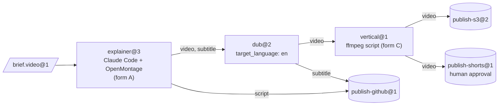
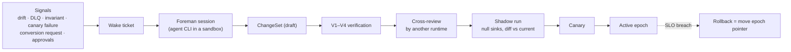

**English** | [简体中文](README_zh-CN.md) | [日本語](README_ja.md)

<p align="center">
  
</p>

<p align="center">
  <strong>Turn open-source products into machines, existing CLI agents into operators, and their output into typed, verified material for the next station.</strong>
</p>

<p align="center">
  
  
  
  
  
</p>

<p align="center">
  <a href="#see-it-run">See It Run</a> ·
  <a href="#quick-start">Quick Start</a> ·
  <a href="#how-it-works">How It Works</a> ·
  <a href="#architecture">Architecture</a> ·
  <a href="#governance-and-the-foreman">Governance</a> ·
  <a href="#cli-at-a-glance">CLI</a> ·
  <a href="docs/en/README.md">Documentation</a>
</p>

---

> **What is this?** A factory control plane. It does not contain an agent and never calls a model API. Every bit of intelligence comes from CLI agents you already use (Claude Code headless, Codex, …) running inside Docker sandboxes. Everything *between* stations — routing, type checks, conversion, storage, scheduling, budgets, approvals and change control — is deterministic code.

Agent-native products such as [OpenMontage](https://github.com/OpenMontageInc/OpenMontage) put the agent in charge of the whole pipeline. Machine Agent Org works one level up: it treats such products as **machines** on a production line. Each machine is operated by an agent **operator** at a **station**. What one station produces is checked, sealed and handed to the next station as its input, until a **sink** publishes the result to S3, GitHub, YouTube or anywhere else.

| Factory word | What it is here | Example |
|---|---|---|
| **Bean** | An immutable, content-addressed piece of material with a type and lineage | `note.text@1`, `video.mp4@1`, `brief.video@1` |
| **Machine** | An existing product described by a *Machine Package* | OpenMontage, MoneyPrinterTurbo, ffmpeg, rclone |
| **Operator** | Who drives the machine | Claude Code headless, Codex, a script, a human inbox |
| **Station** | Recipe × Operator × Policy, with typed ports | `explainer@3`, `dub@2`, `publish-s3@2` |
| **Line** | A typed DAG of stations, with bounded dynamic structure | `explainer-multilang@5` |
| **Source / Sink** | Stations that ingest from / publish to the outside world | webhook intake / S3, GitHub, YouTube |
| **Foreman** | An external agent that maintains the factory through verified ChangeSets | a Claude Code or Codex session |

---

## See It Run

The session below is a real run of `note-pipeline@1` from the fixture registry. It uses the local sandbox provider and the scripted fake agent from `tests/fakes/`, so it needs neither Docker nor a model key. The CLI prints JSON; the picture condenses it.

<p align="center">
  
</p>

Notice what nobody asked for. `write@1` produces `note.raw@1`, but `upper@1` requires `note.text@1`. The structure compiler found a converter station and inserted the node `upper.in.note~note-to-text@1`, and the run's lineage records it. Four jobs were sealed, the run cost $0.02 of a $5.00 cap, and the run is pinned to epoch `e-f4f97580bd8ee4a4`, so a structure change made mid-run cannot affect it.

The walkthrough in [docs/en/getting-started.md](docs/en/getting-started.md) shows how to reproduce it step by step.

---

## Quick Start

### Prerequisites

- **Python 3.12+** and **[uv](https://docs.astral.sh/uv/)**
- **Docker** (optional): needed for the default `docker` sandbox provider and the Docker test tiers. Everything in this README also works with `--provider local`.
- **An agent CLI** (optional): Claude Code or Codex for real stations. The tests use a scripted fake agent instead.

### Install and verify

```bash
git clone https://github.com/rywsl/Company-Machine.git
cd Company-Machine
uv sync

uv run factory --version
uv run mrl --version
uv run python tools/harness.py doctor     # checks the environment
uv run python tools/harness.py status     # milestones and stage gates
uv run python tools/harness.py pytest tests/acceptance/m1   # 98 tests, ~1 min
```

### Your first line

```bash
# 1. Compile a registry (exit 0 = no errors, 3 = invalid)
uv run factory check tests/fixtures/registry-m2

# 2. Import material, plan and run a line
uv run factory --root .factory --registry <registry> --provider local --local-commands commands.json \
    bean import --type agent.task@1 --file task.json=./task.json
uv run factory ... line plan note-pipeline@1
uv run factory ... line run  note-pipeline@1 --in task=sha256:...

# 3. Inspect
uv run factory ... line nodes <run-id>
uv run factory ... bean lineage --direction up <bean-id>
uv run factory ... status
```

`commands.json` maps the command names in machine recipes to host commands for the local provider. The getting-started guide generates one from the test fixtures. For unattended operation, run the daemon and the read-only console:

```bash
uv run factory serve                 # triggers, runs, jobs, governance, audit, canaries, wake tickets
uv run factory console               # http://127.0.0.1:8090, token in $FACTORY_ROOT/console.token
```

---

## How It Works

<p align="center">
  
</p>

A **job** is one station run. The runner checks the inputs, then provisions a sandbox: non-root, `cap-drop ALL`, inputs mounted read-only, and never `docker.sock`. It writes a **Station Brief** for the operator and starts the operator's CLI headlessly. The operator works the machine and talks to the factory only through `factoryctl`. When it finishes, the **gate** checks the output in four steps: structure, validator, acceptance expressions written in MRL, and an optional judge. Output that passes is sealed into the content-addressed warehouse with its lineage.



<sub>The example line `spec/examples/registry/lines/explainer-multilang.yaml`. A brief arriving with the label `line=explainer-multilang` triggers it, and its budget cap is $12.</sub>

**Job lifecycle.** `PENDING → PROVISIONING → RUNNING ⇄ AWAITING_APPROVAL → GATING → SEALED`.
- A **rejected** job is retried with the gate's feedback.
- A **failed** job is retried fresh or resumed.
- A job that exhausts its retries goes **DEAD** and lands in the dead-letter queue.

Expensive stations and every sink work in two phases: *propose*, with a cost estimate, then *execute* after approval.

---

## Architecture

<p align="center">
  
</p>

| Layer | Responsibility | Main code |
|---|---|---|
| **Kernel** | Meta-model, structure compiler, constitution invariants, event log. Changes rarely. | `src/mrl/` (MRL language + factory profile) |
| **Structure** | Registry in Git. Types, machines, operators, stations, lines and policies are all Specs, versioned by **epoch**. | `mao.snapshot`, `mao.governance.epochs` |
| **Runtime** | Scheduler, line runner, job state machine, sandboxes, gates, warehouse, cache, leases. | `mao.runner`, `mao.runs`, `mao.dynamic`, `mao.scheduler`, `mao.gate`, `mao.warehouse` |
| **Adapters** | Machine packages, operator runtimes, Docker/Local sandboxes, connectors, service gateway, egress and model proxies, storage backends. | `mao.sandbox`, `mao.operator`, `mao.gateway`, `mao.egress`, `mao.backends` |
| **Governance** | Verification pipeline, invariant audit, drift monitoring, reconciler, shadow and canary rollout, the foreman. | `mao.governance.*`, `mao.reconcile`, `mao.supervisor`, `mao.daemon` |

**Six verification layers.** Each layer runs at a fixed time and fails in a fixed way:

| Layer | Checks | When |
|---|---|---|
| V1 Spec | schema, references, pinned versions, policy lint | every proposal |
| V2 Structure | edge types, acyclicity, required inputs, every product consumed, budgets, dynamic bounds | proposal and before every run |
| V3 Evolution | compatibility, downstream consumer contracts, blast radius | proposal |
| V4 Contract tests | machine conformance, golden briefs, converter round trips, sink dry runs | proposal and scheduled canaries |
| V5 Runtime | intake and gate checks, sink receipt verification | every job |
| V6 Continuous | invariant audit, drift, CAS and lineage integrity, reconciliation | periodic and event-driven |

**Dynamic structure stays bounded.** A line can contain `map` (over `list<T>`, with `max_items` and `max_parallel`), `switch` (exhaustive, with a default), `until` (with a maximum number of iterations) and `subline`. A **planner** station may emit a `Plan`. The plan is compiled with V1/V2 and checked against the station's `plan_bounds` (allowed stations and sinks, steps, fan-out, depth, budget) before any of it runs.

<details>
<summary><b>Module map of <code>src/mao</code></b></summary>

| Area | Modules |
|---|---|
| Foundation | `base` `errors` `db` `context` `values` `migrations/` |
| Structure & governance | `snapshot` `contract` `governance/{epochs,changesets,risk,rollout,shadow}` `reconcile` |
| Execution | `jobs` `runner` `runplan` `runs` `dynamic` `scheduler` `cache` `durable` `approvals` |
| Materials | `warehouse` `gate` `retention` `backup` |
| Adapters | `sandbox` `operator` `brief` `ctl/factoryctl` `gateway` `connectors` `egress` `images` `backends` |
| Autonomy | `daemon` (`factory serve`) `supervisor` `foreman` `mcp` |
| Observability | `status` `console` |
| CLI | `cli` `commands/*` |

</details>

---

## Governance and the Foreman

The factory is maintained by a **foreman**: an ordinary Claude Code or Codex session. The foreman is woken by signals and works through the `factory foreman` CLI or the MCP server (`factory mcp --role foreman`). It can propose changes, but deterministic code decides whether a change ships.



| Tier | Typical change | What it takes |
|---|---|---|
| T0 | retry, quarantine | automatic |
| T1 | template tuning, new converter, minor type bump | verification + shadow |
| T2 | new or upgraded machine, new line, major type bump | + canary + cross-review |
| T3 | new source/sink, egress or credential binding, policy, retirement | + human approval |
| T4 | the constitution | humans only |

The pipeline computes the risk tier from the diff, and the foreman cannot lower it. The foreman cannot edit the constitution or sealed beans, read secrets, skip verification, or enter a sandbox.

---

## Integration Forms

| Form | Example machines | How the operator is placed |
|---|---|---|
| **A** Agent-native workspace | OpenMontage | in the same sandbox, working directory = the product's workspace |
| **B** Service | MoneyPrinterTurbo, ComfyUI | the factory's service gateway turns the API into *submit → poll → fetch* |
| **C** Tool | ffmpeg, rclone, git | a script station calls it directly |

`spec/examples/registry/` describes OpenMontage, MoneyPrinterTurbo, ffmpeg, rclone, git, a webhook intake and a YouTube uploader as machine packages.

---

## CLI at a Glance

Two entry points: `factory` (the control plane) and `mrl` (the relation language toolkit). Global options: `--root`, `--registry`, `--provider {docker,local}`, `--epoch` and `--json`. The environment variables `FACTORY_ROOT` and `FACTORY_REGISTRY` provide defaults.

| Group | Commands |
|---|---|
| Structure | `check` · `epoch {init,ls,show,rollback,adopt}` · `changeset {propose,ls,show,withdraw,advance}` · `contract …` · `governance {tick,safe-mode}` |
| Material | `bean {import,lineage,label}` · `cache {ls,explain,invalidate}` · `gc [--dry-run]` |
| Execution | `job {run,show,exec}` · `line {plan,run,ls,show,nodes,cancel,retry,rebuild}` · `trigger process` · `schedule {tick,dlq,quarantine,release}` · `approval {ls,show,decide}` |
| Integration | `image {build,ls}` · `gateway manifest` · `egress check` · `secret ls` · `backend {status,migrate,verify}` · `backup {create,verify,restore}` |
| Autonomy | `serve [--once]` · `foreman …` · `mcp --role {foreman,reviewer}` · `maintain bootstrap` · `audit` · `drift ls` |
| Observability | `status` · `metrics` · `events` · `console` |

Exit codes: `0` success · `1` business failure · `2` usage · `3` invalid registry · `4` environment (for example, no Docker) · `5` internal error. The full reference is in [docs/en/cli.md](docs/en/cli.md).

---

## Project Status

All ten milestones are complete, and every stage gate passes. The M9 gate ran lint, format, doc checks, conformance and **1448 tests** with zero failures and zero skips. A few runtime gaps remain open; see [Runtime · Known gaps](docs/en/runtime.md#6-known-gaps-2026-11-13).

| Milestone | Delivered |
|---|---|
| M0 | MRL language, structure compiler, constitution |
| M1 | single station end to end: snapshot, warehouse, sandbox, `factoryctl`, gate, operator, runner, CLI |
| M2 | lines, sources and sinks, cache, DLQ, approvals, V3/V4 |
| M3 | epochs, ChangeSet pipeline, shadow and canary, reconciler, drift, foreman |
| M4 | dynamic structure, plans, service gateway, production backends |
| M5 | autonomy loop: durable execution, `serve`, MCP, foreman supervision |
| M6 | real agent CLIs in Docker, foreman-built images |
| M7 | observability, console, retention, backup and restore |
| M8 | egress proxy hardening, resilient `serve` |
| M9 | the M4 capabilities closed on the production path (S3 SigV4, Postgres via `psql`, …) |

---

## Repository Layout

```
src/mrl/          MRL: lexer, parser, checker, evaluator, rules, factory profile
src/mao/          the factory control plane (package `mao`, CLI `factory`)
spec/             normative specs: MRL 1.0, factory profile, schemas, system specs, example registry
plan/             milestones, task cards, stage gates, reviews, protected-file lock
tests/            acceptance tests per milestone, system tests, fakes, fixture registries
tools/            harness.py (task/gate runner), image builders, hooks
docs/             architecture design (zh-CN), per-language guides, diagrams
```

---

## Documentation

| | English | 简体中文 | 日本語 |
|---|---|---|---|
| Documentation index | [en](docs/en/README.md) | [zh-CN](docs/zh-CN/README.md) | [ja](docs/ja/README.md) |
| Getting started | [getting-started](docs/en/getting-started.md) | [快速上手](docs/zh-CN/getting-started.md) | [はじめに](docs/ja/getting-started.md) |
| Concepts | [concepts](docs/en/concepts.md) | [核心概念](docs/zh-CN/concepts.md) | [コンセプト](docs/ja/concepts.md) |
| Runtime | [runtime](docs/en/runtime.md) | [运行时](docs/zh-CN/runtime.md) | [ランタイム](docs/ja/runtime.md) |
| CLI reference | [cli](docs/en/cli.md) | [命令行](docs/zh-CN/cli.md) | [CLI](docs/ja/cli.md) |
| Development | [development](docs/en/development.md) | [开发流程](docs/zh-CN/development.md) | [開発](docs/ja/development.md) |

The full architecture design (in Chinese) is [docs/architecture.md](docs/architecture.md). The normative specs are in [spec/system/](spec/system/README.md).

---

## Contributing

Work follows a designer/implementer split, enforced by `tools/harness.py`. Specs, task cards and acceptance tests are protected by `plan/protected.lock`; only a human re-registers them. Implementers pick a task with `harness task next`, implement it against the spec and prove it with `harness accept <ID>`. Read [AGENTS.md](AGENTS.md) and [docs/en/development.md](docs/en/development.md) before opening a change.

## License

No license file has been added yet. Until one is, all rights are reserved by the authors.
