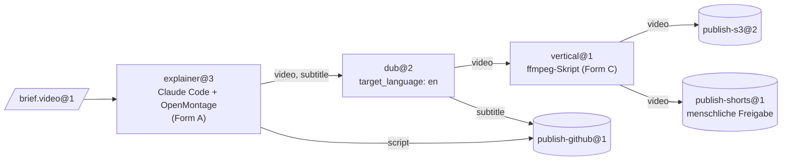
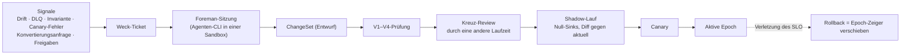

[English](README.md) | [日本語](README_ja.md) | [한국어](README_ko.md) | [Français](README_fr.md) | **Deutsch** | [Español](README_es.md) | [Português (BR)](README_pt-BR.md) | [Русский](README_ru.md) | [简体中文](README_zh-CN.md)

<p align="center">
  
</p>

<p align="center">
  <strong>Machen Sie Open-Source-Produkte zu Maschinen, vorhandene CLI-Agenten zu Operatoren und deren Ergebnisse zu typisiertem, geprüftem Material für die nächste Station.</strong>
</p>

<p align="center">
  
  
  
  
  
</p>

<p align="center">
  <a href="#in-aktion">In Aktion</a> ·
  <a href="#schnellstart">Schnellstart</a> ·
  <a href="#funktionsweise">Funktionsweise</a> ·
  <a href="#architektur">Architektur</a> ·
  <a href="#governance-und-foreman">Governance</a> ·
  <a href="#die-cli-im-überblick">CLI</a> ·
  <a href="docs/de/README.md">Dokumentation</a>
</p>

---

> **Was ist das?** Eine Steuerungsebene (Control Plane) für eine Fabrik. Sie enthält keinen Agenten und ruft niemals eine Modell-API auf. Die gesamte Intelligenz stammt von CLI-Agenten, die Sie bereits nutzen (Claude Code headless, Codex, …) und die in Docker-Sandboxes laufen. Alles *zwischen* den Stationen — Routing, Typprüfung, Konvertierung, Speicherung, Scheduling, Budgets, Freigaben und Änderungssteuerung — ist deterministischer Code.

Agent-native Produkte wie [OpenMontage](https://github.com/OpenMontageInc/OpenMontage) überlassen dem Agenten die gesamte Pipeline. Machine Agent Org arbeitet eine Ebene darüber: Es behandelt solche Produkte als **Maschinen** in einer Produktionslinie. Jede Maschine wird an einer **Station** von einem Agenten als **Operator** bedient. Was eine Station produziert, wird geprüft, versiegelt und als Eingabe an die nächste Station übergeben, bis ein **Sink** (veröffentlichende Station) das Ergebnis auf S3, GitHub, YouTube oder anderswo veröffentlicht.

| Fabrikbegriff | Bedeutung hier | Beispiel |
|---|---|---|
| **Bean** (Material) | Ein unveränderliches, inhaltsadressiertes Stück Material mit Typ und Lineage (Herkunftskette) | `note.text@1`, `video.mp4@1`, `brief.video@1` |
| **Machine** (Maschine) | Ein vorhandenes Produkt, beschrieben durch ein *Machine Package* | OpenMontage, MoneyPrinterTurbo, ffmpeg, rclone |
| **Operator** | Wer die Maschine bedient | Claude Code headless, Codex, ein Skript, ein menschlicher Posteingang |
| **Station** | Recipe × Operator × Policy, mit typisierten Ports | `explainer@3`, `dub@2`, `publish-s3@2` |
| **Line** (Linie) | Ein typisierter DAG aus Stationen, mit begrenzter dynamischer Struktur | `explainer-multilang@5` |
| **Source / Sink** | Stationen, die Daten von außen aufnehmen bzw. nach außen veröffentlichen | Webhook-Eingang / S3, GitHub, YouTube |
| **Foreman** (Vorarbeiter) | Ein externer Agent, der die Fabrik über geprüfte ChangeSets wartet | eine Claude-Code- oder Codex-Sitzung |

---

## In Aktion

Die folgende Sitzung ist ein echter Lauf von `note-pipeline@1` aus der Fixture-Registry. Sie verwendet den lokalen Sandbox-Provider und den geskripteten Fake-Agenten aus `tests/fakes/` und braucht daher weder Docker noch einen Modellschlüssel. Die CLI gibt JSON aus; die Grafik fasst es zusammen.

<p align="center">
  
</p>

Beachten Sie, was niemand angefordert hat. `write@1` erzeugt `note.raw@1`, aber `upper@1` verlangt `note.text@1`. Der Strukturcompiler hat eine Konverterstation gefunden und den Knoten `upper.in.note~note-to-text@1` eingefügt, und die Lineage des Laufs hält ihn fest. Vier Jobs wurden versiegelt, der Lauf kostete 0,02 $ bei einer Obergrenze von 5,00 $, und er ist an die Epoch `e-f4f97580bd8ee4a4` (einen eingefrorenen Strukturstand) gebunden, sodass eine Strukturänderung während des Laufs ihn nicht beeinflussen kann.

Die Schritt-für-Schritt-Anleitung in [docs/de/getting-started.md](docs/de/getting-started.md) zeigt, wie Sie das nachvollziehen.

---

## Schnellstart

### Voraussetzungen

- **Python 3.12+** und **[uv](https://docs.astral.sh/uv/)**
- **Docker** (optional): nötig für den Standard-Sandbox-Provider `docker` und die Docker-Teststufen. Alles in dieser README funktioniert auch mit `--provider local`.
- **Eine Agenten-CLI** (optional): Claude Code oder Codex für echte Stationen. Die Tests verwenden stattdessen einen geskripteten Fake-Agenten.

### Installieren und prüfen

```bash
git clone https://github.com/rywsl/Company-Machine.git
cd Company-Machine
uv sync

uv run factory --version
uv run mrl --version
uv run python tools/harness.py doctor     # prüft die Umgebung
uv run python tools/harness.py status     # Meilensteine und Stage-Gates
uv run python tools/harness.py pytest tests/acceptance/m1   # 98 Tests, ~1 Min.
```

### Ihre erste Linie

```bash
# 1. Eine Registry kompilieren (Exit-Code 0 = keine Fehler, 3 = ungültig)
uv run factory check tests/fixtures/registry-m2

# 2. Material importieren, eine Linie planen und ausführen
uv run factory --root .factory --registry <registry> --provider local --local-commands commands.json \
    bean import --type agent.task@1 --file task.json=./task.json
uv run factory ... line plan note-pipeline@1
uv run factory ... line run  note-pipeline@1 --in task=sha256:...

# 3. Untersuchen
uv run factory ... line nodes <run-id>
uv run factory ... bean lineage --direction up <bean-id>
uv run factory ... status
```

`commands.json` ordnet die Befehlsnamen in Maschinenrezepten Host-Befehlen für den lokalen Provider zu. Die Anleitung „Erste Schritte“ erzeugt eine solche Datei aus den Test-Fixtures. Für den unbeaufsichtigten Betrieb starten Sie den Daemon und die schreibgeschützte Konsole:

```bash
uv run factory serve                 # Trigger, Läufe, Jobs, Governance, Audit, Canaries, Weck-Tickets
uv run factory console               # http://127.0.0.1:8090, Token in $FACTORY_ROOT/console.token
```

---

## Funktionsweise

<p align="center">
  
</p>

Ein **Job** ist ein einzelner Stationslauf. Der Runner prüft die Eingaben und stellt dann eine Sandbox bereit: ohne Root-Rechte, `cap-drop ALL`, Eingaben schreibgeschützt eingehängt und niemals `docker.sock`. Er schreibt ein **Station Brief** für den Operator und startet dessen CLI headless. Der Operator bedient die Maschine und kommuniziert mit der Fabrik ausschließlich über `factoryctl`. Ist er fertig, prüft das **Gate** (Ausgangsprüfung) das Ergebnis in vier Schritten: Struktur, Validator, in MRL geschriebene Akzeptanzausdrücke und ein optionaler Judge. Was besteht, wird mit seiner Lineage im inhaltsadressierten Lager versiegelt.



<sub>Die Beispiellinie `spec/examples/registry/lines/explainer-multilang.yaml`. Sie wird durch ein Brief mit dem Label `line=explainer-multilang` ausgelöst, und ihr Budget ist auf 12 $ begrenzt.</sub>

**Lebenszyklus eines Jobs.** `PENDING → PROVISIONING → RUNNING ⇄ AWAITING_APPROVAL → GATING → SEALED`.
- Ein **abgelehnter** Job wird mit dem Feedback des Gates erneut versucht.
- Ein **fehlgeschlagener** Job wird neu gestartet oder fortgesetzt.
- Ein Job, der seine Wiederholungsversuche aufgebraucht hat, wird **DEAD** und landet in der Dead-Letter-Queue.

Teure Stationen und alle Sinks arbeiten zweiphasig: zuerst *propose* mit einer Kostenschätzung, dann *execute* nach der Freigabe.

---

## Architektur

<p align="center">
  
</p>

| Schicht | Verantwortung | Wichtigster Code |
|---|---|---|
| **Kernel** | Metamodell, Strukturcompiler, Invarianten der Verfassung, Ereignisprotokoll. Ändert sich selten. | `src/mrl/` (MRL-Sprache + Fabrikprofil) |
| **Struktur** | Registry in Git. Typen, Maschinen, Operatoren, Stationen, Linien und Policies sind allesamt Specs, versioniert nach **Epoch**. | `mao.snapshot`, `mao.governance.epochs` |
| **Laufzeit** | Scheduler, Linien-Runner, Job-Zustandsautomat, Sandboxes, Gates, Lager, Cache, Leases. | `mao.runner`, `mao.runs`, `mao.dynamic`, `mao.scheduler`, `mao.gate`, `mao.warehouse` |
| **Adapter** | Maschinenpakete, Operator-Laufzeiten, Docker-/Local-Sandboxes, Konnektoren, Service-Gateway, Egress- und Modell-Proxys, Speicher-Backends. | `mao.sandbox`, `mao.operator`, `mao.gateway`, `mao.egress`, `mao.backends` |
| **Governance** | Prüfpipeline, Invarianten-Audit, Drift-Überwachung, Reconciler, Shadow- und Canary-Rollout, der Foreman. | `mao.governance.*`, `mao.reconcile`, `mao.supervisor`, `mao.daemon` |

**Sechs Prüfschichten.** Jede Schicht läuft zu einem festen Zeitpunkt und schlägt auf eine festgelegte Weise fehl:

| Schicht | Prüft | Wann |
|---|---|---|
| V1 Spec | Schema, Referenzen, fixierte Versionen, Policy-Lint | bei jedem Vorschlag |
| V2 Struktur | Kantentypen, Azyklizität, Pflichteingaben, Verbrauch jedes Produkts, Budgets, dynamische Grenzen | beim Vorschlag und vor jedem Lauf |
| V3 Evolution | Kompatibilität, Verträge nachgelagerter Konsumenten, Auswirkungsradius | beim Vorschlag |
| V4 Vertragstests | Maschinenkonformität, Golden Briefs, Konverter-Round-Trips, Sink-Probeläufe | beim Vorschlag und bei geplanten Canaries |
| V5 Laufzeit | Eingangs- und Gate-Prüfungen, Prüfung der Sink-Quittungen | bei jedem Job |
| V6 Kontinuierlich | Invarianten-Audit, Drift, Integrität von CAS und Lineage, Abgleich | periodisch und ereignisgesteuert |

**Dynamische Struktur bleibt begrenzt.** Eine Linie kann `map` (über `list<T>`, mit `max_items` und `max_parallel`), `switch` (vollständig, mit Default), `until` (mit einer maximalen Zahl von Iterationen) und `subline` enthalten. Eine **Planner**-Station kann einen `Plan` ausgeben. Der Plan wird mit V1/V2 kompiliert und gegen die `plan_bounds` der Station geprüft (erlaubte Stationen und Sinks, Schritte, Fan-out, Tiefe, Budget), bevor irgendein Teil davon läuft.

<details>
<summary><b>Modulübersicht von <code>src/mao</code></b></summary>

| Bereich | Module |
|---|---|
| Grundlagen | `base` `errors` `db` `context` `values` `migrations/` |
| Struktur & Governance | `snapshot` `contract` `governance/{epochs,changesets,risk,rollout,shadow}` `reconcile` |
| Ausführung | `jobs` `runner` `runplan` `runs` `dynamic` `scheduler` `cache` `durable` `approvals` |
| Material | `warehouse` `gate` `retention` `backup` |
| Adapter | `sandbox` `operator` `brief` `ctl/factoryctl` `gateway` `connectors` `egress` `images` `backends` |
| Autonomie | `daemon` (`factory serve`) `supervisor` `foreman` `mcp` |
| Beobachtbarkeit | `status` `console` |
| CLI | `cli` `commands/*` |

</details>

---

## Governance und Foreman

Gewartet wird die Fabrik von einem **Foreman** (Vorarbeiter): einer gewöhnlichen Claude-Code- oder Codex-Sitzung. Der Foreman wird durch Signale geweckt und arbeitet über die CLI `factory foreman` oder den MCP-Server (`factory mcp --role foreman`). Er kann Änderungen vorschlagen, aber ob eine Änderung ausgeliefert wird, entscheidet deterministischer Code.



| Stufe | Typische Änderung | Was nötig ist |
|---|---|---|
| T0 | Wiederholung, Quarantäne | automatisch |
| T1 | Template-Feinschliff, neuer Konverter, kleine Typversion | Prüfung + Shadow |
| T2 | neue oder aktualisierte Maschine, neue Linie, große Typversion | + Canary + Kreuz-Review |
| T3 | neue Source/neuer Sink, Egress- oder Credential-Bindung, Policy, Stilllegung | + menschliche Freigabe |
| T4 | die Verfassung | nur Menschen |

Die Pipeline berechnet die Risikostufe aus dem Diff, und der Foreman kann sie nicht senken. Der Foreman kann weder die Verfassung noch versiegelte Beans bearbeiten, keine Secrets lesen, keine Prüfung überspringen und keine Sandbox betreten.

---

## Integrationsformen

| Form | Beispielmaschinen | Wie der Operator platziert wird |
|---|---|---|
| **A** Agent-nativer Arbeitsbereich | OpenMontage | in derselben Sandbox, Arbeitsverzeichnis = Arbeitsbereich des Produkts |
| **B** Dienst | MoneyPrinterTurbo, ComfyUI | das Service-Gateway der Fabrik macht aus der API ein *submit → poll → fetch* |
| **C** Werkzeug | ffmpeg, rclone, git | eine Skriptstation ruft es direkt auf |

`spec/examples/registry/` beschreibt OpenMontage, MoneyPrinterTurbo, ffmpeg, rclone, git, einen Webhook-Eingang und einen YouTube-Uploader als Maschinenpakete.

---

## Die CLI im Überblick

Zwei Einstiegspunkte: `factory` (die Steuerungsebene) und `mrl` (das Toolkit für die Relationssprache). Globale Optionen: `--root`, `--registry`, `--provider {docker,local}`, `--epoch` und `--json`. Die Umgebungsvariablen `FACTORY_ROOT` und `FACTORY_REGISTRY` liefern Standardwerte.

| Gruppe | Befehle |
|---|---|
| Struktur | `check` · `epoch {init,ls,show,rollback,adopt}` · `changeset {propose,ls,show,withdraw,advance}` · `contract …` · `governance {tick,safe-mode}` |
| Material | `bean {import,lineage,label}` · `cache {ls,explain,invalidate}` · `gc [--dry-run]` |
| Ausführung | `job {run,show,exec}` · `line {plan,run,ls,show,nodes,cancel,retry,rebuild}` · `trigger process` · `schedule {tick,dlq,quarantine,release}` · `approval {ls,show,decide}` |
| Integration | `image {build,ls}` · `gateway manifest` · `egress check` · `secret ls` · `backend {status,migrate,verify}` · `backup {create,verify,restore}` |
| Autonomie | `serve [--once]` · `foreman …` · `mcp --role {foreman,reviewer}` · `maintain bootstrap` · `audit` · `drift ls` |
| Beobachtbarkeit | `status` · `metrics` · `events` · `console` |

Exit-Codes: `0` Erfolg · `1` fachlicher Fehler · `2` Bedienfehler · `3` ungültige Registry · `4` Umgebung (zum Beispiel kein Docker) · `5` interner Fehler. Die vollständige Referenz steht in [docs/de/cli.md](docs/de/cli.md).

---

## Projektstatus

Alle zehn Meilensteine sind abgeschlossen, und jedes Stage-Gate ist bestanden. Das M9-Gate hat Lint, Formatierung, Dokumentationsprüfungen, Konformität und **1448 Tests** ohne einen einzigen Fehlschlag und ohne übersprungene Tests ausgeführt. Einige Lücken in der Laufzeit sind noch offen; siehe [Laufzeit · Bekannte Lücken](docs/de/runtime.md#6-bekannte-lücken-2026-11-13).

| Meilenstein | Geliefert |
|---|---|
| M0 | MRL-Sprache, Strukturcompiler, Verfassung |
| M1 | eine Station Ende-zu-Ende: Snapshot, Lager, Sandbox, `factoryctl`, Gate, Operator, Runner, CLI |
| M2 | Linien, Sources und Sinks, Cache, DLQ, Freigaben, V3/V4 |
| M3 | Epochs, ChangeSet-Pipeline, Shadow und Canary, Reconciler, Drift, Foreman |
| M4 | dynamische Struktur, Pläne, Service-Gateway, Produktions-Backends |
| M5 | Autonomieschleife: dauerhafte Ausführung, `serve`, MCP, Foreman-Überwachung |
| M6 | echte Agenten-CLIs in Docker, vom Foreman gebaute Images |
| M7 | Beobachtbarkeit, Konsole, Aufbewahrung, Backup und Wiederherstellung |
| M8 | Härtung des Egress-Proxys, robustes `serve` |
| M9 | die M4-Fähigkeiten auf dem Produktionspfad geschlossen (S3 SigV4, Postgres über `psql`, …) |

---

## Repository-Aufbau

```
src/mrl/          MRL: Lexer, Parser, Checker, Evaluator, Regeln, Fabrikprofil
src/mao/          die Steuerungsebene der Fabrik (Paket `mao`, CLI `factory`)
spec/             normative Spezifikationen: MRL 1.0, Fabrikprofil, Schemas, Systemspezifikationen, Beispiel-Registry
plan/             Meilensteine, Aufgabenkarten, Stage-Gates, Reviews, Sperre für geschützte Dateien
tests/            Abnahmetests je Meilenstein, Systemtests, Fakes, Fixture-Registries
tools/            harness.py (Ausführung von Aufgaben und Gates), Image-Builder, Hooks
docs/             Architekturentwurf (zh-CN), Anleitungen je Sprache, Diagramme
```

---

## Dokumentation

| | Deutsch |
|---|---|
| Dokumentationsübersicht | [docs/de/README.md](docs/de/README.md) |
| Erste Schritte | [docs/de/getting-started.md](docs/de/getting-started.md) |
| Konzepte | [docs/de/concepts.md](docs/de/concepts.md) |
| Laufzeit | [docs/de/runtime.md](docs/de/runtime.md) |
| CLI-Referenz | [docs/de/cli.md](docs/de/cli.md) |
| Entwicklung | [docs/de/development.md](docs/de/development.md) |

Weitere Sprachen: [English](docs/en/README.md) · [日本語](docs/ja/README.md) · [한국어](docs/ko/README.md) · [Français](docs/fr/README.md) · [Español](docs/es/README.md) · [Português (BR)](docs/pt-BR/README.md) · [Русский](docs/ru/README.md) · [简体中文](docs/zh-CN/README.md)

Der vollständige Architekturentwurf (auf Chinesisch) ist [docs/architecture.md](docs/architecture.md). Die normativen Spezifikationen liegen in [spec/system/](spec/system/README.md).

---

## Mitwirken

Die Arbeit folgt einer Trennung zwischen Designer und Implementierer, die `tools/harness.py` durchsetzt. Spezifikationen, Aufgabenkarten und Abnahmetests sind durch `plan/protected.lock` geschützt; nur ein Mensch registriert sie neu. Implementierer wählen mit `harness task next` eine Aufgabe, setzen sie gemäß der Spezifikation um und weisen sie mit `harness accept <ID>` nach. Lesen Sie [AGENTS.md](AGENTS.md) und [docs/de/development.md](docs/de/development.md), bevor Sie eine Änderung einreichen.

## Lizenz

Es wurde noch keine Lizenzdatei hinzugefügt. Bis dahin behalten sich die Autoren alle Rechte vor.
