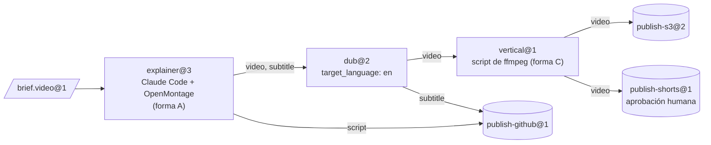
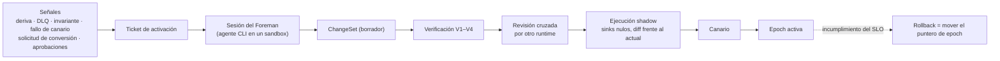

[English](README.md) | [日本語](README_ja.md) | [한국어](README_ko.md) | [Français](README_fr.md) | [Deutsch](README_de.md) | **Español** | [Português (BR)](README_pt-BR.md) | [Русский](README_ru.md) | [简体中文](README_zh-CN.md)

<p align="center">
  
</p>

<p align="center">
  <strong>Convierte productos de código abierto en máquinas, agentes CLI existentes en operadores y lo que producen en material tipado y verificado para la siguiente estación.</strong>
</p>

<p align="center">
  
  
  
  
  
</p>

<p align="center">
  <a href="#en-acción">En acción</a> ·
  <a href="#inicio-rápido">Inicio rápido</a> ·
  <a href="#cómo-funciona">Cómo funciona</a> ·
  <a href="#arquitectura">Arquitectura</a> ·
  <a href="#gobernanza-y-el-foreman">Gobernanza</a> ·
  <a href="#la-cli-de-un-vistazo">CLI</a> ·
  <a href="docs/es/README.md">Documentación</a>
</p>

---

> **¿Qué es esto?** Un plano de control para una fábrica. No contiene ningún agente y nunca llama a la API de un modelo. Toda la inteligencia procede de agentes CLI que ya usas (Claude Code en modo headless, Codex, …), que se ejecutan dentro de sandboxes de Docker. Todo lo que ocurre *entre* estaciones — enrutamiento, comprobación de tipos, conversión, almacenamiento, planificación, presupuestos, aprobaciones y control de cambios — es código determinista.

Los productos «agent-native» como [OpenMontage](https://github.com/OpenMontageInc/OpenMontage) ponen al agente al mando de todo el pipeline. Machine Agent Org trabaja un nivel por encima: trata esos productos como **máquinas** de una línea de producción. Cada máquina la maneja un **operador** —un agente— en una **estación**. Lo que produce una estación se comprueba, se sella y se entrega a la siguiente como entrada, hasta que un **sink** (estación de publicación) publica el resultado en S3, GitHub, YouTube o cualquier otro destino.

| Término de fábrica | Qué es aquí | Ejemplo |
|---|---|---|
| **Bean** (material) | Una pieza de material inmutable, direccionada por contenido, con un tipo y un linaje | `note.text@1`, `video.mp4@1`, `brief.video@1` |
| **Machine** (máquina) | Un producto existente descrito por un *Machine Package* | OpenMontage, MoneyPrinterTurbo, ffmpeg, rclone |
| **Operator** (operador) | Quien maneja la máquina | Claude Code headless, Codex, un script, una bandeja de entrada humana |
| **Station** (estación) | Recipe × Operator × Policy, con puertos tipados | `explainer@3`, `dub@2`, `publish-s3@2` |
| **Line** (línea) | Un DAG tipado de estaciones, con estructura dinámica acotada | `explainer-multilang@5` |
| **Source / Sink** | Estaciones que reciben del exterior / publican hacia el exterior | entrada por webhook / S3, GitHub, YouTube |
| **Foreman** (capataz) | Un agente externo que mantiene la fábrica mediante ChangeSets verificados | una sesión de Claude Code o Codex |

---

## En acción

La sesión siguiente es una ejecución real de `note-pipeline@1` del registro de fixtures. Usa el proveedor de sandbox local y el agente falso con guion de `tests/fakes/`, así que no necesita ni Docker ni una clave de modelo. La CLI imprime JSON; la imagen lo resume.

<p align="center">
  
</p>

Fíjate en lo que nadie pidió. `write@1` produce `note.raw@1`, pero `upper@1` requiere `note.text@1`. El compilador de estructura encontró una estación de conversión e insertó el nodo `upper.in.note~note-to-text@1`, y el linaje de la ejecución lo registra. Se sellaron cuatro jobs, la ejecución costó 0,02 $ de un tope de 5,00 $ y está fijada a la epoch `e-f4f97580bd8ee4a4` (una versión congelada de la estructura), de modo que un cambio de estructura hecho a mitad de la ejecución no puede afectarla.

La guía de [docs/es/getting-started.md](docs/es/getting-started.md) explica cómo reproducirla paso a paso.

---

## Inicio rápido

### Requisitos previos

- **Python 3.12+** y **[uv](https://docs.astral.sh/uv/)**
- **Docker** (opcional): necesario para el proveedor de sandbox predeterminado `docker` y para los niveles de pruebas con Docker. Todo lo de este README también funciona con `--provider local`.
- **Un agente CLI** (opcional): Claude Code o Codex para estaciones reales. Las pruebas usan en su lugar un agente falso con guion.

### Instalar y verificar

```bash
git clone https://github.com/rywsl/Company-Machine.git
cd Company-Machine
uv sync

uv run factory --version
uv run mrl --version
uv run python tools/harness.py doctor     # comprueba el entorno
uv run python tools/harness.py status     # hitos y stage gates
uv run python tools/harness.py pytest tests/acceptance/m1   # 98 pruebas, ~1 min
```

### Tu primera línea

```bash
# 1. Compilar un registro (código 0 = sin errores, 3 = inválido)
uv run factory check tests/fixtures/registry-m2

# 2. Importar material, planificar y ejecutar una línea
uv run factory --root .factory --registry <registry> --provider local --local-commands commands.json \
    bean import --type agent.task@1 --file task.json=./task.json
uv run factory ... line plan note-pipeline@1
uv run factory ... line run  note-pipeline@1 --in task=sha256:...

# 3. Inspeccionar
uv run factory ... line nodes <run-id>
uv run factory ... bean lineage --direction up <bean-id>
uv run factory ... status
```

`commands.json` asigna los nombres de comando de las recetas de las máquinas a comandos del host, para el proveedor local. La guía de primeros pasos genera uno a partir de los fixtures de prueba. Para funcionar de forma desatendida, arranca el demonio y la consola de solo lectura:

```bash
uv run factory serve                 # disparadores, ejecuciones, jobs, gobernanza, auditoría, canarios, tickets de activación
uv run factory console               # http://127.0.0.1:8090, token en $FACTORY_ROOT/console.token
```

---

## Cómo funciona

<p align="center">
  
</p>

Un **job** es una ejecución de una estación. El runner comprueba las entradas y luego aprovisiona un sandbox: usuario no root, `cap-drop ALL`, entradas montadas en solo lectura y nunca `docker.sock`. Escribe un **Station Brief** para el operador e inicia la CLI del operador en modo headless. El operador maneja la máquina y solo habla con la fábrica a través de `factoryctl`. Cuando termina, el **gate** (control de salida) revisa el resultado en cuatro pasos: estructura, validador, expresiones de aceptación escritas en MRL y un juez opcional. Lo que pasa el control se sella en el almacén direccionado por contenido junto con su linaje.



<sub>La línea de ejemplo `spec/examples/registry/lines/explainer-multilang.yaml`. La dispara la llegada de un brief con la etiqueta `line=explainer-multilang`, y su presupuesto tiene un tope de 12 $.</sub>

**Ciclo de vida de un job.** `PENDING → PROVISIONING → RUNNING ⇄ AWAITING_APPROVAL → GATING → SEALED`.
- Un job **rechazado** se reintenta con los comentarios del gate.
- Un job **fallido** se reintenta desde cero o se reanuda.
- Un job que agota sus reintentos pasa a **DEAD** y acaba en la cola de mensajes muertos (DLQ).

Las estaciones costosas y todos los sinks funcionan en dos fases: *propose*, con una estimación de coste, y luego *execute* tras la aprobación.

---

## Arquitectura

<p align="center">
  
</p>

| Capa | Responsabilidad | Código principal |
|---|---|---|
| **Núcleo** | Metamodelo, compilador de estructura, invariantes de la constitución, registro de eventos. Cambia poco. | `src/mrl/` (lenguaje MRL + perfil de fábrica) |
| **Estructura** | Registro en Git. Tipos, máquinas, operadores, estaciones, líneas y políticas son todos Specs, versionadas por **epoch**. | `mao.snapshot`, `mao.governance.epochs` |
| **Runtime** | Planificador, ejecutor de líneas, máquina de estados de los jobs, sandboxes, gates, almacén, caché, arrendamientos. | `mao.runner`, `mao.runs`, `mao.dynamic`, `mao.scheduler`, `mao.gate`, `mao.warehouse` |
| **Adaptadores** | Paquetes de máquinas, runtimes de operadores, sandboxes Docker/Local, conectores, pasarela de servicios, proxies de salida y de modelos, backends de almacenamiento. | `mao.sandbox`, `mao.operator`, `mao.gateway`, `mao.egress`, `mao.backends` |
| **Gobernanza** | Pipeline de verificación, auditoría de invariantes, vigilancia de la deriva, reconciliador, despliegue shadow y canario, el Foreman. | `mao.governance.*`, `mao.reconcile`, `mao.supervisor`, `mao.daemon` |

**Seis capas de verificación.** Cada capa se ejecuta en un momento fijo y falla de una forma fija:

| Capa | Comprueba | Cuándo |
|---|---|---|
| V1 Spec | esquema, referencias, versiones fijadas, lint de políticas | en cada propuesta |
| V2 Estructura | tipos de las aristas, ausencia de ciclos, entradas obligatorias, consumo de cada producto, presupuestos, límites dinámicos | en la propuesta y antes de cada ejecución |
| V3 Evolución | compatibilidad, contratos de los consumidores aguas abajo, radio de impacto | en la propuesta |
| V4 Pruebas de contrato | conformidad de las máquinas, briefs de referencia, viajes de ida y vuelta de los convertidores, ensayos en seco de los sinks | en la propuesta y en los canarios programados |
| V5 Runtime | comprobaciones de entrada y gate, verificación de los recibos de los sinks | en cada job |
| V6 Continua | auditoría de invariantes, deriva, integridad del CAS y del linaje, reconciliación | periódica y por eventos |

**La estructura dinámica sigue acotada.** Una línea puede contener `map` (sobre `list<T>`, con `max_items` y `max_parallel`), `switch` (exhaustivo, con una rama por defecto), `until` (con un número máximo de iteraciones) y `subline`. Una estación **planner** puede emitir un `Plan`. El plan se compila con V1/V2 y se contrasta con los `plan_bounds` de la estación (estaciones y sinks permitidos, pasos, fan-out, profundidad, presupuesto) antes de que se ejecute cualquier parte.

<details>
<summary><b>Mapa de módulos de <code>src/mao</code></b></summary>

| Área | Módulos |
|---|---|
| Base | `base` `errors` `db` `context` `values` `migrations/` |
| Estructura y gobernanza | `snapshot` `contract` `governance/{epochs,changesets,risk,rollout,shadow}` `reconcile` |
| Ejecución | `jobs` `runner` `runplan` `runs` `dynamic` `scheduler` `cache` `durable` `approvals` |
| Materiales | `warehouse` `gate` `retention` `backup` |
| Adaptadores | `sandbox` `operator` `brief` `ctl/factoryctl` `gateway` `connectors` `egress` `images` `backends` |
| Autonomía | `daemon` (`factory serve`) `supervisor` `foreman` `mcp` |
| Observabilidad | `status` `console` |
| CLI | `cli` `commands/*` |

</details>

---

## Gobernanza y el Foreman

La fábrica la mantiene un **Foreman** (capataz): una sesión normal de Claude Code o Codex. El Foreman se despierta con señales y trabaja mediante la CLI `factory foreman` o el servidor MCP (`factory mcp --role foreman`). Puede proponer cambios, pero es código determinista el que decide si un cambio se publica.



| Nivel | Cambio típico | Qué requiere |
|---|---|---|
| T0 | reintento, cuarentena | automático |
| T1 | ajuste de plantilla, nuevo convertidor, subida menor de versión de un tipo | verificación + shadow |
| T2 | máquina nueva o actualizada, línea nueva, subida mayor de versión de un tipo | + canario + revisión cruzada |
| T3 | nuevo source/sink, salida de red o vinculación de credenciales, política, retirada | + aprobación humana |
| T4 | la constitución | solo humanos |

El pipeline calcula el nivel de riesgo a partir del diff, y el Foreman no puede rebajarlo. El Foreman no puede editar la constitución ni los beans sellados, leer secretos, saltarse la verificación ni entrar en un sandbox.

---

## Formas de integración

| Forma | Máquinas de ejemplo | Dónde se coloca el operador |
|---|---|---|
| **A** Espacio de trabajo agent-native | OpenMontage | en el mismo sandbox, directorio de trabajo = el espacio de trabajo del producto |
| **B** Servicio | MoneyPrinterTurbo, ComfyUI | la pasarela de servicios de la fábrica convierte la API en *submit → poll → fetch* |
| **C** Herramienta | ffmpeg, rclone, git | una estación de script la invoca directamente |

`spec/examples/registry/` describe OpenMontage, MoneyPrinterTurbo, ffmpeg, rclone, git, una entrada por webhook y un uploader de YouTube como paquetes de máquinas.

---

## La CLI de un vistazo

Dos puntos de entrada: `factory` (el plano de control) y `mrl` (el kit de herramientas del lenguaje de relaciones). Opciones globales: `--root`, `--registry`, `--provider {docker,local}`, `--epoch` y `--json`. Las variables de entorno `FACTORY_ROOT` y `FACTORY_REGISTRY` proporcionan los valores por defecto.

| Grupo | Comandos |
|---|---|
| Estructura | `check` · `epoch {init,ls,show,rollback,adopt}` · `changeset {propose,ls,show,withdraw,advance}` · `contract …` · `governance {tick,safe-mode}` |
| Material | `bean {import,lineage,label}` · `cache {ls,explain,invalidate}` · `gc [--dry-run]` |
| Ejecución | `job {run,show,exec}` · `line {plan,run,ls,show,nodes,cancel,retry,rebuild}` · `trigger process` · `schedule {tick,dlq,quarantine,release}` · `approval {ls,show,decide}` |
| Integración | `image {build,ls}` · `gateway manifest` · `egress check` · `secret ls` · `backend {status,migrate,verify}` · `backup {create,verify,restore}` |
| Autonomía | `serve [--once]` · `foreman …` · `mcp --role {foreman,reviewer}` · `maintain bootstrap` · `audit` · `drift ls` |
| Observabilidad | `status` · `metrics` · `events` · `console` |

Códigos de salida: `0` éxito · `1` fallo de negocio · `2` uso · `3` registro inválido · `4` entorno (por ejemplo, sin Docker) · `5` error interno. La referencia completa está en [docs/es/cli.md](docs/es/cli.md).

---

## Estado del proyecto

Los diez hitos están completos y todos los stage gates se superan. El gate de M9 ejecutó lint, formato, comprobaciones de documentación, conformidad y **1448 pruebas** sin ningún fallo ni ninguna prueba omitida. Siguen abiertas algunas carencias del runtime; consulta [Runtime · Carencias conocidas](docs/es/runtime.md#6-carencias-conocidas-2026-11-13).

| Hito | Entregado |
|---|---|
| M0 | lenguaje MRL, compilador de estructura, constitución |
| M1 | una estación de extremo a extremo: snapshot, almacén, sandbox, `factoryctl`, gate, operador, runner, CLI |
| M2 | líneas, sources y sinks, caché, DLQ, aprobaciones, V3/V4 |
| M3 | epochs, pipeline de ChangeSets, shadow y canario, reconciliador, deriva, Foreman |
| M4 | estructura dinámica, planes, pasarela de servicios, backends de producción |
| M5 | bucle de autonomía: ejecución duradera, `serve`, MCP, supervisión del Foreman |
| M6 | agentes CLI reales en Docker, imágenes construidas por el Foreman |
| M7 | observabilidad, consola, retención, copia de seguridad y restauración |
| M8 | endurecimiento del proxy de salida, `serve` resiliente |
| M9 | las capacidades de M4 cerradas en la ruta de producción (S3 SigV4, Postgres mediante `psql`, …) |

---

## Estructura del repositorio

```
src/mrl/          MRL: lexer, parser, verificador, evaluador, reglas, perfil de fábrica
src/mao/          el plano de control de la fábrica (paquete `mao`, CLI `factory`)
spec/             especificaciones normativas: MRL 1.0, perfil de fábrica, esquemas, specs de sistema, registro de ejemplo
plan/             hitos, fichas de tareas, stage gates, revisiones, bloqueo de archivos protegidos
tests/            pruebas de aceptación por hito, pruebas de sistema, dobles, registros de fixtures
tools/            harness.py (ejecutor de tareas y gates), constructores de imágenes, hooks
docs/             diseño de la arquitectura (zh-CN), guías por idioma, diagramas
```

---

## Documentación

| | Español |
|---|---|
| Índice de la documentación | [docs/es/README.md](docs/es/README.md) |
| Primeros pasos | [docs/es/getting-started.md](docs/es/getting-started.md) |
| Conceptos | [docs/es/concepts.md](docs/es/concepts.md) |
| Runtime | [docs/es/runtime.md](docs/es/runtime.md) |
| Referencia de la CLI | [docs/es/cli.md](docs/es/cli.md) |
| Desarrollo | [docs/es/development.md](docs/es/development.md) |

Otros idiomas: [English](docs/en/README.md) · [日本語](docs/ja/README.md) · [한국어](docs/ko/README.md) · [Français](docs/fr/README.md) · [Deutsch](docs/de/README.md) · [Português (BR)](docs/pt-BR/README.md) · [Русский](docs/ru/README.md) · [简体中文](docs/zh-CN/README.md)

El diseño completo de la arquitectura (en chino) está en [docs/architecture.md](docs/architecture.md). Las especificaciones normativas están en [spec/system/](spec/system/README.md).

---

## Contribuir

El trabajo sigue una separación entre diseñador e implementador que impone `tools/harness.py`. Las especificaciones, las fichas de tareas y las pruebas de aceptación están protegidas por `plan/protected.lock`; solo una persona puede volver a registrarlas. Los implementadores eligen una tarea con `harness task next`, la implementan según la especificación y lo demuestran con `harness accept <ID>`. Lee [AGENTS.md](AGENTS.md) y [docs/es/development.md](docs/es/development.md) antes de proponer un cambio.

## Licencia

Todavía no se ha añadido ningún archivo de licencia. Hasta que se añada, los autores se reservan todos los derechos.
