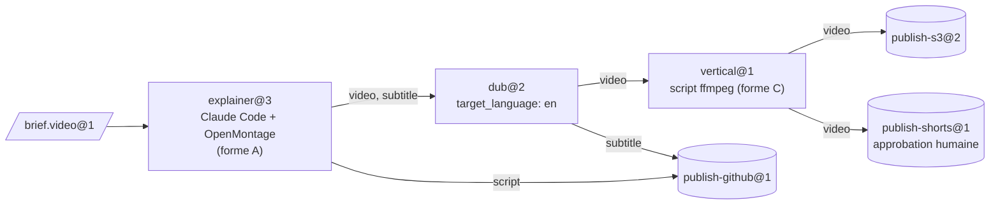
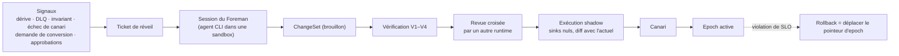

[English](README.md) | [日本語](README_ja.md) | [한국어](README_ko.md) | **Français** | [Deutsch](README_de.md) | [Español](README_es.md) | [Português (BR)](README_pt-BR.md) | [Русский](README_ru.md) | [简体中文](README_zh-CN.md)

<p align="center">
  
</p>

<p align="center">
  <strong>Faites des produits open source des machines, des agents CLI existants leurs opérateurs, et de leur production un matériau typé et vérifié pour la station suivante.</strong>
</p>

<p align="center">
  
  
  
  
  
</p>

<p align="center">
  <a href="#en-action">En action</a> ·
  <a href="#démarrage-rapide">Démarrage rapide</a> ·
  <a href="#fonctionnement">Fonctionnement</a> ·
  <a href="#architecture">Architecture</a> ·
  <a href="#gouvernance-et-foreman">Gouvernance</a> ·
  <a href="#la-cli-en-bref">CLI</a> ·
  <a href="docs/fr/README.md">Documentation</a>
</p>

---

> **De quoi s'agit-il ?** D'un plan de contrôle d'usine. Il ne contient aucun agent et n'appelle jamais d'API de modèle. Toute l'intelligence vient des agents CLI que vous utilisez déjà (Claude Code en mode headless, Codex, …), qui tournent dans des sandboxes Docker. Tout ce qui se passe *entre* les stations — routage, contrôle des types, conversion, stockage, ordonnancement, budgets, approbations et gestion des changements — est du code déterministe.

Les produits « agent-native » comme [OpenMontage](https://github.com/OpenMontageInc/OpenMontage) confient tout le pipeline à l'agent. Machine Agent Org travaille un niveau au-dessus : il traite ces produits comme des **machines** sur une ligne de production. Chaque machine est pilotée par un **opérateur** — un agent — à une **station**. Ce qu'une station produit est contrôlé, scellé, puis transmis à la station suivante comme entrée, jusqu'à ce qu'un **sink** (station de publication) publie le résultat sur S3, GitHub, YouTube ou ailleurs.

| Terme d'usine | Ce que c'est ici | Exemple |
|---|---|---|
| **Bean** (matériau) | Un élément de matériau immuable, adressé par son contenu, avec un type et un lignage | `note.text@1`, `video.mp4@1`, `brief.video@1` |
| **Machine** | Un produit existant décrit par un *Machine Package* | OpenMontage, MoneyPrinterTurbo, ffmpeg, rclone |
| **Operator** (opérateur) | Celui qui pilote la machine | Claude Code headless, Codex, un script, une boîte de réception humaine |
| **Station** | Recipe × Operator × Policy, avec des ports typés | `explainer@3`, `dub@2`, `publish-s3@2` |
| **Line** (ligne) | Un DAG typé de stations, avec une structure dynamique bornée | `explainer-multilang@5` |
| **Source / Sink** | Stations qui importent depuis / publient vers le monde extérieur | réception par webhook / S3, GitHub, YouTube |
| **Foreman** (contremaître) | Un agent externe qui entretient l'usine au moyen de ChangeSets vérifiés | une session Claude Code ou Codex |

---

## En action

La session ci-dessous est une exécution réelle de `note-pipeline@1` issue du registre de fixtures. Elle utilise le fournisseur de sandbox local et l'agent factice scripté de `tests/fakes/` ; elle n'a donc besoin ni de Docker ni d'une clé de modèle. La CLI affiche du JSON ; l'image en donne une version condensée.

<p align="center">
  
</p>

Remarquez ce que personne n'a demandé. `write@1` produit `note.raw@1`, mais `upper@1` exige `note.text@1`. Le compilateur de structure a trouvé une station de conversion et inséré le nœud `upper.in.note~note-to-text@1`, et le lignage de l'exécution l'enregistre. Quatre jobs ont été scellés, l'exécution a coûté 0,02 $ sur un plafond de 5,00 $, et elle est épinglée à l'epoch `e-f4f97580bd8ee4a4` (une version figée de la structure) : une modification de structure faite en cours d'exécution ne peut pas l'affecter.

Le pas-à-pas de [docs/fr/getting-started.md](docs/fr/getting-started.md) montre comment la reproduire étape par étape.

---

## Démarrage rapide

### Prérequis

- **Python 3.12+** et **[uv](https://docs.astral.sh/uv/)**
- **Docker** (facultatif) : nécessaire pour le fournisseur de sandbox par défaut `docker` et pour les niveaux de tests Docker. Tout ce README fonctionne aussi avec `--provider local`.
- **Un agent CLI** (facultatif) : Claude Code ou Codex pour de vraies stations. Les tests utilisent à la place un agent factice scripté.

### Installer et vérifier

```bash
git clone https://github.com/rywsl/Company-Machine.git
cd Company-Machine
uv sync

uv run factory --version
uv run mrl --version
uv run python tools/harness.py doctor     # vérifie l'environnement
uv run python tools/harness.py status     # jalons et stage gates
uv run python tools/harness.py pytest tests/acceptance/m1   # 98 tests, ~1 min
```

### Votre première ligne

```bash
# 1. Compiler un registre (code 0 = aucune erreur, 3 = invalide)
uv run factory check tests/fixtures/registry-m2

# 2. Importer du matériau, planifier et exécuter une ligne
uv run factory --root .factory --registry <registry> --provider local --local-commands commands.json \
    bean import --type agent.task@1 --file task.json=./task.json
uv run factory ... line plan note-pipeline@1
uv run factory ... line run  note-pipeline@1 --in task=sha256:...

# 3. Inspecter
uv run factory ... line nodes <run-id>
uv run factory ... bean lineage --direction up <bean-id>
uv run factory ... status
```

`commands.json` associe les noms de commandes des recettes de machines à des commandes de l'hôte, pour le fournisseur local. Le guide de prise en main en génère un à partir des fixtures de test. Pour un fonctionnement sans surveillance, lancez le démon et la console en lecture seule :

```bash
uv run factory serve                 # déclencheurs, exécutions, jobs, gouvernance, audit, canaris, tickets de réveil
uv run factory console               # http://127.0.0.1:8090, jeton dans $FACTORY_ROOT/console.token
```

---

## Fonctionnement

<p align="center">
  
</p>

Un **job** est une exécution d'une station. Le runner vérifie les entrées, puis provisionne une sandbox : utilisateur non root, `cap-drop ALL`, entrées montées en lecture seule, et jamais de `docker.sock`. Il rédige un **Station Brief** pour l'opérateur et lance la CLI de l'opérateur en mode headless. L'opérateur fait fonctionner la machine et ne communique avec l'usine que par `factoryctl`. Quand il a terminé, le **gate** (contrôle de sortie) vérifie la production en quatre étapes : structure, validateur, expressions d'acceptation écrites en MRL, et un juge facultatif. Ce qui passe est scellé dans l'entrepôt adressé par contenu, avec son lignage.



<sub>La ligne d'exemple `spec/examples/registry/lines/explainer-multilang.yaml`. Elle est déclenchée par l'arrivée d'un brief portant le label `line=explainer-multilang`, et son budget est plafonné à 12 $.</sub>

**Cycle de vie d'un job.** `PENDING → PROVISIONING → RUNNING ⇄ AWAITING_APPROVAL → GATING → SEALED`.
- Un job **rejeté** est relancé avec le retour du gate.
- Un job **en échec** est relancé de zéro ou repris.
- Un job qui épuise ses tentatives passe à l'état **DEAD** et atterrit dans la file de lettres mortes (DLQ).

Les stations coûteuses et tous les sinks fonctionnent en deux phases : *propose*, avec une estimation du coût, puis *execute* après approbation.

---

## Architecture

<p align="center">
  
</p>

| Couche | Responsabilité | Code principal |
|---|---|---|
| **Noyau** | Méta-modèle, compilateur de structure, invariants de la constitution, journal d'événements. Change rarement. | `src/mrl/` (langage MRL + profil usine) |
| **Structure** | Registre dans Git. Types, machines, opérateurs, stations, lignes et politiques sont tous des Specs, versionnées par **epoch**. | `mao.snapshot`, `mao.governance.epochs` |
| **Runtime** | Ordonnanceur, exécuteur de lignes, machine à états des jobs, sandboxes, gates, entrepôt, cache, baux. | `mao.runner`, `mao.runs`, `mao.dynamic`, `mao.scheduler`, `mao.gate`, `mao.warehouse` |
| **Adaptateurs** | Packages de machines, runtimes d'opérateurs, sandboxes Docker/Local, connecteurs, passerelle de services, proxys de sortie réseau et de modèle, backends de stockage. | `mao.sandbox`, `mao.operator`, `mao.gateway`, `mao.egress`, `mao.backends` |
| **Gouvernance** | Pipeline de vérification, audit des invariants, surveillance de la dérive, réconciliateur, déploiement shadow et canari, le Foreman. | `mao.governance.*`, `mao.reconcile`, `mao.supervisor`, `mao.daemon` |

**Six couches de vérification.** Chaque couche s'exécute à un moment fixe et échoue d'une manière fixe :

| Couche | Vérifie | Quand |
|---|---|---|
| V1 Spec | schéma, références, versions épinglées, lint des politiques | à chaque proposition |
| V2 Structure | types des arêtes, absence de cycles, entrées requises, consommation de chaque produit, budgets, bornes dynamiques | à la proposition et avant chaque exécution |
| V3 Évolution | compatibilité, contrats des consommateurs en aval, rayon d'impact | à la proposition |
| V4 Tests de contrat | conformité des machines, briefs de référence, allers-retours des convertisseurs, exécutions à blanc des sinks | à la proposition et lors des canaris planifiés |
| V5 Runtime | contrôles d'entrée et gate, vérification des reçus de sink | à chaque job |
| V6 Continu | audit des invariants, dérive, intégrité du CAS et du lignage, réconciliation | périodiquement et sur événement |

**La structure dynamique reste bornée.** Une ligne peut contenir `map` (sur une `list<T>`, avec `max_items` et `max_parallel`), `switch` (exhaustif, avec une branche par défaut), `until` (avec un nombre maximal d'itérations) et `subline`. Une station **planner** peut émettre un `Plan`. Avant que la moindre partie ne s'exécute, le plan est compilé avec V1/V2 et confronté aux `plan_bounds` de la station (stations et sinks autorisés, étapes, fan-out, profondeur, budget).

<details>
<summary><b>Carte des modules de <code>src/mao</code></b></summary>

| Domaine | Modules |
|---|---|
| Fondations | `base` `errors` `db` `context` `values` `migrations/` |
| Structure et gouvernance | `snapshot` `contract` `governance/{epochs,changesets,risk,rollout,shadow}` `reconcile` |
| Exécution | `jobs` `runner` `runplan` `runs` `dynamic` `scheduler` `cache` `durable` `approvals` |
| Matériaux | `warehouse` `gate` `retention` `backup` |
| Adaptateurs | `sandbox` `operator` `brief` `ctl/factoryctl` `gateway` `connectors` `egress` `images` `backends` |
| Autonomie | `daemon` (`factory serve`) `supervisor` `foreman` `mcp` |
| Observabilité | `status` `console` |
| CLI | `cli` `commands/*` |

</details>

---

## Gouvernance et Foreman

L'usine est entretenue par un **Foreman** (contremaître) : une session Claude Code ou Codex ordinaire. Le Foreman est réveillé par des signaux et travaille via la CLI `factory foreman` ou le serveur MCP (`factory mcp --role foreman`). Il peut proposer des changements, mais c'est du code déterministe qui décide si un changement est livré.



| Niveau | Changement typique | Ce qu'il faut |
|---|---|---|
| T0 | nouvelle tentative, quarantaine | automatique |
| T1 | réglage de template, nouveau convertisseur, montée de version mineure d'un type | vérification + shadow |
| T2 | machine nouvelle ou mise à niveau, nouvelle ligne, montée de version majeure d'un type | + canari + revue croisée |
| T3 | nouvelle source ou nouveau sink, sortie réseau ou liaison d'identifiants, politique, retrait | + approbation humaine |
| T4 | la constitution | humains uniquement |

Le pipeline calcule le niveau de risque à partir du diff, et le Foreman ne peut pas l'abaisser. Le Foreman ne peut ni modifier la constitution ou les beans scellés, ni lire les secrets, ni sauter la vérification, ni entrer dans une sandbox.

---

## Formes d'intégration

| Forme | Machines d'exemple | Placement de l'opérateur |
|---|---|---|
| **A** Espace de travail agent-native | OpenMontage | dans la même sandbox, répertoire de travail = l'espace de travail du produit |
| **B** Service | MoneyPrinterTurbo, ComfyUI | la passerelle de services de l'usine transforme l'API en *submit → poll → fetch* |
| **C** Outil | ffmpeg, rclone, git | une station script l'appelle directement |

`spec/examples/registry/` décrit OpenMontage, MoneyPrinterTurbo, ffmpeg, rclone, git, une réception par webhook et un uploader YouTube sous forme de packages de machines.

---

## La CLI en bref

Deux points d'entrée : `factory` (le plan de contrôle) et `mrl` (la boîte à outils du langage de relations). Options globales : `--root`, `--registry`, `--provider {docker,local}`, `--epoch` et `--json`. Les variables d'environnement `FACTORY_ROOT` et `FACTORY_REGISTRY` fournissent les valeurs par défaut.

| Groupe | Commandes |
|---|---|
| Structure | `check` · `epoch {init,ls,show,rollback,adopt}` · `changeset {propose,ls,show,withdraw,advance}` · `contract …` · `governance {tick,safe-mode}` |
| Matériaux | `bean {import,lineage,label}` · `cache {ls,explain,invalidate}` · `gc [--dry-run]` |
| Exécution | `job {run,show,exec}` · `line {plan,run,ls,show,nodes,cancel,retry,rebuild}` · `trigger process` · `schedule {tick,dlq,quarantine,release}` · `approval {ls,show,decide}` |
| Intégration | `image {build,ls}` · `gateway manifest` · `egress check` · `secret ls` · `backend {status,migrate,verify}` · `backup {create,verify,restore}` |
| Autonomie | `serve [--once]` · `foreman …` · `mcp --role {foreman,reviewer}` · `maintain bootstrap` · `audit` · `drift ls` |
| Observabilité | `status` · `metrics` · `events` · `console` |

Codes de sortie : `0` succès · `1` échec métier · `2` usage · `3` registre invalide · `4` environnement (par exemple, pas de Docker) · `5` erreur interne. La référence complète se trouve dans [docs/fr/cli.md](docs/fr/cli.md).

---

## État du projet

Les dix jalons sont terminés et tous les stage gates passent. Le gate M9 a exécuté le lint, le formatage, les contrôles de documentation, la conformité et **1448 tests**, sans aucun échec ni aucun test ignoré. Quelques lacunes du runtime restent ouvertes ; voir [Runtime · Lacunes connues](docs/fr/runtime.md#6-lacunes-connues-2026-11-13).

| Jalon | Livré |
|---|---|
| M0 | langage MRL, compilateur de structure, constitution |
| M1 | une station de bout en bout : snapshot, entrepôt, sandbox, `factoryctl`, gate, opérateur, runner, CLI |
| M2 | lignes, sources et sinks, cache, DLQ, approbations, V3/V4 |
| M3 | epochs, pipeline de ChangeSets, shadow et canari, réconciliateur, dérive, Foreman |
| M4 | structure dynamique, plans, passerelle de services, backends de production |
| M5 | boucle d'autonomie : exécution durable, `serve`, MCP, supervision du Foreman |
| M6 | vrais agents CLI dans Docker, images construites par le Foreman |
| M7 | observabilité, console, rétention, sauvegarde et restauration |
| M8 | durcissement du proxy de sortie, `serve` résilient |
| M9 | les capacités de M4 bouclées sur le chemin de production (S3 SigV4, Postgres via `psql`, …) |

---

## Organisation du dépôt

```
src/mrl/          MRL : lexer, parser, vérificateur, évaluateur, règles, profil usine
src/mao/          le plan de contrôle de l'usine (paquet `mao`, CLI `factory`)
spec/             specs normatives : MRL 1.0, profil usine, schémas, specs système, registre d'exemple
plan/             jalons, fiches de tâches, stage gates, revues, verrou des fichiers protégés
tests/            tests d'acceptation par jalon, tests système, doublures, registres de fixtures
tools/            harness.py (exécuteur de tâches et de gates), constructeurs d'images, hooks
docs/             conception de l'architecture (zh-CN), guides par langue, diagrammes
```

---

## Documentation

| | Français |
|---|---|
| Index de la documentation | [docs/fr/README.md](docs/fr/README.md) |
| Prise en main | [docs/fr/getting-started.md](docs/fr/getting-started.md) |
| Concepts | [docs/fr/concepts.md](docs/fr/concepts.md) |
| Runtime | [docs/fr/runtime.md](docs/fr/runtime.md) |
| Référence de la CLI | [docs/fr/cli.md](docs/fr/cli.md) |
| Développement | [docs/fr/development.md](docs/fr/development.md) |

Autres langues : [English](docs/en/README.md) · [日本語](docs/ja/README.md) · [한국어](docs/ko/README.md) · [Deutsch](docs/de/README.md) · [Español](docs/es/README.md) · [Português (BR)](docs/pt-BR/README.md) · [Русский](docs/ru/README.md) · [简体中文](docs/zh-CN/README.md)

La conception complète de l'architecture (en chinois) se trouve dans [docs/architecture.md](docs/architecture.md). Les specs normatives sont dans [spec/system/](spec/system/README.md).

---

## Contribuer

Le travail suit une séparation concepteur / implémenteur, imposée par `tools/harness.py`. Les specs, les fiches de tâches et les tests d'acceptation sont protégés par `plan/protected.lock` ; seul un humain peut les réenregistrer. Les implémenteurs choisissent une tâche avec `harness task next`, l'implémentent conformément à la spec et le prouvent avec `harness accept <ID>`. Lisez [AGENTS.md](AGENTS.md) et [docs/fr/development.md](docs/fr/development.md) avant de proposer un changement.

## Licence

Aucun fichier de licence n'a encore été ajouté. D'ici là, tous les droits sont réservés aux auteurs.
