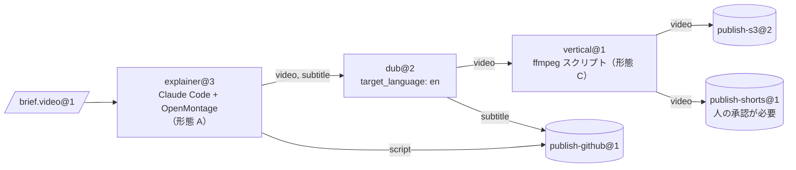
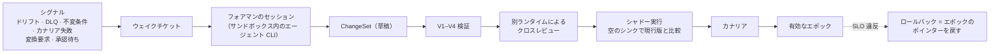

[English](README.md) | **日本語** | [한국어](README_ko.md) | [Français](README_fr.md) | [Deutsch](README_de.md) | [Español](README_es.md) | [Português (BR)](README_pt-BR.md) | [Русский](README_ru.md) | [简体中文](README_zh-CN.md)

<p align="center">
  
</p>

<p align="center">
  <strong>オープンソース製品をマシンに、既存の CLI エージェントをオペレーターに。その成果物を、次のステーションで使える型付き・検証済みの素材に変えます。</strong>
</p>

<p align="center">
  
  
  
  
  
</p>

<p align="center">
  <a href="#実行してみる">実行してみる</a> ·
  <a href="#クイックスタート">クイックスタート</a> ·
  <a href="#仕組み">仕組み</a> ·
  <a href="#アーキテクチャ">アーキテクチャ</a> ·
  <a href="#ガバナンスとフォアマン">ガバナンス</a> ·
  <a href="#cli-早見表">CLI</a> ·
  <a href="docs/ja/README.md">ドキュメント</a>
</p>

---

> **これは何か？** 工場のコントロールプレーンです。エージェントは一切同梱しておらず、モデル API を呼び出すこともありません。知能はすべて、すでに使っている CLI エージェント（Claude Code ヘッドレス、Codex など）から来ます。エージェントは Docker サンドボックスの中で動きます。ステーション**間**のこと、つまりルーティング、型チェック、変換、保存、スケジューリング、予算、承認、変更管理は、すべて決定論的なコードが担います。

[OpenMontage](https://github.com/OpenMontageInc/OpenMontage) のような「エージェントネイティブ」な製品は、パイプライン全体をエージェントに任せます。Machine Agent Org はその一段上で動きます。そうした製品を生産ラインの**マシン**として扱い、各マシンは**ステーション**でエージェントの**オペレーター**が操作します。あるステーションの成果物は検査・封印されて次のステーションの素材になり、最後に**シンク**が結果を S3、GitHub、YouTube などへ公開します。

| 工場の用語 | このプロジェクトでの意味 | 例 |
|---|---|---|
| **Bean（素材）** | 不変・内容アドレス方式で、型と系譜を持つ素材 | `note.text@1`、`video.mp4@1`、`brief.video@1` |
| **Machine（マシン）** | *Machine Package* で記述された既存製品 | OpenMontage、MoneyPrinterTurbo、ffmpeg、rclone |
| **Operator（オペレーター）** | マシンを操作する主体 | Claude Code ヘッドレス、Codex、スクリプト、人の受信箱 |
| **Station（ステーション）** | Recipe × Operator × Policy。ポートは型付き | `explainer@3`、`dub@2`、`publish-s3@2` |
| **Line（ライン）** | ステーションからなる型付き DAG。動的構造は上限付き | `explainer-multilang@5` |
| **Source / Sink** | 外部から取り込む / 外部へ公開するステーション | webhook 取り込み / S3、GitHub、YouTube |
| **Foreman（フォアマン）** | 検証済みの ChangeSet で工場を保守する外部エージェント | Claude Code または Codex のセッション |

---

## 実行してみる

以下は fixture registry の `note-pipeline@1` を実際に実行したものです。ローカルのサンドボックスプロバイダーと `tests/fakes/` のスクリプト化された fake agent を使うので、Docker もモデルキーも要りません。CLI の出力は JSON で、図では要約しています。

<p align="center">
  
</p>

誰も頼んでいないノードに注目してください。`write@1` は `note.raw@1` を出力しますが、`upper@1` は `note.text@1` を要求します。構造コンパイラーは変換ステーションを見つけ、ノード `upper.in.note~note-to-text@1` を挿入しました。run の系譜にもこのノードが記録されています。4 つの job がすべて封印され、費用は $0.02（上限 $5.00）でした。run はエポック `e-f4f97580bd8ee4a4` に固定されているので、実行中に構造が変わっても影響を受けません。

手順を追った再現方法は [docs/ja/getting-started.md](docs/ja/getting-started.md) にあります。

---

## クイックスタート

### 前提条件

- **Python 3.12+** と **[uv](https://docs.astral.sh/uv/)**
- **Docker**（任意）：既定の `docker` サンドボックスプロバイダーと Docker テスト層で必要です。この README の内容はすべて `--provider local` でも動きます。
- **エージェント CLI**（任意）：実際のステーションでは Claude Code か Codex を使います。テストはスクリプト化された fake agent で代用します。

### インストールと確認

```bash
git clone https://github.com/rywsl/Company-Machine.git
cd Company-Machine
uv sync

uv run factory --version
uv run mrl --version
uv run python tools/harness.py doctor     # 環境チェック
uv run python tools/harness.py status     # マイルストーンとステージゲート
uv run python tools/harness.py pytest tests/acceptance/m1   # 98 テスト、約 1 分
```

### 最初のライン

```bash
# 1. registry をコンパイル（終了コード 0 = エラーなし、3 = 不正）
uv run factory check tests/fixtures/registry-m2

# 2. 素材を取り込み、ラインを計画して実行
uv run factory --root .factory --registry <registry> --provider local --local-commands commands.json \
    bean import --type agent.task@1 --file task.json=./task.json
uv run factory ... line plan note-pipeline@1
uv run factory ... line run  note-pipeline@1 --in task=sha256:...

# 3. 確認
uv run factory ... line nodes <run-id>
uv run factory ... bean lineage --direction up <bean-id>
uv run factory ... status
```

`commands.json` はローカルプロバイダー用のコマンド対応表で、レシピ中のコマンド名をホストのコマンドに対応づけます。はじめにガイドでテストフィクスチャから生成します。無人運転では、デーモンと読み取り専用コンソールを起動します。

```bash
uv run factory serve                 # トリガー、run、job、ガバナンス、監査、カナリア、ウェイクチケット
uv run factory console               # http://127.0.0.1:8090、トークンは $FACTORY_ROOT/console.token
```

---

## 仕組み

<p align="center">
  
</p>

**job** はステーションの 1 回の実行です。

1. Runner が入力を検査します。
2. Runner がサンドボックスを用意します。非 root、`cap-drop ALL`、入力は読み取り専用、`docker.sock` は決してマウントしません。
3. Runner がオペレーター向けの **Station Brief** を書き、オペレーターの CLI をヘッドレスで起動します。
4. オペレーターはマシンを操作し、工場とは `factoryctl` だけでやり取りします。
5. 完了すると、**ゲート**が成果物を 4 段階で検査します。構造、validator、MRL で書いた受け入れ式、任意の judge です。
6. 合格した成果物は系譜とともに内容アドレス型の倉庫に封印されます。



<sub>サンプルライン `spec/examples/registry/lines/explainer-multilang.yaml`。ラベル `line=explainer-multilang` 付きの brief が届くと起動し、予算上限は $12 です。</sub>

**job のライフサイクル：** `PENDING → PROVISIONING → RUNNING ⇄ AWAITING_APPROVAL → GATING → SEALED`。
- **差し戻し**（REJECTED）になった job は、ゲートのフィードバック付きで再試行します。
- **失敗**（FAILED）した job は、最初からやり直すか再開します。
- 再試行の上限を超えると **DEAD** になり、デッドレターキューに入ります。

高コストなステーションとすべてのシンクは 2 段階で動きます。まずコスト見積もり付きで *propose* し、承認後に *execute* します。

---

## アーキテクチャ

<p align="center">
  
</p>

| 層 | 役割 | 主なコード |
|---|---|---|
| **カーネル** | メタモデル、構造コンパイラー、憲法の不変条件、イベントログ。めったに変わらない | `src/mrl/`（MRL 言語と工場プロファイル） |
| **構造** | Git 上の Registry。型・マシン・オペレーター・ステーション・ライン・ポリシーはすべて Spec で、**エポック**ごとに版管理される | `mao.snapshot`、`mao.governance.epochs` |
| **ランタイム** | スケジューラー、ラインランナー、job 状態機械、サンドボックス、ゲート、倉庫、キャッシュ、リース | `mao.runner`、`mao.runs`、`mao.dynamic`、`mao.scheduler`、`mao.gate`、`mao.warehouse` |
| **アダプター** | マシンパッケージ、オペレーターランタイム、Docker/Local サンドボックス、コネクター、サービスゲートウェイ、出口・モデルプロキシ、ストレージバックエンド | `mao.sandbox`、`mao.operator`、`mao.gateway`、`mao.egress`、`mao.backends` |
| **ガバナンス** | 検証パイプライン、不変条件監査、ドリフト監視、リコンサイラー、シャドー実行とカナリア、フォアマン | `mao.governance.*`、`mao.reconcile`、`mao.supervisor`、`mao.daemon` |

**6 層の検証。** 各層は決まったタイミングで実行され、失敗時の扱いも決まっています。

| 層 | 検査内容 | タイミング |
|---|---|---|
| V1 Spec | スキーマ、参照、バージョン固定、ポリシー lint | 変更の提案ごと |
| V2 構造 | 辺の型、非巡回、必須入力、成果物の行き先、予算、動的構造の上限 | 提案時と毎回の実行前 |
| V3 進化 | 互換性、下流のコンシューマー契約、影響範囲 | 提案時 |
| V4 契約テスト | マシンの適合性、ゴールデン brief、コンバーターの往復、シンクのドライラン | 提案時と定期カナリア |
| V5 ランタイム | 入力検査とゲート、シンクのレシート検証 | すべての job |
| V6 継続 | 不変条件監査、ドリフト、CAS と系譜の完全性、リコンサイル | 定期実行とイベント駆動 |

**動的構造には上限があります。** ラインでは次の動的構造が使えます。
- `map`：`list<T>` を展開します。`max_items` と `max_parallel` の上限付きです。
- `switch`：網羅的で、default が必須です。
- `until`：最大反復回数付きです。
- `subline`：別のラインを入れ子で呼び出します。

**planner** ステーションは `Plan` を出力できます。Plan のどの部分も、実行する前に V1/V2 でコンパイルされ、そのステーションの `plan_bounds`（許可されたステーションとシンク、ステップ数、ファンアウト、深さ、予算）と照合されます。

<details>
<summary><b><code>src/mao</code> のモジュールマップ</b></summary>

| 領域 | モジュール |
|---|---|
| 基盤 | `base` `errors` `db` `context` `values` `migrations/` |
| 構造とガバナンス | `snapshot` `contract` `governance/{epochs,changesets,risk,rollout,shadow}` `reconcile` |
| 実行 | `jobs` `runner` `runplan` `runs` `dynamic` `scheduler` `cache` `durable` `approvals` |
| 素材 | `warehouse` `gate` `retention` `backup` |
| アダプター | `sandbox` `operator` `brief` `ctl/factoryctl` `gateway` `connectors` `egress` `images` `backends` |
| 自律 | `daemon`（`factory serve`） `supervisor` `foreman` `mcp` |
| 可観測性 | `status` `console` |
| CLI | `cli` `commands/*` |

</details>

---

## ガバナンスとフォアマン

工場は**フォアマン**が保守します。フォアマンは普通の Claude Code または Codex のセッションで、シグナルで起こされ、`factory foreman` CLI または MCP サーバー（`factory mcp --role foreman`）を通じて作業します。フォアマンは変更を提案できますが、変更を出すかどうかは決定論的なコードが決めます。



| ティア | 典型的な変更 | 必要なもの |
|---|---|---|
| T0 | 再試行、隔離 | 自動 |
| T1 | テンプレート調整、コンバーター追加、型の minor 更新 | 検証 + シャドー |
| T2 | マシンの導入・更新、新しいライン、型の major 更新 | + カナリア + クロスレビュー |
| T3 | ソース/シンク追加、出口・認証情報の割り当て、ポリシー、廃止 | + 人の承認 |
| T4 | 憲法 | 人のみ |

リスクティアはパイプラインが diff から計算し、フォアマンが下げることはできません。フォアマンは憲法や封印済みの Bean を編集できず、シークレットを読めず、検証を飛ばせず、サンドボックスにも入れません。

---

## 接続形態

| 形態 | マシンの例 | オペレーターの配置 |
|---|---|---|
| **A** エージェントネイティブなワークスペース | OpenMontage | 製品と同じサンドボックス、作業ディレクトリは製品のワークスペース |
| **B** サービス型 | MoneyPrinterTurbo、ComfyUI | 工場のサービスゲートウェイが API を「投入 → ポーリング → 取得」に統一する |
| **C** ツール型 | ffmpeg、rclone、git | スクリプトステーションが直接呼び出す |

`spec/examples/registry/` には、OpenMontage、MoneyPrinterTurbo、ffmpeg、rclone、git、webhook 取り込み、YouTube アップローダーのマシンパッケージがあります。

---

## CLI 早見表

エントリーポイントは 2 つです。`factory`（コントロールプレーン）と `mrl`（関係言語ツールキット）です。グローバルオプションは `--root`、`--registry`、`--provider {docker,local}`、`--epoch`、`--json` で、環境変数 `FACTORY_ROOT` と `FACTORY_REGISTRY` が既定値になります。

| グループ | コマンド |
|---|---|
| 構造 | `check` · `epoch {init,ls,show,rollback,adopt}` · `changeset {propose,ls,show,withdraw,advance}` · `contract …` · `governance {tick,safe-mode}` |
| 素材 | `bean {import,lineage,label}` · `cache {ls,explain,invalidate}` · `gc [--dry-run]` |
| 実行 | `job {run,show,exec}` · `line {plan,run,ls,show,nodes,cancel,retry,rebuild}` · `trigger process` · `schedule {tick,dlq,quarantine,release}` · `approval {ls,show,decide}` |
| 接続 | `image {build,ls}` · `gateway manifest` · `egress check` · `secret ls` · `backend {status,migrate,verify}` · `backup {create,verify,restore}` |
| 自律 | `serve [--once]` · `foreman …` · `mcp --role {foreman,reviewer}` · `maintain bootstrap` · `audit` · `drift ls` |
| 可観測性 | `status` · `metrics` · `events` · `console` |

終了コード：
- `0` 成功
- `1` 業務上の失敗
- `2` 使い方の誤り
- `3` registry が不正
- `4` 環境エラー（Docker がないなど）
- `5` 内部エラー

完全なリファレンスは [docs/ja/cli.md](docs/ja/cli.md) にあります。

---

## プロジェクトの状況

10 のマイルストーンはすべて完了し、すべてのステージゲートに合格しています。M9 ゲートでは lint、フォーマット、ドキュメント検査、適合性ケース、**1448 テスト**を実行し、失敗ゼロ・スキップゼロでした。ランタイムには既知のギャップがいくつか残っています。[ランタイム · 既知のギャップ](docs/ja/runtime.md#6-既知のギャップ2026-11-13)を参照してください。

| マイルストーン | 成果 |
|---|---|
| M0 | MRL 言語、構造コンパイラー、憲法 |
| M1 | 単一ステーションのエンドツーエンド：スナップショット、倉庫、サンドボックス、`factoryctl`、ゲート、オペレーター、Runner、CLI |
| M2 | ライン、ソースとシンク、キャッシュ、DLQ、承認、V3/V4 |
| M3 | エポック、ChangeSet パイプライン、シャドーとカナリア、リコンサイラー、ドリフト、フォアマン |
| M4 | 動的構造、Plan、サービスゲートウェイ、本番バックエンド |
| M5 | 自律ループ：永続実行、`serve`、MCP、フォアマンの監督 |
| M6 | Docker 上の実際のエージェント CLI、フォアマンによるイメージ構築 |
| M7 | 可観測性、コンソール、保持期間、バックアップと復元 |
| M8 | 出口プロキシの強化、`serve` の耐障害性 |
| M9 | M4 の機能を本番経路で閉じる（S3 SigV4、`psql` 経由の Postgres など） |

---

## リポジトリ構成

```
src/mrl/          MRL：字句解析、構文解析、検査器、評価器、ルール、工場プロファイル
src/mao/          工場のコントロールプレーン（パッケージ `mao`、コマンド `factory`）
spec/             規範：MRL 1.0、工場プロファイル、スキーマ、システム仕様、サンプル registry
plan/             マイルストーン、タスクカード、ステージゲート、レビュー、保護ファイルのロック
tests/            マイルストーンごとの受け入れテスト、システムテスト、テストダブル、フィクスチャ registry
tools/            harness.py（タスクとゲートの実行器）、イメージビルダー、フック
docs/             アーキテクチャ設計（中国語）、各言語のガイド、図
```

---

## ドキュメント

| | 日本語 |
|---|---|
| ドキュメント索引 | [docs/ja/README.md](docs/ja/README.md) |
| はじめに | [docs/ja/getting-started.md](docs/ja/getting-started.md) |
| コンセプト | [docs/ja/concepts.md](docs/ja/concepts.md) |
| ランタイム | [docs/ja/runtime.md](docs/ja/runtime.md) |
| CLI リファレンス | [docs/ja/cli.md](docs/ja/cli.md) |
| 開発 | [docs/ja/development.md](docs/ja/development.md) |

他の言語：[English](docs/en/README.md) · [한국어](docs/ko/README.md) · [Français](docs/fr/README.md) · [Deutsch](docs/de/README.md) · [Español](docs/es/README.md) · [Português (BR)](docs/pt-BR/README.md) · [Русский](docs/ru/README.md) · [简体中文](docs/zh-CN/README.md)

アーキテクチャ設計の全文（中国語）は [docs/architecture.md](docs/architecture.md)、規範文書は [spec/system/](spec/system/README.md) にあります。

---

## コントリビュート

このプロジェクトは「設計者 / 実装者」の分担で進め、`tools/harness.py` がそれを強制します。仕様、タスクカード、受け入れテストは `plan/protected.lock` で保護され、再登録できるのは人だけです。実装者は `harness task next` でタスクを選び、仕様どおりに実装し、`harness accept <ID>` で完了を証明します。変更を出す前に [AGENTS.md](AGENTS.md)（中国語）と [docs/ja/development.md](docs/ja/development.md) を読んでください。

## ライセンス

ライセンスファイルはまだ追加されていません。追加されるまで、すべての権利は作者に帰属します。
