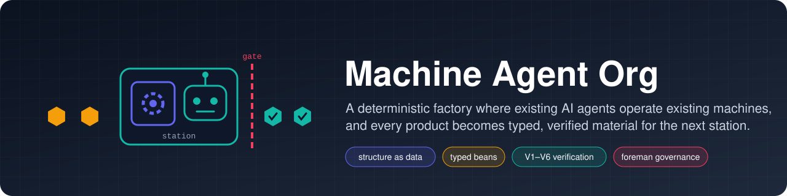
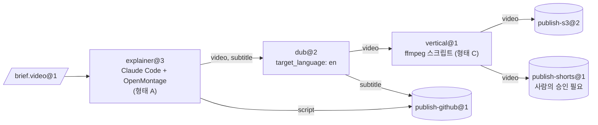

[English](README.md) | [日本語](README_ja.md) | **한국어** | [Français](README_fr.md) | [Deutsch](README_de.md) | [Español](README_es.md) | [Português (BR)](README_pt-BR.md) | [Русский](README_ru.md) | [简体中文](README_zh-CN.md)

<p align="center">
  
</p>

<p align="center">
  <strong>오픈소스 제품을 머신으로, 기존 CLI 에이전트를 오퍼레이터로 바꾸고, 그 산출물을 다음 스테이션이 쓸 수 있는 타입이 있고 검증된 소재로 만듭니다.</strong>
</p>

<p align="center">
  
  
  
  
  
</p>

<p align="center">
  <a href="#실행해-보기">실행해 보기</a> ·
  <a href="#빠른-시작">빠른 시작</a> ·
  <a href="#동작-방식">동작 방식</a> ·
  <a href="#아키텍처">아키텍처</a> ·
  <a href="#거버넌스와-foreman">거버넌스</a> ·
  <a href="#cli-한눈에-보기">CLI</a> ·
  <a href="docs/ko/README.md">문서</a>
</p>

---

> **이게 무엇인가요?** 공장의 컨트롤 플레인입니다. 에이전트를 하나도 포함하지 않으며 모델 API를 호출하는 일도 없습니다. 모든 지능은 이미 쓰고 있는 CLI 에이전트(Claude Code 헤드리스, Codex 등)에서 나오고, 이 에이전트들은 Docker 샌드박스 안에서 동작합니다. 스테이션 *사이*의 모든 일, 즉 라우팅, 타입 검사, 변환, 저장, 스케줄링, 예산, 승인, 변경 관리는 전부 결정론적인 코드가 맡습니다.

[OpenMontage](https://github.com/OpenMontageInc/OpenMontage) 같은 에이전트 네이티브 제품은 파이프라인 전체를 에이전트에게 맡깁니다. Machine Agent Org는 그보다 한 단계 위에서 동작합니다. 이런 제품을 생산 라인 위의 **머신**으로 다루고, 각 머신은 **스테이션**에서 에이전트 **오퍼레이터**가 조작합니다. 한 스테이션이 만든 결과물은 검사·봉인된 뒤 다음 스테이션의 입력으로 넘어가고, 마지막에 **싱크**(sink, 외부로 내보내는 스테이션)가 결과를 S3, GitHub, YouTube 등 원하는 곳에 게시합니다.

| 공장 용어 | 여기서의 의미 | 예시 |
|---|---|---|
| **Bean(소재)** | 타입과 계보를 가진, 불변이며 내용 주소 방식으로 식별되는 소재 한 단위 | `note.text@1`, `video.mp4@1`, `brief.video@1` |
| **Machine(머신)** | *Machine Package*로 기술된 기존 제품 | OpenMontage, MoneyPrinterTurbo, ffmpeg, rclone |
| **Operator(오퍼레이터)** | 머신을 조작하는 주체 | Claude Code 헤드리스, Codex, 스크립트, 사람의 받은편지함 |
| **Station(스테이션)** | Recipe × Operator × Policy, 타입이 지정된 포트를 가짐 | `explainer@3`, `dub@2`, `publish-s3@2` |
| **Line(라인)** | 스테이션으로 이루어진 타입 있는 DAG, 동적 구조에는 상한이 있음 | `explainer-multilang@5` |
| **Source / Sink(소스 / 싱크)** | 외부에서 받아들이는 / 외부로 게시하는 스테이션 | webhook 수신 / S3, GitHub, YouTube |
| **Foreman(현장 감독)** | 검증된 ChangeSet으로 공장을 유지보수하는 외부 에이전트 | Claude Code 또는 Codex 세션 |

---

## 실행해 보기

아래는 fixture 레지스트리의 `note-pipeline@1`을 실제로 실행한 세션입니다. 로컬 샌드박스 프로바이더와 `tests/fakes/`의 스크립트형 가짜 에이전트를 쓰므로 Docker도 모델 키도 필요 없습니다. CLI는 JSON을 출력하며, 그림은 그 내용을 요약한 것입니다.

<p align="center">
  
</p>

아무도 요청하지 않은 부분에 주목하세요. `write@1`은 `note.raw@1`을 만들지만 `upper@1`은 `note.text@1`을 요구합니다. 구조 컴파일러가 변환 스테이션을 찾아 `upper.in.note~note-to-text@1` 노드를 끼워 넣었고, 실행의 계보에도 이 노드가 기록됩니다. job 4개가 모두 봉인되었고 비용은 상한 $5.00 중 $0.02였습니다. 이 실행은 에포크(epoch, 고정된 구조 버전) `e-f4f97580bd8ee4a4`에 고정되어 있으므로 실행 도중 구조가 바뀌어도 영향을 받지 않습니다.

단계별 재현 방법은 [docs/ko/getting-started.md](docs/ko/getting-started.md)에 있습니다.

---

## 빠른 시작

### 사전 준비

- **Python 3.12+**와 **[uv](https://docs.astral.sh/uv/)**
- **Docker**(선택): 기본 `docker` 샌드박스 프로바이더와 Docker 테스트 계층에 필요합니다. 이 README의 내용은 모두 `--provider local`로도 동작합니다.
- **에이전트 CLI**(선택): 실제 스테이션에는 Claude Code 또는 Codex를 씁니다. 테스트는 그 대신 스크립트형 가짜 에이전트를 사용합니다.

### 설치와 확인

```bash
git clone https://github.com/rywsl/Company-Machine.git
cd Company-Machine
uv sync

uv run factory --version
uv run mrl --version
uv run python tools/harness.py doctor     # 환경 점검
uv run python tools/harness.py status     # 마일스톤과 스테이지 게이트
uv run python tools/harness.py pytest tests/acceptance/m1   # 테스트 98개, 약 1분
```

### 첫 번째 라인

```bash
# 1. 레지스트리 컴파일 (종료 코드 0 = 오류 없음, 3 = 유효하지 않음)
uv run factory check tests/fixtures/registry-m2

# 2. 소재를 가져오고, 라인을 계획하고 실행
uv run factory --root .factory --registry <registry> --provider local --local-commands commands.json \
    bean import --type agent.task@1 --file task.json=./task.json
uv run factory ... line plan note-pipeline@1
uv run factory ... line run  note-pipeline@1 --in task=sha256:...

# 3. 확인
uv run factory ... line nodes <run-id>
uv run factory ... bean lineage --direction up <bean-id>
uv run factory ... status
```

`commands.json`은 로컬 프로바이더용으로, 머신 레시피에 나오는 명령 이름을 호스트 명령에 대응시킵니다. 시작하기 가이드에서 테스트 fixture로부터 이 파일을 생성합니다. 무인 운영을 하려면 데몬과 읽기 전용 콘솔을 실행하세요.

```bash
uv run factory serve                 # 트리거, 실행, job, 거버넌스, 감사, 카나리, 웨이크 티켓
uv run factory console               # http://127.0.0.1:8090, 토큰은 $FACTORY_ROOT/console.token
```

---

## 동작 방식

<p align="center">
  
</p>

**job**은 스테이션을 한 번 실행하는 단위입니다. Runner는 입력을 검사한 뒤 샌드박스를 준비합니다. 비 root, `cap-drop ALL`, 입력은 읽기 전용으로 마운트하며 `docker.sock`은 절대 마운트하지 않습니다. 이어서 오퍼레이터를 위한 **Station Brief**를 작성하고 오퍼레이터의 CLI를 헤드리스로 실행합니다. 오퍼레이터는 머신을 조작하며, 공장과는 오직 `factoryctl`로만 통신합니다. 작업이 끝나면 **게이트**(gate, 출하 검사)가 결과물을 네 단계로 검사합니다. 구조, validator, MRL로 작성한 수락 표현식, 그리고 선택적인 judge입니다. 통과한 결과물은 계보와 함께 내용 주소 방식의 창고에 봉인됩니다.



<sub>예제 라인 `spec/examples/registry/lines/explainer-multilang.yaml`. `line=explainer-multilang` 레이블이 붙은 brief가 도착하면 시작되며, 예산 상한은 $12입니다.</sub>

**job 생명주기.** `PENDING → PROVISIONING → RUNNING ⇄ AWAITING_APPROVAL → GATING → SEALED`.
- **반려된** job은 게이트의 피드백을 받아 재시도합니다.
- **실패한** job은 처음부터 다시 하거나 이어서 재개합니다.
- 재시도 한도를 모두 쓴 job은 **DEAD**가 되어 데드 레터 큐(DLQ)로 들어갑니다.

비용이 큰 스테이션과 모든 싱크는 두 단계로 동작합니다. 먼저 비용 추정과 함께 *propose*하고, 승인 후에 *execute*합니다.

---

## 아키텍처

<p align="center">
  
</p>

| 계층 | 역할 | 주요 코드 |
|---|---|---|
| **커널** | 메타모델, 구조 컴파일러, 헌법 불변식, 이벤트 로그. 거의 바뀌지 않습니다. | `src/mrl/`(MRL 언어 + 공장 프로파일) |
| **구조** | Git에 있는 레지스트리. 타입, 머신, 오퍼레이터, 스테이션, 라인, 정책은 모두 Spec이며 **에포크** 단위로 버전이 관리됩니다. | `mao.snapshot`, `mao.governance.epochs` |
| **런타임** | 스케줄러, 라인 러너, job 상태 기계, 샌드박스, 게이트, 창고, 캐시, 리스. | `mao.runner`, `mao.runs`, `mao.dynamic`, `mao.scheduler`, `mao.gate`, `mao.warehouse` |
| **어댑터** | 머신 패키지, 오퍼레이터 런타임, Docker/Local 샌드박스, 커넥터, 서비스 게이트웨이, 이그레스·모델 프록시, 스토리지 백엔드. | `mao.sandbox`, `mao.operator`, `mao.gateway`, `mao.egress`, `mao.backends` |
| **거버넌스** | 검증 파이프라인, 불변식 감사, 드리프트 모니터링, 리컨실러, 섀도·카나리 배포, Foreman. | `mao.governance.*`, `mao.reconcile`, `mao.supervisor`, `mao.daemon` |

**6계층 검증.** 각 계층은 정해진 시점에 실행되고, 실패할 때의 처리도 정해져 있습니다.

| 계층 | 검사 내용 | 시점 |
|---|---|---|
| V1 Spec | 스키마, 참조, 고정된 버전, 정책 lint | 모든 제안 |
| V2 구조 | 엣지 타입, 비순환성, 필수 입력, 모든 산출물의 소비 여부, 예산, 동적 구조 상한 | 제안 시와 매 실행 전 |
| V3 진화 | 호환성, 다운스트림 소비자 계약, 영향 범위 | 제안 시 |
| V4 계약 테스트 | 머신 적합성, 골든 brief, 컨버터 왕복 변환, 싱크 드라이 런 | 제안 시와 정기 카나리 |
| V5 런타임 | 입력 검사와 게이트, 싱크 영수증 검증 | 모든 job |
| V6 지속 | 불변식 감사, 드리프트, CAS와 계보 무결성, 리컨실 | 주기적 실행과 이벤트 기반 |

**동적 구조에는 상한이 있습니다.** 라인에는 `map`(`list<T>`를 순회하며 `max_items`와 `max_parallel` 상한이 있음), `switch`(망라적이어야 하며 default 필수), `until`(최대 반복 횟수 지정), `subline`을 넣을 수 있습니다. **planner** 스테이션은 `Plan`을 내보낼 수 있습니다. Plan은 어느 부분도 실행되기 전에 V1/V2로 컴파일되고, 해당 스테이션의 `plan_bounds`(허용된 스테이션과 싱크, 단계 수, 팬아웃, 깊이, 예산)와 대조됩니다.

<details>
<summary><b><code>src/mao</code> 모듈 맵</b></summary>

| 영역 | 모듈 |
|---|---|
| 기반 | `base` `errors` `db` `context` `values` `migrations/` |
| 구조와 거버넌스 | `snapshot` `contract` `governance/{epochs,changesets,risk,rollout,shadow}` `reconcile` |
| 실행 | `jobs` `runner` `runplan` `runs` `dynamic` `scheduler` `cache` `durable` `approvals` |
| 소재 | `warehouse` `gate` `retention` `backup` |
| 어댑터 | `sandbox` `operator` `brief` `ctl/factoryctl` `gateway` `connectors` `egress` `images` `backends` |
| 자율 | `daemon`(`factory serve`) `supervisor` `foreman` `mcp` |
| 관측성 | `status` `console` |
| CLI | `cli` `commands/*` |

</details>

---

## 거버넌스와 Foreman

공장은 **Foreman**(현장 감독)이 유지보수합니다. Foreman은 평범한 Claude Code 또는 Codex 세션으로, 신호를 받아 깨어나고 `factory foreman` CLI나 MCP 서버(`factory mcp --role foreman`)를 통해 작업합니다. Foreman은 변경을 제안할 수 있지만, 그 변경을 내보낼지는 결정론적인 코드가 정합니다.


| 티어 | 대표적인 변경 | 필요한 것 |
|---|---|---|
| T0 | 재시도, 격리 | 자동 |
| T1 | 템플릿 조정, 새 컨버터, 타입 minor 버전 올림 | 검증 + 섀도 |
| T2 | 머신 신규 도입·업그레이드, 새 라인, 타입 major 버전 올림 | + 카나리 + 교차 리뷰 |
| T3 | 새 소스/싱크, 이그레스·자격 증명 바인딩, 정책, 퇴역 | + 사람의 승인 |
| T4 | 헌법 | 사람만 가능 |

리스크 티어는 파이프라인이 diff로부터 계산하며 Foreman은 이를 낮출 수 없습니다. Foreman은 헌법이나 봉인된 Bean을 수정할 수 없고, 시크릿을 읽거나 검증을 건너뛰거나 샌드박스에 들어갈 수도 없습니다.

---

## 통합 형태

| 형태 | 머신 예시 | 오퍼레이터 배치 방식 |
|---|---|---|
| **A** 에이전트 네이티브 워크스페이스 | OpenMontage | 같은 샌드박스 안, 작업 디렉터리 = 제품의 워크스페이스 |
| **B** 서비스 | MoneyPrinterTurbo, ComfyUI | 공장의 서비스 게이트웨이가 API를 *submit → poll → fetch*로 바꿈 |
| **C** 도구 | ffmpeg, rclone, git | 스크립트 스테이션이 직접 호출 |

`spec/examples/registry/`에는 OpenMontage, MoneyPrinterTurbo, ffmpeg, rclone, git, webhook 수신, YouTube 업로더가 머신 패키지로 기술되어 있습니다.

---

## CLI 한눈에 보기

진입점은 두 개입니다. `factory`(컨트롤 플레인)와 `mrl`(관계 언어 툴킷)입니다. 전역 옵션은 `--root`, `--registry`, `--provider {docker,local}`, `--epoch`, `--json`이며, 환경 변수 `FACTORY_ROOT`와 `FACTORY_REGISTRY`가 기본값을 제공합니다.

| 그룹 | 명령 |
|---|---|
| 구조 | `check` · `epoch {init,ls,show,rollback,adopt}` · `changeset {propose,ls,show,withdraw,advance}` · `contract …` · `governance {tick,safe-mode}` |
| 소재 | `bean {import,lineage,label}` · `cache {ls,explain,invalidate}` · `gc [--dry-run]` |
| 실행 | `job {run,show,exec}` · `line {plan,run,ls,show,nodes,cancel,retry,rebuild}` · `trigger process` · `schedule {tick,dlq,quarantine,release}` · `approval {ls,show,decide}` |
| 통합 | `image {build,ls}` · `gateway manifest` · `egress check` · `secret ls` · `backend {status,migrate,verify}` · `backup {create,verify,restore}` |
| 자율 | `serve [--once]` · `foreman …` · `mcp --role {foreman,reviewer}` · `maintain bootstrap` · `audit` · `drift ls` |
| 관측성 | `status` · `metrics` · `events` · `console` |

종료 코드: `0` 성공 · `1` 업무상 실패 · `2` 사용법 오류 · `3` 유효하지 않은 레지스트리 · `4` 환경 오류(예: Docker 없음) · `5` 내부 오류. 전체 레퍼런스는 [docs/ko/cli.md](docs/ko/cli.md)에 있습니다.

---

## 프로젝트 현황

10개 마일스톤이 모두 완료되었고 모든 스테이지 게이트를 통과했습니다. M9 게이트에서는 lint, 포맷, 문서 검사, 적합성 검사와 **테스트 1448개**를 실행했으며 실패 0건, 건너뜀 0건이었습니다. 런타임에는 아직 해결되지 않은 미비점이 몇 가지 있습니다. [런타임 · 알려진 미비점](docs/ko/runtime.md#6-알려진-미비점-2026-11-13)을 참고하세요.

| 마일스톤 | 결과물 |
|---|---|
| M0 | MRL 언어, 구조 컴파일러, 헌법 |
| M1 | 단일 스테이션 엔드투엔드: 스냅샷, 창고, 샌드박스, `factoryctl`, 게이트, 오퍼레이터, Runner, CLI |
| M2 | 라인, 소스와 싱크, 캐시, DLQ, 승인, V3/V4 |
| M3 | 에포크, ChangeSet 파이프라인, 섀도와 카나리, 리컨실러, 드리프트, Foreman |
| M4 | 동적 구조, Plan, 서비스 게이트웨이, 프로덕션 백엔드 |
| M5 | 자율 루프: 내구성 있는 실행, `serve`, MCP, Foreman 감독 |
| M6 | Docker 안의 실제 에이전트 CLI, Foreman이 빌드한 이미지 |
| M7 | 관측성, 콘솔, 보존 기간, 백업과 복원 |
| M8 | 이그레스 프록시 강화, 장애에 강한 `serve` |
| M9 | M4 기능을 프로덕션 경로에서 마무리(S3 SigV4, `psql`을 통한 Postgres 등) |

---

## 저장소 구조

```
src/mrl/          MRL: 렉서, 파서, 검사기, 평가기, 규칙, 공장 프로파일
src/mao/          공장 컨트롤 플레인(패키지 `mao`, CLI `factory`)
spec/             규범 문서: MRL 1.0, 공장 프로파일, 스키마, 시스템 명세, 예제 레지스트리
plan/             마일스톤, 태스크 카드, 스테이지 게이트, 리뷰, 보호 파일 잠금
tests/            마일스톤별 인수 테스트, 시스템 테스트, 테스트 대역, fixture 레지스트리
tools/            harness.py(태스크·게이트 실행기), 이미지 빌더, 훅
docs/             아키텍처 설계(zh-CN), 언어별 가이드, 다이어그램
```

---

## 문서

| | 한국어 |
|---|---|
| 문서 목차 | [docs/ko/README.md](docs/ko/README.md) |
| 시작하기 | [docs/ko/getting-started.md](docs/ko/getting-started.md) |
| 핵심 개념 | [docs/ko/concepts.md](docs/ko/concepts.md) |
| 런타임 | [docs/ko/runtime.md](docs/ko/runtime.md) |
| CLI 레퍼런스 | [docs/ko/cli.md](docs/ko/cli.md) |
| 개발 | [docs/ko/development.md](docs/ko/development.md) |

다른 언어: [English](docs/en/README.md) · [日本語](docs/ja/README.md) · [Français](docs/fr/README.md) · [Deutsch](docs/de/README.md) · [Español](docs/es/README.md) · [Português (BR)](docs/pt-BR/README.md) · [Русский](docs/ru/README.md) · [简体中文](docs/zh-CN/README.md)

전체 아키텍처 설계(중국어)는 [docs/architecture.md](docs/architecture.md)에, 규범 명세는 [spec/system/](spec/system/README.md)에 있습니다.

---

## 기여하기

작업은 설계자/구현자 역할 분리를 따르며, `tools/harness.py`가 이를 강제합니다. 명세, 태스크 카드, 인수 테스트는 `plan/protected.lock`으로 보호되며 다시 등록할 수 있는 것은 사람뿐입니다. 구현자는 `harness task next`로 태스크를 고르고, 명세에 맞게 구현한 뒤 `harness accept <ID>`로 완료를 증명합니다. 변경을 올리기 전에 [AGENTS.md](AGENTS.md)와 [docs/ko/development.md](docs/ko/development.md)를 읽어 주세요.

## 라이선스

아직 라이선스 파일이 추가되지 않았습니다. 추가되기 전까지 모든 권리는 저작자에게 있습니다.
