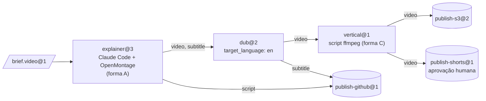
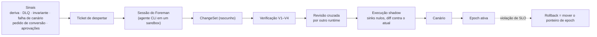

[English](README.md) | [日本語](README_ja.md) | [한국어](README_ko.md) | [Français](README_fr.md) | [Deutsch](README_de.md) | [Español](README_es.md) | **Português (BR)** | [Русский](README_ru.md) | [简体中文](README_zh-CN.md)

<p align="center">
  
</p>

<p align="center">
  <strong>Transforme produtos open source em máquinas, agentes CLI existentes em operadores e o que eles produzem em material tipado e verificado para a próxima estação.</strong>
</p>

<p align="center">
  
  
  
  
  
</p>

<p align="center">
  <a href="#veja-em-ação">Veja em ação</a> ·
  <a href="#início-rápido">Início rápido</a> ·
  <a href="#como-funciona">Como funciona</a> ·
  <a href="#arquitetura">Arquitetura</a> ·
  <a href="#governança-e-o-foreman">Governança</a> ·
  <a href="#a-cli-em-resumo">CLI</a> ·
  <a href="docs/pt-BR/README.md">Documentação</a>
</p>

---

> **O que é isto?** Um plano de controle de fábrica. Ele não contém nenhum agente e nunca chama a API de um modelo. Toda a inteligência vem de agentes CLI que você já usa (Claude Code em modo headless, Codex, …), executados dentro de sandboxes Docker. Tudo o que acontece *entre* as estações — roteamento, verificação de tipos, conversão, armazenamento, agendamento, orçamentos, aprovações e controle de mudanças — é código determinístico.

Produtos "agent-native" como o [OpenMontage](https://github.com/OpenMontageInc/OpenMontage) colocam o agente no comando de todo o pipeline. O Machine Agent Org trabalha um nível acima: ele trata esses produtos como **máquinas** em uma linha de produção. Cada máquina é operada por um **operador** — um agente — em uma **estação**. O que uma estação produz é verificado, selado e entregue à próxima estação como entrada, até que um **sink** (estação de publicação) publique o resultado no S3, no GitHub, no YouTube ou em qualquer outro lugar.

| Termo de fábrica | O que é aqui | Exemplo |
|---|---|---|
| **Bean** (material) | Uma porção de material imutável, endereçada por conteúdo, com tipo e linhagem | `note.text@1`, `video.mp4@1`, `brief.video@1` |
| **Machine** (máquina) | Um produto existente descrito por um *Machine Package* | OpenMontage, MoneyPrinterTurbo, ffmpeg, rclone |
| **Operator** (operador) | Quem opera a máquina | Claude Code headless, Codex, um script, uma caixa de entrada humana |
| **Station** (estação) | Recipe × Operator × Policy, com portas tipadas | `explainer@3`, `dub@2`, `publish-s3@2` |
| **Line** (linha) | Um DAG tipado de estações, com estrutura dinâmica limitada | `explainer-multilang@5` |
| **Source / Sink** | Estações que recebem do mundo externo / publicam para ele | entrada por webhook / S3, GitHub, YouTube |
| **Foreman** (capataz) | Um agente externo que mantém a fábrica por meio de ChangeSets verificados | uma sessão do Claude Code ou do Codex |

---

## Veja em ação

A sessão abaixo é uma execução real de `note-pipeline@1` do registro de fixtures. Ela usa o provedor de sandbox local e o agente falso roteirizado de `tests/fakes/`, então não precisa nem de Docker nem de uma chave de modelo. A CLI imprime JSON; a imagem resume a saída.

<p align="center">
  
</p>

Repare no que ninguém pediu. `write@1` produz `note.raw@1`, mas `upper@1` exige `note.text@1`. O compilador de estrutura encontrou uma estação conversora e inseriu o nó `upper.in.note~note-to-text@1`, e a linhagem da execução registra isso. Quatro jobs foram selados, a execução custou US$ 0,02 de um teto de US$ 5,00 e está fixada na epoch `e-f4f97580bd8ee4a4` (uma versão congelada da estrutura), de modo que uma mudança de estrutura feita no meio da execução não pode afetá-la.

O passo a passo em [docs/pt-BR/getting-started.md](docs/pt-BR/getting-started.md) mostra como reproduzi-la.

---

## Início rápido

### Pré-requisitos

- **Python 3.12+** e **[uv](https://docs.astral.sh/uv/)**
- **Docker** (opcional): necessário para o provedor de sandbox padrão `docker` e para os níveis de teste com Docker. Tudo neste README também funciona com `--provider local`.
- **Um agente CLI** (opcional): Claude Code ou Codex para estações reais. Os testes usam um agente falso roteirizado no lugar.

### Instalar e verificar

```bash
git clone https://github.com/rywsl/Company-Machine.git
cd Company-Machine
uv sync

uv run factory --version
uv run mrl --version
uv run python tools/harness.py doctor     # verifica o ambiente
uv run python tools/harness.py status     # marcos e stage gates
uv run python tools/harness.py pytest tests/acceptance/m1   # 98 testes, ~1 min
```

### Sua primeira linha

```bash
# 1. Compilar um registro (código 0 = sem erros, 3 = inválido)
uv run factory check tests/fixtures/registry-m2

# 2. Importar material, planejar e executar uma linha
uv run factory --root .factory --registry <registry> --provider local --local-commands commands.json \
    bean import --type agent.task@1 --file task.json=./task.json
uv run factory ... line plan note-pipeline@1
uv run factory ... line run  note-pipeline@1 --in task=sha256:...

# 3. Inspecionar
uv run factory ... line nodes <run-id>
uv run factory ... bean lineage --direction up <bean-id>
uv run factory ... status
```

`commands.json` mapeia os nomes de comando das receitas das máquinas para comandos do host, para o provedor local. O guia de primeiros passos gera um a partir das fixtures de teste. Para operação sem supervisão, rode o daemon e o console somente leitura:

```bash
uv run factory serve                 # gatilhos, execuções, jobs, governança, auditoria, canários, tickets de despertar
uv run factory console               # http://127.0.0.1:8090, token em $FACTORY_ROOT/console.token
```

---

## Como funciona

<p align="center">
  
</p>

Um **job** é uma execução de uma estação. O runner verifica as entradas e então provisiona um sandbox: usuário não root, `cap-drop ALL`, entradas montadas como somente leitura e nunca `docker.sock`. Ele escreve um **Station Brief** para o operador e inicia a CLI do operador em modo headless. O operador opera a máquina e só fala com a fábrica por meio do `factoryctl`. Quando ele termina, o **gate** (controle de saída) verifica o resultado em quatro etapas: estrutura, validador, expressões de aceitação escritas em MRL e um juiz opcional. O que passa é selado no armazém endereçado por conteúdo, junto com sua linhagem.



<sub>A linha de exemplo `spec/examples/registry/lines/explainer-multilang.yaml`. Ela é disparada pela chegada de um brief com o rótulo `line=explainer-multilang`, e seu orçamento tem teto de US$ 12.</sub>

**Ciclo de vida do job.** `PENDING → PROVISIONING → RUNNING ⇄ AWAITING_APPROVAL → GATING → SEALED`.
- Um job **rejeitado** é tentado de novo com o feedback do gate.
- Um job que **falhou** é tentado de novo do zero ou retomado.
- Um job que esgota suas tentativas vai para **DEAD** e cai na fila de mensagens mortas (DLQ).

Estações caras e todos os sinks funcionam em duas fases: *propose*, com uma estimativa de custo, e depois *execute*, após a aprovação.

---

## Arquitetura

<p align="center">
  
</p>

| Camada | Responsabilidade | Código principal |
|---|---|---|
| **Kernel** | Metamodelo, compilador de estrutura, invariantes da constituição, log de eventos. Muda raramente. | `src/mrl/` (linguagem MRL + perfil de fábrica) |
| **Estrutura** | Registro no Git. Tipos, máquinas, operadores, estações, linhas e políticas são todos Specs, versionadas por **epoch**. | `mao.snapshot`, `mao.governance.epochs` |
| **Runtime** | Agendador, executor de linhas, máquina de estados dos jobs, sandboxes, gates, armazém, cache, leases. | `mao.runner`, `mao.runs`, `mao.dynamic`, `mao.scheduler`, `mao.gate`, `mao.warehouse` |
| **Adaptadores** | Pacotes de máquinas, runtimes de operadores, sandboxes Docker/Local, conectores, gateway de serviços, proxies de saída e de modelo, backends de armazenamento. | `mao.sandbox`, `mao.operator`, `mao.gateway`, `mao.egress`, `mao.backends` |
| **Governança** | Pipeline de verificação, auditoria de invariantes, monitoramento de deriva, reconciliador, rollout shadow e canário, o Foreman. | `mao.governance.*`, `mao.reconcile`, `mao.supervisor`, `mao.daemon` |

**Seis camadas de verificação.** Cada camada roda em um momento fixo e falha de um jeito fixo:

| Camada | Verifica | Quando |
|---|---|---|
| V1 Spec | schema, referências, versões fixadas, lint de políticas | a cada proposta |
| V2 Estrutura | tipos das arestas, ausência de ciclos, entradas obrigatórias, consumo de cada produto, orçamentos, limites dinâmicos | na proposta e antes de cada execução |
| V3 Evolução | compatibilidade, contratos dos consumidores a jusante, raio de impacto | na proposta |
| V4 Testes de contrato | conformidade das máquinas, briefs de referência, idas e voltas dos conversores, simulações dos sinks | na proposta e nos canários agendados |
| V5 Runtime | verificações de entrada e gate, verificação dos recibos dos sinks | a cada job |
| V6 Contínua | auditoria de invariantes, deriva, integridade do CAS e da linhagem, reconciliação | periódica e orientada a eventos |

**A estrutura dinâmica continua limitada.** Uma linha pode conter `map` (sobre `list<T>`, com `max_items` e `max_parallel`), `switch` (exaustivo, com um ramo padrão), `until` (com um número máximo de iterações) e `subline`. Uma estação **planner** pode emitir um `Plan`. O plano é compilado com V1/V2 e conferido contra os `plan_bounds` da estação (estações e sinks permitidos, etapas, fan-out, profundidade, orçamento) antes que qualquer parte dele rode.

<details>
<summary><b>Mapa de módulos de <code>src/mao</code></b></summary>

| Área | Módulos |
|---|---|
| Fundação | `base` `errors` `db` `context` `values` `migrations/` |
| Estrutura e governança | `snapshot` `contract` `governance/{epochs,changesets,risk,rollout,shadow}` `reconcile` |
| Execução | `jobs` `runner` `runplan` `runs` `dynamic` `scheduler` `cache` `durable` `approvals` |
| Materiais | `warehouse` `gate` `retention` `backup` |
| Adaptadores | `sandbox` `operator` `brief` `ctl/factoryctl` `gateway` `connectors` `egress` `images` `backends` |
| Autonomia | `daemon` (`factory serve`) `supervisor` `foreman` `mcp` |
| Observabilidade | `status` `console` |
| CLI | `cli` `commands/*` |

</details>

---

## Governança e o Foreman

A fábrica é mantida por um **Foreman** (capataz): uma sessão comum do Claude Code ou do Codex. O Foreman é despertado por sinais e trabalha pela CLI `factory foreman` ou pelo servidor MCP (`factory mcp --role foreman`). Ele pode propor mudanças, mas é código determinístico que decide se uma mudança é entregue.



| Nível | Mudança típica | O que exige |
|---|---|---|
| T0 | nova tentativa, quarentena | automático |
| T1 | ajuste de template, novo conversor, versão minor de tipo | verificação + shadow |
| T2 | máquina nova ou atualizada, nova linha, versão major de tipo | + canário + revisão cruzada |
| T3 | nova source/sink, saída de rede ou vínculo de credenciais, política, desativação | + aprovação humana |
| T4 | a constituição | somente humanos |

O pipeline calcula o nível de risco a partir do diff, e o Foreman não pode reduzi-lo. O Foreman não pode editar a constituição nem beans selados, ler segredos, pular a verificação ou entrar em um sandbox.

---

## Formas de integração

| Forma | Máquinas de exemplo | Como o operador é posicionado |
|---|---|---|
| **A** Espaço de trabalho agent-native | OpenMontage | no mesmo sandbox, diretório de trabalho = o espaço de trabalho do produto |
| **B** Serviço | MoneyPrinterTurbo, ComfyUI | o gateway de serviços da fábrica transforma a API em *submit → poll → fetch* |
| **C** Ferramenta | ffmpeg, rclone, git | uma estação de script a chama diretamente |

`spec/examples/registry/` descreve OpenMontage, MoneyPrinterTurbo, ffmpeg, rclone, git, uma entrada por webhook e um uploader do YouTube como pacotes de máquinas.

---

## A CLI em resumo

Dois pontos de entrada: `factory` (o plano de controle) e `mrl` (o kit de ferramentas da linguagem de relações). Opções globais: `--root`, `--registry`, `--provider {docker,local}`, `--epoch` e `--json`. As variáveis de ambiente `FACTORY_ROOT` e `FACTORY_REGISTRY` fornecem os valores padrão.

| Grupo | Comandos |
|---|---|
| Estrutura | `check` · `epoch {init,ls,show,rollback,adopt}` · `changeset {propose,ls,show,withdraw,advance}` · `contract …` · `governance {tick,safe-mode}` |
| Material | `bean {import,lineage,label}` · `cache {ls,explain,invalidate}` · `gc [--dry-run]` |
| Execução | `job {run,show,exec}` · `line {plan,run,ls,show,nodes,cancel,retry,rebuild}` · `trigger process` · `schedule {tick,dlq,quarantine,release}` · `approval {ls,show,decide}` |
| Integração | `image {build,ls}` · `gateway manifest` · `egress check` · `secret ls` · `backend {status,migrate,verify}` · `backup {create,verify,restore}` |
| Autonomia | `serve [--once]` · `foreman …` · `mcp --role {foreman,reviewer}` · `maintain bootstrap` · `audit` · `drift ls` |
| Observabilidade | `status` · `metrics` · `events` · `console` |

Códigos de saída: `0` sucesso · `1` falha de negócio · `2` uso · `3` registro inválido · `4` ambiente (por exemplo, sem Docker) · `5` erro interno. A referência completa está em [docs/pt-BR/cli.md](docs/pt-BR/cli.md).

---

## Status do projeto

Os dez marcos estão concluídos e todos os stage gates passam. O gate do M9 executou lint, formatação, verificações de documentação, conformidade e **1448 testes**, com zero falhas e zero testes pulados. Algumas lacunas do runtime continuam abertas; veja [Runtime · Lacunas conhecidas](docs/pt-BR/runtime.md#6-lacunas-conhecidas-2026-11-13).

| Marco | Entregue |
|---|---|
| M0 | linguagem MRL, compilador de estrutura, constituição |
| M1 | uma estação de ponta a ponta: snapshot, armazém, sandbox, `factoryctl`, gate, operador, runner, CLI |
| M2 | linhas, sources e sinks, cache, DLQ, aprovações, V3/V4 |
| M3 | epochs, pipeline de ChangeSets, shadow e canário, reconciliador, deriva, Foreman |
| M4 | estrutura dinâmica, planos, gateway de serviços, backends de produção |
| M5 | loop de autonomia: execução durável, `serve`, MCP, supervisão do Foreman |
| M6 | agentes CLI reais no Docker, imagens construídas pelo Foreman |
| M7 | observabilidade, console, retenção, backup e restauração |
| M8 | endurecimento do proxy de saída, `serve` resiliente |
| M9 | as capacidades do M4 fechadas no caminho de produção (S3 SigV4, Postgres via `psql`, …) |

---

## Estrutura do repositório

```
src/mrl/          MRL: lexer, parser, verificador, avaliador, regras, perfil de fábrica
src/mao/          o plano de controle da fábrica (pacote `mao`, CLI `factory`)
spec/             specs normativas: MRL 1.0, perfil de fábrica, schemas, specs de sistema, registro de exemplo
plan/             marcos, cartões de tarefa, stage gates, revisões, trava dos arquivos protegidos
tests/            testes de aceitação por marco, testes de sistema, dublês, registros de fixtures
tools/            harness.py (executor de tarefas e gates), construtores de imagens, hooks
docs/             design da arquitetura (zh-CN), guias por idioma, diagramas
```

---

## Documentação

| | Português (BR) |
|---|---|
| Índice da documentação | [docs/pt-BR/README.md](docs/pt-BR/README.md) |
| Primeiros passos | [docs/pt-BR/getting-started.md](docs/pt-BR/getting-started.md) |
| Conceitos | [docs/pt-BR/concepts.md](docs/pt-BR/concepts.md) |
| Runtime | [docs/pt-BR/runtime.md](docs/pt-BR/runtime.md) |
| Referência da CLI | [docs/pt-BR/cli.md](docs/pt-BR/cli.md) |
| Desenvolvimento | [docs/pt-BR/development.md](docs/pt-BR/development.md) |

Outros idiomas: [English](docs/en/README.md) · [日本語](docs/ja/README.md) · [한국어](docs/ko/README.md) · [Français](docs/fr/README.md) · [Deutsch](docs/de/README.md) · [Español](docs/es/README.md) · [Русский](docs/ru/README.md) · [简体中文](docs/zh-CN/README.md)

O design completo da arquitetura (em chinês) está em [docs/architecture.md](docs/architecture.md). As specs normativas estão em [spec/system/](spec/system/README.md).

---

## Como contribuir

O trabalho segue uma divisão entre designer e implementador, imposta por `tools/harness.py`. Specs, cartões de tarefa e testes de aceitação são protegidos por `plan/protected.lock`; só um humano pode registrá-los novamente. Implementadores escolhem uma tarefa com `harness task next`, implementam conforme a spec e comprovam com `harness accept <ID>`. Leia o [AGENTS.md](AGENTS.md) e o [docs/pt-BR/development.md](docs/pt-BR/development.md) antes de propor uma mudança.

## Licença

Nenhum arquivo de licença foi adicionado ainda. Até que seja, todos os direitos são reservados aos autores.
