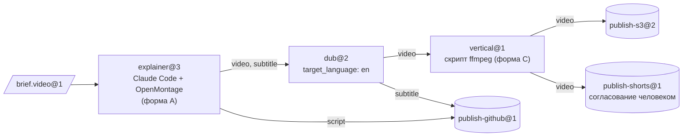
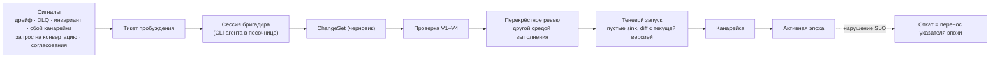

[English](README.md) | [日本語](README_ja.md) | [한국어](README_ko.md) | [Français](README_fr.md) | [Deutsch](README_de.md) | [Español](README_es.md) | [Português (BR)](README_pt-BR.md) | **Русский** | [简体中文](README_zh-CN.md)

<p align="center">
  
</p>

<p align="center">
  <strong>Превратите продукты с открытым исходным кодом в машины, существующих CLI-агентов — в операторов, а их результаты — в типизированный, проверенный материал для следующей станции.</strong>
</p>

<p align="center">
  
  
  
  
  
</p>

<p align="center">
  <a href="#пример-запуска">Пример запуска</a> ·
  <a href="#быстрый-старт">Быстрый старт</a> ·
  <a href="#как-это-работает">Как это работает</a> ·
  <a href="#архитектура">Архитектура</a> ·
  <a href="#управление-и-бригадир">Управление</a> ·
  <a href="#cli-вкратце">CLI</a> ·
  <a href="docs/ru/README.md">Документация</a>
</p>

---

> **Что это такое?** Плоскость управления фабрикой. В ней нет ни одного агента, и она никогда не обращается к API моделей. Весь интеллект дают CLI-агенты, которыми вы уже пользуетесь (Claude Code в headless-режиме, Codex, …); они работают внутри песочниц Docker. Всё, что происходит *между* станциями, — маршрутизация, проверка типов, преобразование, хранение, планирование, бюджеты, согласования и управление изменениями — реализовано детерминированным кодом.

Продукты, изначально построенные вокруг агента, такие как [OpenMontage](https://github.com/OpenMontageInc/OpenMontage), отдают агенту весь конвейер целиком. Machine Agent Org работает уровнем выше: он рассматривает такие продукты как **машины** на производственной линии. Каждой машиной на **станции** управляет агент-**оператор**. То, что производит станция, проверяется, запечатывается и передаётся следующей станции как входные данные, пока **sink** (станция публикации) не опубликует результат в S3, GitHub, YouTube или куда-либо ещё.

| Заводской термин | Что это здесь | Пример |
|---|---|---|
| **Bean** (единица материала) | Неизменяемая порция материала с адресацией по содержимому, типом и историей происхождения | `note.text@1`, `video.mp4@1`, `brief.video@1` |
| **Machine** (машина) | Существующий продукт, описанный *Machine Package* | OpenMontage, MoneyPrinterTurbo, ffmpeg, rclone |
| **Operator** (оператор) | Тот, кто управляет машиной | Claude Code в headless-режиме, Codex, скрипт, входящие у человека |
| **Station** (станция) | Recipe × Operator × Policy, с типизированными портами | `explainer@3`, `dub@2`, `publish-s3@2` |
| **Line** (линия) | Типизированный DAG из станций с ограниченной динамической структурой | `explainer-multilang@5` |
| **Source / Sink** | Станции, которые принимают данные извне / публикуют их вовне | приём через webhook / S3, GitHub, YouTube |
| **Foreman** (бригадир) | Внешний агент, который обслуживает фабрику через проверенные ChangeSet | сессия Claude Code или Codex |

---

## Пример запуска

Ниже — реальный запуск `note-pipeline@1` из реестра фикстур. Он использует локальный провайдер песочниц и сценарного фейкового агента из `tests/fakes/`, поэтому ему не нужны ни Docker, ни ключ модели. CLI выводит JSON; на картинке он показан в сжатом виде.

<p align="center">
  
</p>

Обратите внимание на то, о чём никто не просил. `write@1` выдаёт `note.raw@1`, а `upper@1` требует `note.text@1`. Компилятор структуры нашёл станцию-конвертер и вставил узел `upper.in.note~note-to-text@1`, а история происхождения запуска это фиксирует. Четыре задания запечатаны, запуск стоил 0,02 $ при лимите 5,00 $ и закреплён за эпохой (epoch — зафиксированная версия структуры) `e-f4f97580bd8ee4a4`, так что изменение структуры посреди запуска на него не повлияет.

Пошаговое воспроизведение описано в [docs/ru/getting-started.md](docs/ru/getting-started.md).

---

## Быстрый старт

### Требования

- **Python 3.12+** и **[uv](https://docs.astral.sh/uv/)**
- **Docker** (необязательно): нужен для провайдера песочниц `docker`, используемого по умолчанию, и для уровней тестов с Docker. Всё, что описано в этом README, работает и с `--provider local`.
- **CLI агента** (необязательно): Claude Code или Codex для настоящих станций. Тесты вместо них используют сценарного фейкового агента.

### Установка и проверка

```bash
git clone https://github.com/rywsl/Company-Machine.git
cd Company-Machine
uv sync

uv run factory --version
uv run mrl --version
uv run python tools/harness.py doctor     # проверяет окружение
uv run python tools/harness.py status     # вехи и контрольные точки этапов
uv run python tools/harness.py pytest tests/acceptance/m1   # 98 тестов, ~1 мин
```

### Первая линия

```bash
# 1. Скомпилировать реестр (код 0 = ошибок нет, 3 = реестр некорректен)
uv run factory check tests/fixtures/registry-m2

# 2. Импортировать материал, спланировать и запустить линию
uv run factory --root .factory --registry <registry> --provider local --local-commands commands.json \
    bean import --type agent.task@1 --file task.json=./task.json
uv run factory ... line plan note-pipeline@1
uv run factory ... line run  note-pipeline@1 --in task=sha256:...

# 3. Посмотреть результат
uv run factory ... line nodes <run-id>
uv run factory ... bean lineage --direction up <bean-id>
uv run factory ... status
```

`commands.json` сопоставляет имена команд из рецептов машин с командами хоста для локального провайдера. Руководство «Начало работы» генерирует такой файл из тестовых фикстур. Для работы без присмотра запустите демон и консоль только для чтения:

```bash
uv run factory serve                 # триггеры, запуски, задания, управление, аудит, канарейки, тикеты пробуждения
uv run factory console               # http://127.0.0.1:8090, токен в $FACTORY_ROOT/console.token
```

---

## Как это работает

<p align="center">
  
</p>

**Задание** (job) — это один запуск станции. Runner проверяет входные данные, затем готовит песочницу: без root, `cap-drop ALL`, входные данные смонтированы только для чтения и никогда — `docker.sock`. Он пишет для оператора **Station Brief** и запускает CLI оператора в headless-режиме. Оператор работает с машиной и общается с фабрикой только через `factoryctl`. Когда он заканчивает, **выходной контроль** (gate) проверяет результат в четыре шага: структура, валидатор, выражения приёмки на MRL и необязательный судья. Прошедший проверку результат запечатывается на склад с адресацией по содержимому вместе с историей происхождения.



<sub>Пример линии: `spec/examples/registry/lines/explainer-multilang.yaml`. Её запускает поступление brief с меткой `line=explainer-multilang`, а лимит бюджета составляет 12 $.</sub>

**Жизненный цикл задания.** `PENDING → PROVISIONING → RUNNING ⇄ AWAITING_APPROVAL → GATING → SEALED`.
- **Отклонённое** задание повторяется с замечаниями выходного контроля.
- **Упавшее** задание повторяется с нуля или возобновляется.
- Задание, исчерпавшее попытки, переходит в **DEAD** и попадает в очередь мёртвых писем (DLQ).

Дорогие станции и все sink работают в две фазы: сначала *propose* с оценкой стоимости, затем *execute* после согласования.

---

## Архитектура

<p align="center">
  
</p>

| Уровень | Ответственность | Основной код |
|---|---|---|
| **Ядро** | Метамодель, компилятор структуры, инварианты конституции, журнал событий. Меняется редко. | `src/mrl/` (язык MRL + профиль фабрики) |
| **Структура** | Реестр в Git. Типы, машины, операторы, станции, линии и политики — всё это Spec, версионируемые по **эпохам**. | `mao.snapshot`, `mao.governance.epochs` |
| **Среда выполнения** | Планировщик, исполнитель линий, конечный автомат заданий, песочницы, выходной контроль, склад, кеш, аренды. | `mao.runner`, `mao.runs`, `mao.dynamic`, `mao.scheduler`, `mao.gate`, `mao.warehouse` |
| **Адаптеры** | Пакеты машин, среды выполнения операторов, песочницы Docker/Local, коннекторы, шлюз сервисов, прокси исходящего трафика и моделей, бэкенды хранения. | `mao.sandbox`, `mao.operator`, `mao.gateway`, `mao.egress`, `mao.backends` |
| **Управление** | Конвейер проверки, аудит инвариантов, мониторинг дрейфа, согласователь состояния, теневые и канареечные выкатки, бригадир. | `mao.governance.*`, `mao.reconcile`, `mao.supervisor`, `mao.daemon` |

**Шесть уровней проверки.** Каждый уровень выполняется в строго определённый момент и отказывает строго определённым образом:

| Уровень | Что проверяет | Когда |
|---|---|---|
| V1 Spec | схема, ссылки, закреплённые версии, линт политик | при каждом предложении |
| V2 Структура | типы рёбер, отсутствие циклов, обязательные входы, потребление каждого продукта, бюджеты, динамические ограничения | при предложении и перед каждым запуском |
| V3 Эволюция | совместимость, контракты нижестоящих потребителей, радиус поражения | при предложении |
| V4 Контрактные тесты | соответствие машин, эталонные brief, конвертация туда и обратно, пробные прогоны sink | при предложении и в плановых канареечных запусках |
| V5 Среда выполнения | проверка на входе и выходной контроль, проверка квитанций sink | в каждом задании |
| V6 Непрерывная | аудит инвариантов, дрейф, целостность CAS и истории происхождения, согласование состояния | периодически и по событиям |

**Динамическая структура остаётся ограниченной.** Линия может содержать `map` (по `list<T>`, с `max_items` и `max_parallel`), `switch` (исчерпывающий, с ветвью по умолчанию), `until` (с максимальным числом итераций) и `subline`. Станция-**планировщик** (planner) может выдать `Plan`. Прежде чем выполнится хоть какая-то его часть, план компилируется проверками V1/V2 и сверяется с `plan_bounds` станции (разрешённые станции и sink, число шагов, ветвление, глубина, бюджет).

<details>
<summary><b>Карта модулей <code>src/mao</code></b></summary>

| Область | Модули |
|---|---|
| Основа | `base` `errors` `db` `context` `values` `migrations/` |
| Структура и управление | `snapshot` `contract` `governance/{epochs,changesets,risk,rollout,shadow}` `reconcile` |
| Исполнение | `jobs` `runner` `runplan` `runs` `dynamic` `scheduler` `cache` `durable` `approvals` |
| Материалы | `warehouse` `gate` `retention` `backup` |
| Адаптеры | `sandbox` `operator` `brief` `ctl/factoryctl` `gateway` `connectors` `egress` `images` `backends` |
| Автономность | `daemon` (`factory serve`) `supervisor` `foreman` `mcp` |
| Наблюдаемость | `status` `console` |
| CLI | `cli` `commands/*` |

</details>

---

## Управление и бригадир

Фабрику обслуживает **бригадир** (Foreman) — обычная сессия Claude Code или Codex. Бригадира будят сигналы, и он работает через CLI `factory foreman` или MCP-сервер (`factory mcp --role foreman`). Он может предлагать изменения, но будет ли изменение выпущено, решает детерминированный код.



| Уровень | Типичное изменение | Что требуется |
|---|---|---|
| T0 | повтор, карантин | автоматически |
| T1 | настройка шаблона, новый конвертер, минорное повышение версии типа | проверка + теневой запуск |
| T2 | новая или обновлённая машина, новая линия, мажорное повышение версии типа | + канарейка + перекрёстное ревью |
| T3 | новый source/sink, выход в сеть или привязка учётных данных, политика, вывод из эксплуатации | + согласование человеком |
| T4 | конституция | только люди |

Уровень риска конвейер вычисляет по diff, и бригадир не может его понизить. Бригадир не может редактировать конституцию или запечатанные Bean, читать секреты, пропускать проверку или входить в песочницу.

---

## Формы интеграции

| Форма | Примеры машин | Как размещается оператор |
|---|---|---|
| **A** Рабочее пространство, построенное вокруг агента | OpenMontage | в той же песочнице, рабочий каталог = рабочее пространство продукта |
| **B** Сервис | MoneyPrinterTurbo, ComfyUI | шлюз сервисов фабрики превращает API в цепочку *submit → poll → fetch* |
| **C** Инструмент | ffmpeg, rclone, git | станция-скрипт вызывает его напрямую |

В `spec/examples/registry/` OpenMontage, MoneyPrinterTurbo, ffmpeg, rclone, git, приём через webhook и загрузчик на YouTube описаны как пакеты машин.

---

## CLI вкратце

Две точки входа: `factory` (плоскость управления) и `mrl` (инструментарий языка отношений). Глобальные параметры: `--root`, `--registry`, `--provider {docker,local}`, `--epoch` и `--json`. Значения по умолчанию задают переменные окружения `FACTORY_ROOT` и `FACTORY_REGISTRY`.

| Группа | Команды |
|---|---|
| Структура | `check` · `epoch {init,ls,show,rollback,adopt}` · `changeset {propose,ls,show,withdraw,advance}` · `contract …` · `governance {tick,safe-mode}` |
| Материал | `bean {import,lineage,label}` · `cache {ls,explain,invalidate}` · `gc [--dry-run]` |
| Исполнение | `job {run,show,exec}` · `line {plan,run,ls,show,nodes,cancel,retry,rebuild}` · `trigger process` · `schedule {tick,dlq,quarantine,release}` · `approval {ls,show,decide}` |
| Интеграция | `image {build,ls}` · `gateway manifest` · `egress check` · `secret ls` · `backend {status,migrate,verify}` · `backup {create,verify,restore}` |
| Автономность | `serve [--once]` · `foreman …` · `mcp --role {foreman,reviewer}` · `maintain bootstrap` · `audit` · `drift ls` |
| Наблюдаемость | `status` · `metrics` · `events` · `console` |

Коды выхода: `0` успех · `1` прикладная ошибка · `2` неверное использование · `3` некорректный реестр · `4` окружение (например, нет Docker) · `5` внутренняя ошибка. Полный справочник — в [docs/ru/cli.md](docs/ru/cli.md).

---

## Состояние проекта

Все десять вех завершены, все контрольные точки этапов пройдены. Контрольная точка M9 прогнала линт, проверку форматирования, проверки документации, тесты соответствия и **1448 тестов** — ни одного сбоя и ни одного пропуска. Несколько недоработок в среде выполнения пока остаются открытыми; см. [Среда выполнения · Известные недоработки](docs/ru/runtime.md#6-известные-недоработки-2026-11-13).

| Веха | Что сделано |
|---|---|
| M0 | язык MRL, компилятор структуры, конституция |
| M1 | одна станция от начала до конца: снимок, склад, песочница, `factoryctl`, выходной контроль, оператор, runner, CLI |
| M2 | линии, source и sink, кеш, DLQ, согласования, V3/V4 |
| M3 | эпохи, конвейер ChangeSet, теневые и канареечные запуски, согласователь состояния, дрейф, бригадир |
| M4 | динамическая структура, планы, шлюз сервисов, промышленные бэкенды |
| M5 | контур автономности: надёжное исполнение, `serve`, MCP, надзор за бригадиром |
| M6 | настоящие CLI агентов в Docker, образы, собранные бригадиром |
| M7 | наблюдаемость, консоль, сроки хранения, резервное копирование и восстановление |
| M8 | усиление прокси исходящего трафика, отказоустойчивый `serve` |
| M9 | возможности M4 доведены до промышленного пути (S3 SigV4, Postgres через `psql`, …) |

---

## Структура репозитория

```
src/mrl/          MRL: лексер, парсер, проверка, вычислитель, правила, профиль фабрики
src/mao/          плоскость управления фабрикой (пакет `mao`, CLI `factory`)
spec/             нормативные спецификации: MRL 1.0, профиль фабрики, схемы, системные спецификации, пример реестра
plan/             вехи, карточки задач, контрольные точки этапов, ревью, блокировка защищённых файлов
tests/            приёмочные тесты по вехам, системные тесты, фейки, реестры фикстур
tools/            harness.py (исполнитель задач и контрольных точек), сборщики образов, хуки
docs/             архитектурный проект (zh-CN), руководства на разных языках, диаграммы
```

---

## Документация

| | Русский |
|---|---|
| Оглавление документации | [docs/ru/README.md](docs/ru/README.md) |
| Начало работы | [docs/ru/getting-started.md](docs/ru/getting-started.md) |
| Основные понятия | [docs/ru/concepts.md](docs/ru/concepts.md) |
| Среда выполнения | [docs/ru/runtime.md](docs/ru/runtime.md) |
| Справочник CLI | [docs/ru/cli.md](docs/ru/cli.md) |
| Разработка | [docs/ru/development.md](docs/ru/development.md) |

Другие языки: [English](docs/en/README.md) · [日本語](docs/ja/README.md) · [한국어](docs/ko/README.md) · [Français](docs/fr/README.md) · [Deutsch](docs/de/README.md) · [Español](docs/es/README.md) · [Português (BR)](docs/pt-BR/README.md) · [简体中文](docs/zh-CN/README.md)

Полный архитектурный проект (на китайском) — [docs/architecture.md](docs/architecture.md). Нормативные спецификации находятся в [spec/system/](spec/system/README.md).

---

## Участие в разработке

Работа ведётся с разделением ролей на проектировщика и исполнителя, и `tools/harness.py` следит за его соблюдением. Спецификации, карточки задач и приёмочные тесты защищены `plan/protected.lock`; перерегистрировать их может только человек. Исполнители берут задачу через `harness task next`, реализуют её по спецификации и подтверждают результат командой `harness accept <ID>`. Прежде чем предлагать изменение, прочитайте [AGENTS.md](AGENTS.md) и [docs/ru/development.md](docs/ru/development.md).

## Лицензия

Файл лицензии пока не добавлен. До его появления все права принадлежат авторам.
