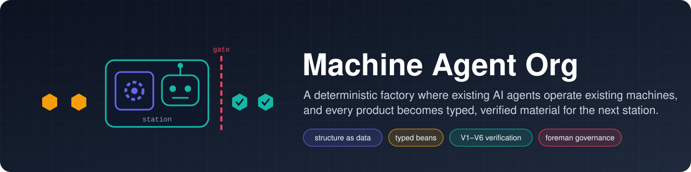
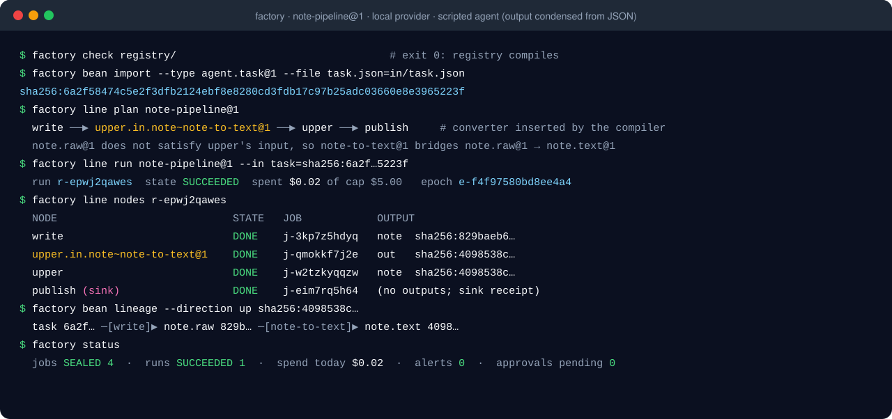
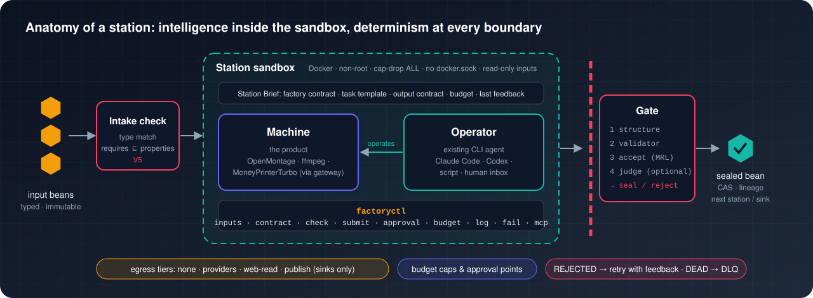
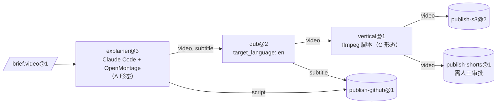
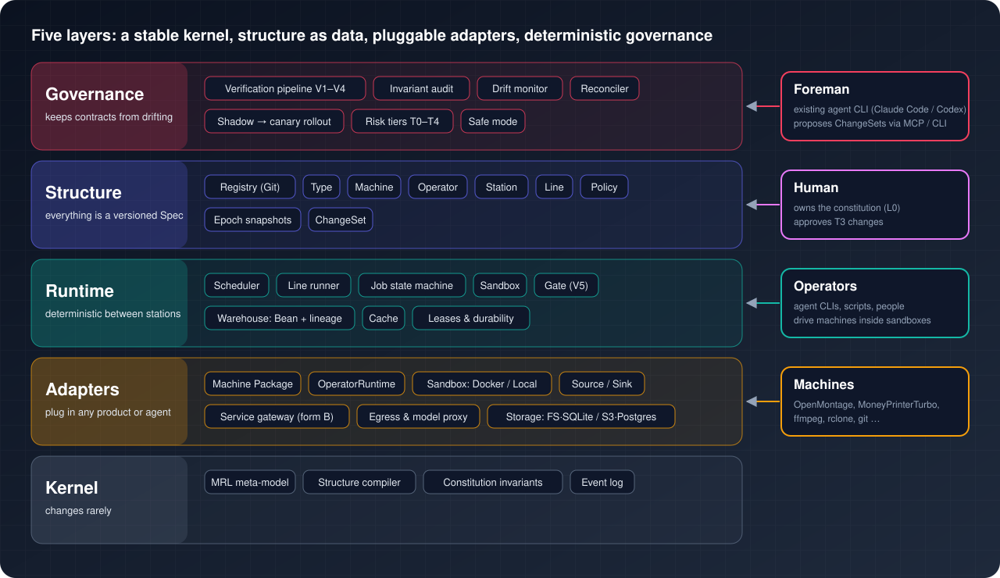
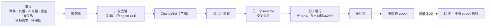

[English](README.md) | [日本語](README_ja.md) | [한국어](README_ko.md) | [Français](README_fr.md) | [Deutsch](README_de.md) | [Español](README_es.md) | [Português (BR)](README_pt-BR.md) | [Русский](README_ru.md) | **简体中文**

<p align="center">
  
</p>

<p align="center">
  <strong>把开源产品变成机器，把现成的 CLI agent 变成操作工，把它们的产出变成下一站可用的、带类型且经过检验的物料。</strong>
</p>

<p align="center">
  
  
  
  
</p>

<p align="center">
  <a href="#实际运行">实际运行</a> ·
  <a href="#快速开始">快速开始</a> ·
  <a href="#工作原理">工作原理</a> ·
  <a href="#架构">架构</a> ·
  <a href="#治理与厂长">治理</a> ·
  <a href="#命令行一览">命令行</a> ·
  <a href="docs/zh-CN/README.md">文档</a>
</p>

---

> **这是什么？** 一个工厂控制面。它本身不包含任何 agent，也从不调用模型 API。所有智能都来自你已经在用的官方 CLI agent（Claude Code 无头模式、Codex……），它们运行在受控的 Podman 或 Kiri 沙箱里。工位**之间**的一切，包括路由、类型检查、转换、存储、调度、预算、审批和变更控制，都由确定性代码完成。

[OpenMontage](https://github.com/OpenMontageInc/OpenMontage) 这类“智能体原生”产品让 agent 掌控整条流水线。Machine Agent Org 工作在它的上一层：把这类产品当作产线上的**机器**，每台机器在一个**工位**上由 agent **操作工**驱动。一个工位的产物经检验、封存后交给下一个工位作为物料，直到**消费者（Sink）**把结果发布到 S3、GitHub、YouTube 或其他地方。

| 工厂术语 | 在本项目中的含义 | 例子 |
|---|---|---|
| **Bean（物料）** | 不可变、内容寻址、带类型和血缘的一份物料 | `note.text@1`、`video.mp4@1`、`brief.video@1` |
| **Machine（机器）** | 用 *Machine Package* 描述的现成产品 | OpenMontage、MoneyPrinterTurbo、ffmpeg、rclone |
| **Operator（操作工）** | 驱动机器的一方 | Claude Code 无头模式、Codex、脚本、人工收件箱 |
| **Station（工位）** | Recipe × Operator × Policy，端口带类型 | `explainer@3`、`dub@2`、`publish-s3@2` |
| **Line（产线）** | 由工位组成、带类型的 DAG，可含受限的动态结构 | `explainer-multilang@5` |
| **Source / Sink** | 从外部摄入 / 向外部发布的工位 | webhook 摄入 / S3、GitHub、YouTube |
| **Foreman（厂长）** | 通过经过验证的 ChangeSet 维护工厂的外部 agent | 一个 Claude Code 或 Codex 会话 |

---

## 实际运行

下面是 fixture registry 中 `note-pipeline@1` 的一次真实运行。它使用本地测试提供者和脚本化 fake agent，所以不需要启动 Podman 或 Kiri，也不需要模型密钥。CLI 输出的是 JSON，图中做了精简。

<p align="center">
  
</p>

注意那个没人要求的节点。`write@1` 产出的是 `note.raw@1`，但 `upper@1` 要求 `note.text@1`。结构编译器找到了一个转换工位，插入节点 `upper.in.note~note-to-text@1`，run 的血缘里也记录了它。四个 job 全部封存，花费 $0.02（上限 $5.00）。run 固定在 epoch `e-f4f97580bd8ee4a4` 上，运行期间的结构变更不会影响它。

逐步复现见 [docs/zh-CN/getting-started.md](docs/zh-CN/getting-started.md)。

---

## 快速开始

### 前置条件

- **Bun** 和 **TypeScript**
- **Podman 或 Kiri**：活动 Bun runtime。Linux 下设置 `MAO_CONTAINER_RUNTIME=kiri` 即可使用官方 Kiri headless 服务。
- **agent CLI**（可选）：真实工位用 Claude Code 或 Codex；测试用脚本化的 fake agent 代替。

### 安装与验证

```bash
git clone https://github.com/rywsl/Company-Machine.git
cd Company-Machine
bun install
bun run verify:bun                       # 检查活动 Bun 实现
```

### 第一条产线

```bash
# 1. 查看活动 Bun 控制面
bun run factory status

# 2. 交给厂长搭建业务系统
bun run factory project intake --name "视频生产系统" --repo https://example.test/repo.git

# 3. 使用 Web App
bun run backend/src/index.ts
```

项目来源、Operator、Machine、DAG、物料血缘、Foreman 对话、项目资源请求和运行时状态都从 Bun Web App 管理。Python 产线 CLI 和旧夹具保存在 `removed/python/`。

---

## 工作原理

<p align="center">
  
</p>

一个 **job** 就是工位的一次运行。

1. Runner 先做来料检验。
2. Runner 创建沙箱：非 root，`cap-drop ALL`，输入只读挂载，永不挂载 `docker.sock`。
3. Runner 为操作工写好 **Station Brief**，并以无头方式启动操作工的 CLI。
4. 操作工驱动机器，只通过 `factoryctl` 与工厂交互。
5. 操作工结束后，**出厂检验（Gate）**依次检查结构、validator、用 MRL 写的验收表达式，以及可选的 judge。
6. 通过检验的产物连同血缘一起封存进内容寻址的仓库。



<sub>示例产线 `spec/examples/registry/lines/explainer-multilang.yaml`：带 `line=explainer-multilang` 标签的 brief 到达即触发，预算上限 $12。</sub>

**Job 生命周期：** `PENDING → PROVISIONING → RUNNING ⇄ AWAITING_APPROVAL → GATING → SEALED`。
- 被**退回**（REJECTED）时，带着出厂检验的反馈重试。
- **失败**（FAILED）时，从头重试或续跑。
- 超过重试上限进入 **DEAD**，即死信队列。

高成本工位和所有 Sink 都分两阶段：先 *propose*（附成本预估），审批后再 *execute*。

---

## 架构

<p align="center">
  
</p>

| 层 | 职责 | 主要代码 |
|---|---|---|
| **内核** | MRL 表达式、规则求值、业务记录和事件日志 | `backend/mrl/`、`backend/src/models.ts`、`backend/src/event-bus.ts` |
| **业务结构层** | 业务系统、Operator、Machine、物料和 DAG 记录 | `backend/src/db.ts`、`backend/src/models.ts` |
| **运行层** | 业务运行调度、前置物料检查、产物记录、实时事件 | `backend/src/server.ts`、`backend/src/foreman.ts` |
| **适配层** | 官方 Harness/ACP、受控 Podman/Kiri、项目接入 | `backend/src/harness.ts`、`backend/src/acp.ts`、`backend/runtime/` |
| **治理层** | 外部厂长对话、密钥请求状态和用户可见投影 | `backend/src/foreman.ts`、`backend/src/vault.ts`、`frontend/src/` |

**六层验证。** 每一层都有固定的执行时机和固定的失败后果：

| 层 | 检查内容 | 时机 |
|---|---|---|
| V1 规格校验 | schema、引用、版本固定、策略 lint | 每次提交变更 |
| V2 结构编译 | 边类型、无环、必填输入、产物有去处、预算、动态结构上限 | 提交变更时，以及每次运行前 |
| V3 演进校验 | 兼容性、下游消费者契约、影响面 | 提交变更时 |
| V4 契约测试 | 机器 conformance、黄金 brief、converter 往返、Sink 演练 | 提交变更时，以及定时金丝雀 |
| V5 运行时检验 | 来料检验与出厂检验、Sink 回执核验 | 每个 job |
| V6 持续校验 | 不变量审计、漂移、CAS 与血缘完整性、调和 | 周期运行，并由事件触发 |

**动态结构有界。** 产线可以使用以下动态构造：
- `map`：对 `list<T>` 展开，受 `max_items` 和 `max_parallel` 约束；
- `switch`：分支必须穷尽，并带 default；
- `until`：有最大迭代次数；
- `subline`：嵌套调用另一条产线。

**planner** 工位可以产出 `Plan`。Plan 中的任何部分运行之前，都要先经 V1/V2 编译，并对照该工位的 `plan_bounds` 检查（允许的工位与 Sink、步数、扇出、深度、预算）。

<details>
<summary><b><code>backend/</code> 模块地图</b></summary>

| 领域 | 模块 |
|---|---|
| 业务模型与持久化 | `src/models.ts` `src/db.ts` `src/event-bus.ts` |
| 厂长与官方 Harness | `src/foreman.ts` `src/harness.ts` `src/acp.ts` `src/operator.ts` |
| 运行时 | `runtime/podman.ts` `runtime/kiri.ts` |
| MRL | `mrl/` |
| Web API 与 CLI | `src/server.ts` `src/cli.ts` |

</details>

---

## 治理与厂长

工厂由**厂长**维护。厂长就是一个普通的 Claude Code 或 Codex 会话，由信号唤醒，通过 `factory foreman` CLI 或 MCP 服务（`factory mcp --role foreman`）工作。厂长可以提出变更，但变更能否上线由确定性代码决定。



| 等级 | 典型变更 | 要求 |
|---|---|---|
| T0 | 重试、隔离 | 自动执行 |
| T1 | 模板调优、新增 converter、类型 minor 升级 | 验证 + 影子运行 |
| T2 | 接入或升级机器、新建产线、类型 major 升级 | 再加金丝雀 + 交叉复核 |
| T3 | 新增 Source/Sink、出网或凭据绑定、策略、退役 | 再加人工审批 |
| T4 | 宪法 | 只能由人修改 |

风险等级由流水线根据 diff 计算，厂长不能降级。厂长不能修改宪法或已封存的 Bean，不能读取密钥，不能跳过验证，也不能进入沙箱。

---

## 接入形态

| 形态 | 机器示例 | 操作工如何放置 |
|---|---|---|
| **A** 智能体原生工作区 | OpenMontage | 与产品同一个沙箱，工作目录指向产品的工作区 |
| **B** 服务型 | MoneyPrinterTurbo、ComfyUI | 工厂的服务网关把 API 统一成“提交 → 轮询 → 取回” |
| **C** 工具型 | ffmpeg、rclone、git | 脚本工位直接调用 |

`spec/examples/registry/` 用机器包描述了 OpenMontage、MoneyPrinterTurbo、ffmpeg、rclone、git、webhook 摄入和 YouTube 上传。

---

## 命令行一览

活动入口是 Bun 的 `factory` CLI、`mrl` CLI 和 Web App。业务命令使用 `business`、`project`、`foreman`、`runtime` 等分组，官方 Harness 由控制面分配，不由项目自建。历史 Python 命令保存在 `removed/python/`。

| 分组 | 命令 |
|---|---|
| 运行时 | `serve` · `status` · `runtime status` · `runtime ensure-ready` |
| 项目 | `project intake --name NAME --repo URL`、`--folder PATH` 或 `--file-ref REF` |
| 业务系统 | `business units|run|runs|export|graph|artifact|conversion` |
| 厂长 | `foreman inbox|claim|done` · `talk send|reply` |
| Registry | `registry check PATH [--json]` |
| MRL | `mrl eval|template|check|run` |

退出码：
- `0` 成功
- `1` 业务失败
- `2` 用法错误
- `3` Registry 不合法
- `4` 环境错误（如 Podman 或 Kiri 不可用）
- `5` 内部错误

活动 CLI 退出码为 `0` 成功、`1` 业务或请求失败、`2` 用法错误、`4` 运行时不可用。完整参考见 [docs/zh-CN/cli.md](docs/zh-CN/cli.md)。

---

## 项目状态

当前代码和 spec 的活动一致性检查命令是 `bun run verify:bun`。下面的里程碑说明作为项目历史背景保留，Python 实现与旧验收位于 `removed/python/`。

| 里程碑 | 交付 |
|---|---|
| M0 | MRL 语言、结构编译器、宪法 |
| M1 | 单工位端到端：快照、仓库、沙箱、`factoryctl`、出厂检验、操作工、Runner、命令行 |
| M2 | 产线、Source/Sink、缓存、死信、审批、V3/V4 |
| M3 | epoch、ChangeSet 流水线、影子运行与金丝雀、调和器、漂移、厂长 |
| M4 | 动态结构、Plan、服务网关、生产后端 |
| M5 | 自治闭环：持久化执行、`serve`、MCP、厂长值守 |
| M6 | 受控 Podman/Kiri 中的真实 agent CLI、厂长构建镜像 |
| M7 | 可观测性、控制台、保留期、备份与恢复 |
| M8 | 出网代理加固、`serve` 韧性 |
| M9 | M4 的能力在生产路径上闭环（S3 SigV4、经 `psql` 的 Postgres……） |

---

## 仓库结构

```
backend/mrl/      Bun MRL：词法、语法、检查器、求值器和规则
backend/src/      Bun 工厂控制面、业务 API、厂长和官方 Harness 分配
backend/runtime/  Podman 与 Kiri 运行时适配
frontend/         Web App 与图形化业务投影
removed/python/   历史 Python 实现、旧 CLI、旧验收和旧夹具
spec/             规范：MRL 1.0、工厂 profile、schema、系统规范、示例 registry
plan/             historical design, task and review material
tests/            spec-linked acceptance tests, system tests and fixtures
tools/            verify harness and build utilities
docs/             架构设计（中文）、多语言指南、图示
```

---

## 文档

| | 简体中文 |
|---|---|
| 文档索引 | [docs/zh-CN/README.md](docs/zh-CN/README.md) |
| 快速上手 | [docs/zh-CN/getting-started.md](docs/zh-CN/getting-started.md) |
| 核心概念 | [docs/zh-CN/concepts.md](docs/zh-CN/concepts.md) |
| 运行时 | [docs/zh-CN/runtime.md](docs/zh-CN/runtime.md) |
| 命令行参考 | [docs/zh-CN/cli.md](docs/zh-CN/cli.md) |
| 开发流程 | [docs/zh-CN/development.md](docs/zh-CN/development.md) |

其他语言：[English](docs/en/README.md) · [日本語](docs/ja/README.md) · [한국어](docs/ko/README.md) · [Français](docs/fr/README.md) · [Deutsch](docs/de/README.md) · [Español](docs/es/README.md) · [Português (BR)](docs/pt-BR/README.md) · [Русский](docs/ru/README.md)

完整的架构设计见 [docs/architecture.md](docs/architecture.md)，规范性文档在 [spec/system/](spec/system/README.md)。

---

## 参与贡献

当前开发流程允许代码、spec 和验收测试一起演进。提交或推送前运行 `bun run verify:bun`。一致性检查见 [AGENTS.md](AGENTS.md) 和 [docs/zh-CN/development.md](docs/zh-CN/development.md)。

## 许可证

仓库尚未添加许可证文件。在添加之前，作者保留所有权利。
