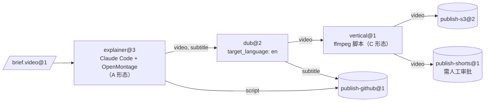
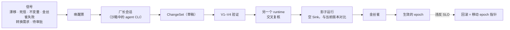

[English](README.md) | [日本語](README_ja.md) | [한국어](README_ko.md) | [Français](README_fr.md) | [Deutsch](README_de.md) | [Español](README_es.md) | [Português (BR)](README_pt-BR.md) | [Русский](README_ru.md) | **简体中文**

<p align="center">
  
</p>

<p align="center">
  <strong>把开源产品变成机器，把现成的 CLI agent 变成操作工，把它们的产出变成下一站可用的、带类型且经过检验的物料。</strong>
</p>

<p align="center">
  
  
  
  
  
</p>

<p align="center">
  <a href="#实际运行">实际运行</a> ·
  <a href="#快速开始">快速开始</a> ·
  <a href="#工作原理">工作原理</a> ·
  <a href="#架构">架构</a> ·
  <a href="#治理与厂长">治理</a> ·
  <a href="#命令行一览">命令行</a> ·
  <a href="docs/zh-CN/README.md">文档</a>
</p>

---

> **这是什么？** 一个工厂控制面。它本身不包含任何 agent，也从不调用模型 API。所有智能都来自你已经在用的 CLI agent（Claude Code 无头模式、Codex……），它们运行在 Docker 沙箱里。工位**之间**的一切，包括路由、类型检查、转换、存储、调度、预算、审批和变更控制，都由确定性代码完成。

[OpenMontage](https://github.com/OpenMontageInc/OpenMontage) 这类“智能体原生”产品让 agent 掌控整条流水线。Machine Agent Org 工作在它的上一层：把这类产品当作产线上的**机器**，每台机器在一个**工位**上由 agent **操作工**驱动。一个工位的产物经检验、封存后交给下一个工位作为物料，直到**消费者（Sink）**把结果发布到 S3、GitHub、YouTube 或其他地方。

| 工厂术语 | 在本项目中的含义 | 例子 |
|---|---|---|
| **Bean（物料）** | 不可变、内容寻址、带类型和血缘的一份物料 | `note.text@1`、`video.mp4@1`、`brief.video@1` |
| **Machine（机器）** | 用 *Machine Package* 描述的现成产品 | OpenMontage、MoneyPrinterTurbo、ffmpeg、rclone |
| **Operator（操作工）** | 驱动机器的一方 | Claude Code 无头模式、Codex、脚本、人工收件箱 |
| **Station（工位）** | Recipe × Operator × Policy，端口带类型 | `explainer@3`、`dub@2`、`publish-s3@2` |
| **Line（产线）** | 由工位组成、带类型的 DAG，可含受限的动态结构 | `explainer-multilang@5` |
| **Source / Sink** | 从外部摄入 / 向外部发布的工位 | webhook 摄入 / S3、GitHub、YouTube |
| **Foreman（厂长）** | 通过经过验证的 ChangeSet 维护工厂的外部 agent | 一个 Claude Code 或 Codex 会话 |

---

## 实际运行

下面是 fixture registry 中 `note-pipeline@1` 的一次真实运行。它使用本地沙箱提供者和 `tests/fakes/` 里的脚本化 fake agent，所以不需要 Docker，也不需要模型密钥。CLI 输出的是 JSON，图中做了精简。

<p align="center">
  
</p>

注意那个没人要求的节点。`write@1` 产出的是 `note.raw@1`，但 `upper@1` 要求 `note.text@1`。结构编译器找到了一个转换工位，插入节点 `upper.in.note~note-to-text@1`，run 的血缘里也记录了它。四个 job 全部封存，花费 $0.02（上限 $5.00）。run 固定在 epoch `e-f4f97580bd8ee4a4` 上，运行期间的结构变更不会影响它。

逐步复现见 [docs/zh-CN/getting-started.md](docs/zh-CN/getting-started.md)。

---

## 快速开始

### 前置条件

- **Python 3.12+** 和 **[uv](https://docs.astral.sh/uv/)**
- **Docker**（可选）：默认的 `docker` 沙箱提供者和 Docker 测试层需要它。本文所有内容也可以用 `--provider local` 运行。
- **agent CLI**（可选）：真实工位用 Claude Code 或 Codex；测试用脚本化的 fake agent 代替。

### 安装与验证

```bash
git clone https://github.com/rywsl/Company-Machine.git
cd Company-Machine
uv sync

uv run factory --version
uv run mrl --version
uv run python tools/harness.py doctor     # 检查环境
uv run python tools/harness.py status     # 里程碑与阶段门
uv run python tools/harness.py pytest tests/acceptance/m1   # 98 个测试，约 1 分钟
```

### 第一条产线

```bash
# 1. 编译 registry（退出码 0 = 无错误，3 = 不合法）
uv run factory check tests/fixtures/registry-m2

# 2. 导入物料，规划并运行产线
uv run factory --root .factory --registry <registry> --provider local --local-commands commands.json \
    bean import --type agent.task@1 --file task.json=./task.json
uv run factory ... line plan note-pipeline@1
uv run factory ... line run  note-pipeline@1 --in task=sha256:...

# 3. 查看
uv run factory ... line nodes <run-id>
uv run factory ... bean lineage --direction up <bean-id>
uv run factory ... status
```

`commands.json` 是本地提供者用的命令映射，把配方里的命令名对应到宿主机命令。快速上手指南会从测试夹具生成它。无人值守运行时，启动守护进程和只读控制台：

```bash
uv run factory serve                 # 触发、run、job、治理、审计、金丝雀、唤醒票
uv run factory console               # http://127.0.0.1:8090，令牌在 $FACTORY_ROOT/console.token
```

---

## 工作原理

<p align="center">
  
</p>

一个 **job** 就是工位的一次运行。

1. Runner 先做来料检验。
2. Runner 创建沙箱：非 root，`cap-drop ALL`，输入只读挂载，永不挂载 `docker.sock`。
3. Runner 为操作工写好 **Station Brief**，并以无头方式启动操作工的 CLI。
4. 操作工驱动机器，只通过 `factoryctl` 与工厂交互。
5. 操作工结束后，**出厂检验（Gate）**依次检查结构、validator、用 MRL 写的验收表达式，以及可选的 judge。
6. 通过检验的产物连同血缘一起封存进内容寻址的仓库。



<sub>示例产线 `spec/examples/registry/lines/explainer-multilang.yaml`：带 `line=explainer-multilang` 标签的 brief 到达即触发，预算上限 $12。</sub>

**Job 生命周期：** `PENDING → PROVISIONING → RUNNING ⇄ AWAITING_APPROVAL → GATING → SEALED`。
- 被**退回**（REJECTED）时，带着出厂检验的反馈重试。
- **失败**（FAILED）时，从头重试或续跑。
- 超过重试上限进入 **DEAD**，即死信队列。

高成本工位和所有 Sink 都分两阶段：先 *propose*（附成本预估），审批后再 *execute*。

---

## 架构

<p align="center">
  
</p>

| 层 | 职责 | 主要代码 |
|---|---|---|
| **内核** | 元模型、结构编译器、宪法不变量、事件日志，极少变化 | `src/mrl/`（MRL 语言与工厂 profile） |
| **结构层** | Git 中的 Registry；类型、机器、操作工、工位、产线、策略都是 Spec，按 **epoch** 版本化 | `mao.snapshot`、`mao.governance.epochs` |
| **运行层** | 调度器、产线运行器、job 状态机、沙箱、出厂检验、仓库、缓存、租约 | `mao.runner`、`mao.runs`、`mao.dynamic`、`mao.scheduler`、`mao.gate`、`mao.warehouse` |
| **适配层** | 机器包、操作工运行时、Docker/Local 沙箱、连接器、服务网关、出网与模型代理、存储后端 | `mao.sandbox`、`mao.operator`、`mao.gateway`、`mao.egress`、`mao.backends` |
| **治理层** | 验证流水线、不变量审计、漂移监测、调和器、影子运行与金丝雀、厂长 | `mao.governance.*`、`mao.reconcile`、`mao.supervisor`、`mao.daemon` |

**六层验证。** 每一层都有固定的执行时机和固定的失败后果：

| 层 | 检查内容 | 时机 |
|---|---|---|
| V1 规格校验 | schema、引用、版本固定、策略 lint | 每次提交变更 |
| V2 结构编译 | 边类型、无环、必填输入、产物有去处、预算、动态结构上限 | 提交变更时，以及每次运行前 |
| V3 演进校验 | 兼容性、下游消费者契约、影响面 | 提交变更时 |
| V4 契约测试 | 机器 conformance、黄金 brief、converter 往返、Sink 演练 | 提交变更时，以及定时金丝雀 |
| V5 运行时检验 | 来料检验与出厂检验、Sink 回执核验 | 每个 job |
| V6 持续校验 | 不变量审计、漂移、CAS 与血缘完整性、调和 | 周期运行，并由事件触发 |

**动态结构有界。** 产线可以使用以下动态构造：
- `map`：对 `list<T>` 展开，受 `max_items` 和 `max_parallel` 约束；
- `switch`：分支必须穷尽，并带 default；
- `until`：有最大迭代次数；
- `subline`：嵌套调用另一条产线。

**planner** 工位可以产出 `Plan`。Plan 中的任何部分运行之前，都要先经 V1/V2 编译，并对照该工位的 `plan_bounds` 检查（允许的工位与 Sink、步数、扇出、深度、预算）。

<details>
<summary><b><code>src/mao</code> 模块地图</b></summary>

| 领域 | 模块 |
|---|---|
| 基础设施 | `base` `errors` `db` `context` `values` `migrations/` |
| 结构与治理 | `snapshot` `contract` `governance/{epochs,changesets,risk,rollout,shadow}` `reconcile` |
| 执行 | `jobs` `runner` `runplan` `runs` `dynamic` `scheduler` `cache` `durable` `approvals` |
| 物料 | `warehouse` `gate` `retention` `backup` |
| 适配 | `sandbox` `operator` `brief` `ctl/factoryctl` `gateway` `connectors` `egress` `images` `backends` |
| 自治 | `daemon`（`factory serve`） `supervisor` `foreman` `mcp` |
| 可观测性 | `status` `console` |
| 命令行 | `cli` `commands/*` |

</details>

---

## 治理与厂长

工厂由**厂长**维护。厂长就是一个普通的 Claude Code 或 Codex 会话，由信号唤醒，通过 `factory foreman` CLI 或 MCP 服务（`factory mcp --role foreman`）工作。厂长可以提出变更，但变更能否上线由确定性代码决定。



| 等级 | 典型变更 | 要求 |
|---|---|---|
| T0 | 重试、隔离 | 自动执行 |
| T1 | 模板调优、新增 converter、类型 minor 升级 | 验证 + 影子运行 |
| T2 | 接入或升级机器、新建产线、类型 major 升级 | 再加金丝雀 + 交叉复核 |
| T3 | 新增 Source/Sink、出网或凭据绑定、策略、退役 | 再加人工审批 |
| T4 | 宪法 | 只能由人修改 |

风险等级由流水线根据 diff 计算，厂长不能降级。厂长不能修改宪法或已封存的 Bean，不能读取密钥，不能跳过验证，也不能进入沙箱。

---

## 接入形态

| 形态 | 机器示例 | 操作工如何放置 |
|---|---|---|
| **A** 智能体原生工作区 | OpenMontage | 与产品同一个沙箱，工作目录指向产品的工作区 |
| **B** 服务型 | MoneyPrinterTurbo、ComfyUI | 工厂的服务网关把 API 统一成“提交 → 轮询 → 取回” |
| **C** 工具型 | ffmpeg、rclone、git | 脚本工位直接调用 |

`spec/examples/registry/` 用机器包描述了 OpenMontage、MoneyPrinterTurbo、ffmpeg、rclone、git、webhook 摄入和 YouTube 上传。

---

## 命令行一览

有两个入口：`factory`（控制面）和 `mrl`（关系语言工具）。全局参数：`--root`、`--registry`、`--provider {docker,local}`、`--epoch`、`--json`。环境变量 `FACTORY_ROOT` 和 `FACTORY_REGISTRY` 提供默认值。

| 分组 | 命令 |
|---|---|
| 结构 | `check` · `epoch {init,ls,show,rollback,adopt}` · `changeset {propose,ls,show,withdraw,advance}` · `contract …` · `governance {tick,safe-mode}` |
| 物料 | `bean {import,lineage,label}` · `cache {ls,explain,invalidate}` · `gc [--dry-run]` |
| 执行 | `job {run,show,exec}` · `line {plan,run,ls,show,nodes,cancel,retry,rebuild}` · `trigger process` · `schedule {tick,dlq,quarantine,release}` · `approval {ls,show,decide}` |
| 接入 | `image {build,ls}` · `gateway manifest` · `egress check` · `secret ls` · `backend {status,migrate,verify}` · `backup {create,verify,restore}` |
| 自治 | `serve [--once]` · `foreman …` · `mcp --role {foreman,reviewer}` · `maintain bootstrap` · `audit` · `drift ls` |
| 可观测性 | `status` · `metrics` · `events` · `console` |

退出码：
- `0` 成功
- `1` 业务失败
- `2` 用法错误
- `3` Registry 不合法
- `4` 环境错误（如没有 Docker）
- `5` 内部错误

完整参考见 [docs/zh-CN/cli.md](docs/zh-CN/cli.md)。

---

## 项目状态

十个里程碑全部完成，所有阶段门通过。阶段门 M9 运行了 lint、格式、文档检查、一致性用例和 **1448 个测试**，零失败、零跳过。运行期还有几处已知缺口，见 [运行时 · 已知缺口](docs/zh-CN/runtime.md#6-已知缺口2026-11-13)。

| 里程碑 | 交付 |
|---|---|
| M0 | MRL 语言、结构编译器、宪法 |
| M1 | 单工位端到端：快照、仓库、沙箱、`factoryctl`、出厂检验、操作工、Runner、命令行 |
| M2 | 产线、Source/Sink、缓存、死信、审批、V3/V4 |
| M3 | epoch、ChangeSet 流水线、影子运行与金丝雀、调和器、漂移、厂长 |
| M4 | 动态结构、Plan、服务网关、生产后端 |
| M5 | 自治闭环：持久化执行、`serve`、MCP、厂长值守 |
| M6 | Docker 中的真实 agent CLI、厂长构建镜像 |
| M7 | 可观测性、控制台、保留期、备份与恢复 |
| M8 | 出网代理加固、`serve` 韧性 |
| M9 | M4 的能力在生产路径上闭环（S3 SigV4、经 `psql` 的 Postgres……） |

---

## 仓库结构

```
src/mrl/          MRL：词法、语法、检查器、求值器、规则、工厂 profile
src/mao/          工厂控制面（包 `mao`，命令 `factory`）
spec/             规范：MRL 1.0、工厂 profile、schema、系统规范、示例 registry
plan/             里程碑、任务卡、阶段门、审查、受保护文件锁
tests/            按里程碑划分的验收测试、系统测试、替身、夹具 registry
tools/            harness.py（任务与阶段门执行器）、镜像构建、hooks
docs/             架构设计（中文）、多语言指南、图示
```

---

## 文档

| | 简体中文 |
|---|---|
| 文档索引 | [docs/zh-CN/README.md](docs/zh-CN/README.md) |
| 快速上手 | [docs/zh-CN/getting-started.md](docs/zh-CN/getting-started.md) |
| 核心概念 | [docs/zh-CN/concepts.md](docs/zh-CN/concepts.md) |
| 运行时 | [docs/zh-CN/runtime.md](docs/zh-CN/runtime.md) |
| 命令行参考 | [docs/zh-CN/cli.md](docs/zh-CN/cli.md) |
| 开发流程 | [docs/zh-CN/development.md](docs/zh-CN/development.md) |

其他语言：[English](docs/en/README.md) · [日本語](docs/ja/README.md) · [한국어](docs/ko/README.md) · [Français](docs/fr/README.md) · [Deutsch](docs/de/README.md) · [Español](docs/es/README.md) · [Português (BR)](docs/pt-BR/README.md) · [Русский](docs/ru/README.md)

完整的架构设计见 [docs/architecture.md](docs/architecture.md)，规范性文档在 [spec/system/](spec/system/README.md)。

---

## 参与贡献

本项目采用“设计方 / 实现方”分工，由 `tools/harness.py` 强制执行。规范、任务卡和验收测试受 `plan/protected.lock` 保护，只有人能重新登记。实现方用 `harness task next` 领取任务，按规范实现，再用 `harness accept <ID>` 证明完成。提交变更前请先阅读 [AGENTS.md](AGENTS.md) 和 [docs/zh-CN/development.md](docs/zh-CN/development.md)。

## 许可证

仓库尚未添加许可证文件。在添加之前，作者保留所有权利。
