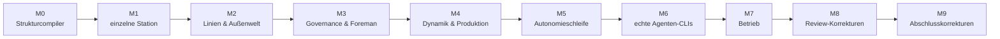

[English](../en/development.md) | [日本語](../ja/development.md) | [한국어](../ko/development.md) | [Français](../fr/development.md) | **Deutsch** | [Español](../es/development.md) | [Português (BR)](../pt-BR/development.md) | [Русский](../ru/development.md) | [简体中文](../zh-CN/development.md)

# Entwicklung

Machine Agent Org wird mit einer expliziten Trennung zwischen **Designer und Implementierer** entwickelt. Ein deterministisches Harness, `tools/harness.py`, setzt sie durch, sodass keine Seite stillschweigend die Torpfosten verschieben kann.

## 1. Rollen

| Rolle | Verantwortlich für | Darf nicht |
|---|---|---|
| **Designer** | Spezifikationen (`spec/`), Plan und Aufgabenkarten (`plan/`), Abnahmetests (`tests/acceptance/`), Reviews | Produktionscode implementieren |
| **Implementierer** | `src/`, Systemtests (`tests/system/`), Journaleinträge | Spezifikationen, Abnahmetests oder Abnahmekriterien ändern; Schnittstellen erfinden; dem Meilenstein vorgreifen |
| **Mensch** | die Verfassung, ADRs und das **Neuregistrieren geschützter Dateien** (`harness lock --update`) | — |

Geschützte Dateien sind per Glob in `plan/protected.lock` aufgeführt und per SHA-256 fixiert. Ein PreToolUse-Hook (`.claude/settings.json`) weist Änderungen von Agenten an ihnen zurück, und `harness lock --verify` erkennt jede Änderung. Stößt ein Implementierer auf einen Widerspruch, hält er an, schreibt in `plan/journal/` und führt `harness task block` aus. Der Designer korrigiert die geschützte Datei, und ein Mensch registriert die Sperre neu.

## 2. Die Harness-Schleife

```bash
uv run python tools/harness.py doctor            # Umgebung
uv run python tools/harness.py status            # Meilensteine, Aufgaben, Gates
uv run python tools/harness.py task next         # erste Aufgabe, deren Abhängigkeiten erledigt sind
uv run python tools/harness.py task show M9-01   # die Aufgabenkarte und ihre Pflichtlektüre
uv run python tools/harness.py task start M9-01
# … implementieren …
uv run python tools/harness.py accept M9-01      # führt die Abnahmeprüfungen der Aufgabe aus, zeichnet Nachweise auf
uv run python tools/harness.py gate M9           # Stage-Gate: alle Prüfungen des Meilensteins (und die geerbten)
```

Weitere Unterbefehle:
- `doccheck`: Die Testtabellen in Kapitel 7 der Spezifikationen müssen zu den Testfunktionen passen.
- `check`: eine benannte Prüfung.
- `scenario`: geskriptete Szenarien in `plan/scenarios/`.
- `pytest`: führt pytest aus und gibt eine JSON-Zusammenfassung aus. Verwenden Sie es immer statt eines einfachen `pytest`, weil es den Importpfad für das Paket `tests` einrichtet.
- `lock --verify`: vergleicht die geschützten Dateien mit der Sperre.

Nachweise (Befehle, Exit-Codes, Digests der Ausgaben, Git-Commit) werden in `plan/state.json` geschrieben.

## 3. Meilensteine



Jeder Meilenstein endet in einem nutzbaren, übergabefähigen Zustand, und jedes Stage-Gate erbt die Prüfungen des vorherigen Gates. M5, M8 und M9 sind *Korrektur*-Meilensteine. Jeder ging aus einem Designer-Review hervor, das Fähigkeiten fand, die ihre Tests bestanden, aber nicht in den Produktionspfad eingebunden waren (`plan/drift.md`, `plan/review-m5-m7.md`, `plan/review-closure.md`). Die Lehre daraus, inzwischen eine Regel für Abnahmetests: **die Produktionseinstiegspunkte ansteuern und Fakes das Verhalten prüfen lassen.** Ein Fake-S3 berechnet SigV4 nach, ein Fake-`psql` protokolliert jeden Aufruf, und ein Fake-`factoryctl` leitet die echte Methode und den echten Pfad weiter.

## 4. Tests

| Stufe | Wo | Was |
|---|---|---|
| Abnahme | `tests/acceptance/m0…m9/` | eine Datei pro Aufgabe, benannt in Kapitel 7 der Spezifikation; geschützt |
| System | `tests/system/` | Unit- und Integrationstests in der Verantwortung des Implementierers |
| Konformität | `spec/mrl/conformance/`, `tests/test_conformance.py` | MRL-Fälle für Ausdrücke, Regeln und die Fabrik; bestehende Fälle dürfen nur ergänzt werden |
| Policy | `tests/test_codebase_policy.py`, `tests/test_hooks.py` | statische Regeln für `src/mao` (keine Imports per Monkey-Patching, kein Zugriff auf das aktuelle Verzeichnis, kein privater modulübergreifender Zugriff, …) |

Testdoubles liegen in `tests/fakes/`:
- `fake_agent.py` ist ein geskripteter Claude-Code-Doppelgänger. Sein Verhalten ergibt sich aus der `task.json` der Task-Bean.
- `fake_llm.py` ist ein Modell-Upstream für die Live-Stufe.
- `tools/` enthält die Fixture-Werkzeuge.

Die Fixture-Registries sind `tests/fixtures/registry-m1` und `registry-m2`. Die Docker-Stufen brauchen `uv run python tools/build_test_images.py`. Ohne Docker werden sie übersprungen; setzen Sie `MAO_REQUIRE_DOCKER=1`, damit sie stattdessen fehlschlagen. Stage-Gates verlangen null übersprungene Tests.

## 5. Code-Regeln

Sie stammen aus `spec/system/README.md` (Entscheidungen D1–D14) und `plan/README.md` § 6:

- Python ≥ 3.12. Laufzeitabhängigkeiten sind nur die Standardbibliothek, `pyyaml`, `jsonschema` und das `mrl` im Repository. Eine neue Abhängigkeit erfordert ein ADR. Die Docker-CLI wird als Unterprozess aufgerufen, SQLite über `sqlite3`.
- Kein `shell=True`. Keine Aufrufe von LLM-APIs: Intelligenz kommt nur aus den CLIs der Operatoren.
- **MRL ist die einzige Ausdrucks- und Vorlagensprache.** Spec-Vorlagen werden mit `mrl.expr` kompiliert; `eval`, Jinja und `str.format` sind für Spec-Inhalte verboten.
- Bibliothekscode bezieht Pfade aus `Context.root` oder von seinem Aufrufer, niemals aus dem aktuellen Verzeichnis.
- Laufzeit-SQL muss zwischen SQLite und PostgreSQL portabel sein. SQLite-spezifische Formen sind nur in `db.py`, `backends.py` und `backup.py` erlaubt.
- `uv run ruff check src tests tools` und `uv run ruff format --check` müssen durchlaufen; die Zeilenlänge beträgt 110.

## 6. Weiterführende Lektüre

| Thema | Dokument |
|---|---|
| Workflow-Regeln, Journalformat, verbotene Aktionen | [`plan/README.md`](../../plan/README.md) |
| Meilensteine und Abschlusskriterien | [`plan/milestones.md`](../../plan/milestones.md), [`plan/gates.yaml`](../../plan/gates.yaml) |
| Komponentenübergreifende Entscheidungen und Konventionen | [`spec/system/README.md`](../../spec/system/README.md) |
| Sprache MRL | [`spec/mrl/mrl-1.0.md`](../../spec/mrl/mrl-1.0.md), [`spec/mrl/factory-profile.md`](../../spec/mrl/factory-profile.md) |
| Anweisungen für Implementierer | [`AGENTS.md`](../../AGENTS.md) |
