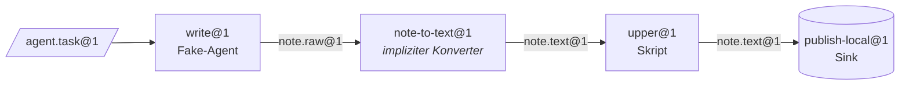

[English](../en/getting-started.md) | [日本語](../ja/getting-started.md) | [한국어](../ko/getting-started.md) | [Français](../fr/getting-started.md) | **Deutsch** | [Español](../es/getting-started.md) | [Português (BR)](../pt-BR/getting-started.md) | [Русский](../ru/getting-started.md) | [简体中文](../zh-CN/getting-started.md)

# Erste Schritte

Diese Anleitung installiert das Projekt, führt die Prüfungen aus und startet über die `factory`-CLI eine echte Linie mit drei Stationen. Weder Docker noch ein API-Schlüssel für ein Modell ist nötig: Die Linie nutzt den lokalen Sandbox-Provider und den geskripteten Fake-Agenten aus `tests/fakes/`.

<p align="center"></p>

## 1. Voraussetzungen

| Werkzeug | Benötigt für | Hinweise |
|---|---|---|
| Python 3.12+ | alles | |
| [uv](https://docs.astral.sh/uv/) | Verwaltung von Abhängigkeiten und venv | `uv sync` installiert die Runtime- und Dev-Gruppen |
| Docker | den Standard-Provider `docker`, Docker-Teststufen, `serve` | für diese Anleitung optional |
| Claude Code / Codex | echte Agentenstationen | optional; die Tests verwenden `tests/fakes/fake_agent.py` |

Die Laufzeitabhängigkeiten sind bewusst auf `pyyaml` und `jsonschema` beschränkt. Für die Entwicklung kommen `pytest` und `ruff` hinzu.

## 2. Installieren und prüfen

```bash
git clone https://github.com/rywsl/Company-Machine.git
cd Company-Machine
uv sync

uv run factory --version                   # CLI der Steuerungsebene
uv run mrl --version                       # MRL-Toolkit (gibt "mrl 1.0.0" aus)
uv run python tools/harness.py doctor      # Umgebungsprüfung
uv run python tools/harness.py status      # Meilensteine und Stage-Gates
```

Führen Sie zuerst eine schnelle Teilmenge der Tests aus und, wenn Sie Zeit haben, danach die gesamte Suite:

```bash
uv run python tools/harness.py pytest tests/acceptance/m1   # 98 Tests, etwa eine Minute
uv run python tools/harness.py pytest tests                 # die gesamte Suite (~1450 Tests, ~15 Min. mit Docker)
```

Führen Sie Tests immer über `harness.py pytest` aus. Es richtet den Importpfad für das Paket `tests` ein; ein einfaches `pytest` scheitert mit `ModuleNotFoundError: tests`.

## 3. Einen Arbeitsbereich vorbereiten

Die Fixture-Registry `tests/fixtures/registry-m2` enthält kleine Maschinen (`toolbox`, `studio`, …), Stationen und Linien, die von den Abnahmetests verwendet werden. Kopieren Sie sie in ein temporäres Verzeichnis und legen Sie die Befehlstabelle an, die der lokale Provider braucht. Die Tabelle sagt dem Provider, welcher Host-Befehl jeden in einem Rezept verwendeten Befehlsnamen ausführt.

```bash
W=/tmp/mao-demo                            # beliebiges temporäres Verzeichnis
mkdir -p $W && cp -r tests/fixtures/registry-m2 $W/registry

uv run python -c "import json; from tests.fakes.fakelib import local_commands; print(json.dumps(local_commands()))" > $W/commands.json

export FACTORY_ROOT=$W/factory             # Zustand: SQLite, CAS, Job-Arbeitsbereiche
export FACTORY_REGISTRY=$W/registry        # Struktur: die Specs
F="uv run factory --provider local --local-commands $W/commands.json"
```

Die erste Station, `write@1`, wird vom Fake-Agenten bedient. Sein Verhalten ergibt sich aus der `task.json` der Task-Bean. Dieses Skript schreibt einen Entwurf:

```bash
cat > $W/task.json <<'EOF'
{"cost_usd": 0.02, "default": [{"do": "write", "path": "drafts/note.txt", "text": "hello factory\n"}]}
EOF
```

## 4. Kompilieren, importieren, planen, ausführen

```bash
$F check $W/registry                       # Exit-Code 0 = Registry kompiliert; 3 = ungültig

TASK=$($F bean import --type agent.task@1 --file task.json=$W/task.json)
echo $TASK                                 # sha256:… (Inhaltsadresse der neuen Bean)

$F line plan note-pipeline@1               # kompilierte Knotenliste, Budgets, Konverterauflösung
$F line run  note-pipeline@1 --in task=$TASK
```

`line run` gibt den Lauf als JSON aus. Achten Sie auf `"state":"SUCCEEDED"`, `"spent_usd":0.02` und die fixierte `"epoch"`.



Das YAML der Linie nennt nur `write`, `upper` und `publish`. `write@1` erzeugt `note.raw@1`, während `upper@1` `note.text@1` verlangt; deshalb hat der Compiler den Konverter `note-to-text@1` aufgelöst und als Knoten `upper.in.note~note-to-text@1` eingefügt.

## 5. Untersuchen

```bash
RUN=r-xxxxxxxxxx                           # die "id" aus line run
$F line nodes $RUN                         # jeder Knoten: Zustand, Job, Ausgaben, cache_hit
$F bean lineage --direction up <bean-id>   # welche Jobs und Beans sie erzeugt haben
$F job show <job-id>                       # ein Job: Versuche, Transkriptkosten, Gate-Bericht
$F status                                  # Jobs/Läufe nach Zustand, Ausgaben, Alarme, Zustand von serve
$F events --limit 20                       # Ereignisprotokoll: job.state, run.node, sink.claimed, …
```

Alles wird unter `$FACTORY_ROOT` gespeichert:

```
factory.db          SQLite-Zustand: Jobs, Läufe, Knoten, Ereignisse, Quittungen, Epochs, Changesets …
cas/sha256/…        inhaltsadressierte Blobs (Nutzdaten der Beans)
jobs/<job-id>/      Arbeitsbereiche je Job, bei Fehlschlag zum Fortsetzen aufbewahrt
tmp/                Sandboxes und temporärer Platz für das Gate
tools/factory/bin/  factoryctl, in die Sandboxes eingehängt
```

## 6. Auf Docker umsteigen

Der Standard-Provider ist `docker`. Bauen Sie die Test-Images einmal und lassen Sie dann `--provider local` weg:

```bash
uv run python tools/build_test_images.py   # baut mao-test/<name>:dev und gibt die Image-IDs aus
uv run python tools/harness.py pytest tests/acceptance   # die Docker-Stufen laufen jetzt, statt übersprungen zu werden
```

Unter Docker läuft jede Station als Container ohne Root-Rechte mit `cap-drop ALL`, schreibgeschützten Eingaben, Ressourcenlimits und ohne `docker.sock`. Netzwerkzugriffe laufen über den Egress-Proxy der Fabrik, Modellverkehr über ihren Modell-Proxy.

## 7. Unbeaufsichtigt betreiben

```bash
uv run factory serve               # ein Prozess: Trigger, Läufe, Jobs, Governance, Audit, Canaries, Weck-Tickets
uv run factory serve --once        # ein einzelner Tick, praktisch für cron oder zum Debuggen
uv run factory console             # schreibgeschützte Webkonsole unter http://127.0.0.1:8090
uv run factory metrics             # Prometheus-Textformat
```

Die Konsole bindet sich nur an `127.0.0.1` und verlangt das in `$FACTORY_ROOT/console.token` gespeicherte Token.

`serve` liest seine Einstellungen aus dem Abschnitt `serve` von `$FACTORY_ROOT/factory.json` und startet nicht, wenn dieser fehlt. Die Felder finden Sie in [Laufzeit § 1](runtime.md#1-prozesse).

## Nächste Schritte

- [Konzepte](concepts.md): wie Sie eigene Typen, Stationen und Linien schreiben.
- [Laufzeit](runtime.md): was jeder Prozess tut und wie Fehler behandelt werden.
- `spec/examples/registry/`: vollständige Maschinenpakete für OpenMontage, MoneyPrinterTurbo, ffmpeg, rclone und git.
