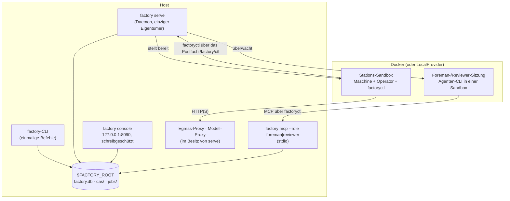
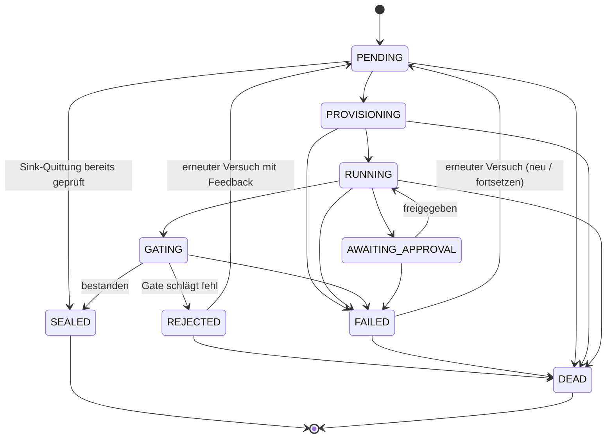

[English](../en/runtime.md) | [日本語](../ja/runtime.md) | [한국어](../ko/runtime.md) | [Français](../fr/runtime.md) | **Deutsch** | [Español](../es/runtime.md) | [Português (BR)](../pt-BR/runtime.md) | [Русский](../ru/runtime.md) | [简体中文](../zh-CN/runtime.md)

# Laufzeit

Diese Seite beschreibt, was tatsächlich läuft: die Prozesse, die Lebenszyklen von Jobs und Läufen, wie eine Station isoliert wird, wo der Zustand liegt und wie Sie alles beobachten. Am Ende stehen die Lücken, die bei der Vorbereitung dieser Dokumentation (2026-11-13) gefunden wurden.

<p align="center"></p>

## 1. Prozesse



- **`factory`-CLI.** Jeder Befehl öffnet einen `Context` auf `$FACTORY_ROOT`, lädt einen Snapshot der Registry, erledigt seine Arbeit und beendet sich. `job run` und `line run` laufen inline; deshalb funktioniert die Demo aus [Erste Schritte](getting-started.md) ohne Daemon.
- **`factory serve`.** Der dauerhaft laufende Eigentümer der Fabrik. Er hält eine Lease (Heartbeat in `$FACTORY_ROOT/serve.json`), startet die Proxys, die ihm gehören, und arbeitet in Ticks. Er braucht einen Abschnitt `serve` in `$FACTORY_ROOT/factory.json` und startet ohne ihn nicht (`SERVE_CONFIG_MISSING`):

  ```json
  {"serve": {"tick_s": 2.0, "max_parallel_jobs": 4, "audit_every_s": 600,
             "canary_every_s": 86400, "docker_timeout_s": 60, "supervise": true}}
  ```

- **`factory console`.** Eine lokale, schreibgeschützte Weboberfläche mit Token-Authentifizierung, die nur an `127.0.0.1` gebunden ist.
- **`factory mcp`.** Die Arbeitsoberfläche von Foreman (Vorarbeiter) und Reviewer, ausschließlich über stdio bereitgestellt.

### Ein `serve`-Tick

Jeder Tick wird als `TickReport` gemeldet und durchläuft diese Phasen der Reihe nach:

| Phase | Was passiert |
|---|---|
| `epochs` | die in Betrieb befindlichen Epochs (aktiv und Canary) aktualisieren |
| `recovered` | Jobs übernehmen, deren Lease abgelaufen ist, z. B. nach einem Absturz (`mao.durable`) |
| `triggered` | Linien-Trigger auslösen: Bean-Eingänge, `cron`, `every` |
| `advanced` | jeden laufenden Linienlauf weiterschalten (`LineRunner.tick`): dynamische Konstrukte entfalten, bereite Knoten einreichen |
| `dispatched` / `finished` | Jobs innerhalb von `max_parallel_jobs` an den Scheduler übergeben, Ergebnisse einsammeln |
| `governance` | ChangeSets voranbringen: Prüfung → Shadow → Canary → aktiv, und den Safe Mode bewerten |
| `audited` | alle `audit_every_s` Sekunden das Invarianten-Audit ausführen |
| `canaries` | alle `canary_every_s` Sekunden die V4-Canaries ausführen |
| `wakes` | Signale in Weck-Tickets umwandeln; mit `supervise: true` dafür Foreman-Sitzungen starten |

## 2. Lebenszyklus eines Jobs



Diese Übergänge entsprechen genau `mao.jobs.EDGES`. `SEALED` und `DEAD` sind Endzustände. Die Grenzen für Wiederholungen stammen aus `limits.retries` der Station, und ein toter Job landet in der Dead-Letter-Queue (`factory schedule dlq`). Eine Bean, die wiederholt nachgelagerte Jobs scheitern lässt, kann unter Quarantäne gestellt werden (`factory schedule quarantine`).

**Linienläufe** durchlaufen `PENDING → RUNNING → SUCCEEDED`. Ein Fehlschlag läuft über `FAILING → FAILED` aus, ein Abbruch über `CANCELLING → CANCELLED`. Jeder Knoten ist `WAITING → SUBMITTED → DONE`, `FAILED` oder `SKIPPED`. Steuerknoten (`map`, `switch`, `until`, `subline`, `plan`) reichen selbst nie Jobs ein. Stattdessen erzeugen sie Kindknoten; die Schritte eines Plans erscheinen zum Beispiel als `<planner>/<step>`, etwa `plan/shout`.

## 3. Im Inneren einer Station

1. **Eingangsprüfung:** Typabgleich, dann Auswertung von `requires` an den tatsächlichen Eingabe-Beans.
2. **Bereitstellung:**
   - Eingaben werden schreibgeschützt unter `/factory/in/<port>/` bereitgestellt.
   - Der Job erhält einen beschreibbaren Arbeitsbereich, der bei einem Fehlschlag erhalten bleibt, damit der Job fortgesetzt werden kann.
   - Die Sandbox läuft ohne Root-Rechte mit `cap-drop ALL`, CPU- und Speicherlimits und ohne `docker.sock`.
3. **Brief:** Der Operator erhält ein Station Brief, bestehend aus dem Fabrikvertrag, der Aufgabenvorlage, dem Ausgabevertrag, dem Budget und der Freigaberichtlinie sowie etwaigem Feedback aus der vorigen Ablehnung.
4. **Bedienung:**
   - Die Operator-CLI läuft headless. Ihr einziger Kanal zum Host ist `factoryctl` (`inputs`, `contract`, `check`, `submit`, `approval`, `budget`, `log`, `fail`, `harvest`, `mcp`), das in das Postfach `/factory/ctl` schreibt.
   - Dienstmaschinen (Form B) werden vom `ServiceGateway` des Hosts gesteuert: *submit → poll → fetch*.
5. **Ernte und Gate:**
   - Ausgaben werden über Ernteregeln oder ein explizites `submit` eingesammelt.
   - Das Gate prüft Struktur → Validatoren → Akzeptanzausdrücke (MRL) → optionalen Judge und versiegelt oder lehnt dann ab.
6. **Versiegeln:** Die Nutzdaten wandern in den CAS, die Bean, ihre Lineage und der Gate-Bericht in `factory.db`.

**Netzwerk.** Stationen haben standardmäßig kein Netzwerk. Eine Policy kann eine Egress-Stufe gewähren: `providers`, `web_read`, `publish` (nur Sinks) oder `ingress` (nur Sources). Der Verkehr läuft über den Egress-Proxy der Fabrik, der jede Anfrage nach Domain und Methode erlaubt oder verweigert. Modellaufrufe laufen über den Modell-Proxy, der den Schlüssel einsetzt; Modellschlüssel gelangen nie in eine Sandbox.

**Sinks** arbeiten zweiphasig (*propose*, dann *execute*) und idempotent. Ein Sink beansprucht eine Quittung, die über seinen `idempotency_key` adressiert ist, bevor er irgendetwas nach außen tut.

## 4. Zustand und Speicherung

```
$FACTORY_ROOT/
├── factory.json        Betreiberkonfiguration: serve, Aufbewahrung, Governance-Registry …
├── factory.db          SQLite: jobs, runs, run_nodes, events, receipts, job_keys, epochs, changesets, wakes …
├── cas/sha256/…        inhaltsadressierte Blobs
├── jobs/<job-id>/      Job-Arbeitsbereiche
├── tmp/                Sandboxes, temporärer Platz für das Gate
├── tools/factory/bin/  factoryctl (schreibgeschützt in die Sandboxes eingehängt)
├── serve.json          Heartbeat von serve (Eigentümer, Tick, laufende Jobs)
└── console.token       Zugriffstoken der Konsole
```

| Backend | Standard | Produktion | Umschalten |
|---|---|---|---|
| Blobs (CAS) | lokales Dateisystem | S3 / MinIO mit SigV4-Signatur | `factory backend migrate`, festgehalten in `backend-active.json`; jeder Befehl liest diesen Zeiger |
| Zustand | SQLite | PostgreSQL, angesteuert über `psql` (keine Treiberabhängigkeit) | ebenso; `factory backend verify` prüft die Kopie |

Für Datenhygiene sorgen `factory gc [--dry-run]`, das Aufbewahrungsregeln, Tombstones und das Aufräumen von Blobs anwendet, sowie `factory backup {create,verify,restore}`.

## 5. Beobachtbarkeit

| Werkzeug | Liefert |
|---|---|
| `factory status` | Jobs und Läufe nach Zustand, offene Freigaben, heutige Ausgaben, Alarme, Zustand von `serve` und Supervisor, Safe Mode |
| `factory metrics` | Prometheus-Textausgabe |
| `factory events [--since] [--kind] [--limit]` | das nur anfügende Ereignisprotokoll (`job.state`, `run.node`, `run.budget`, `sink.claimed`, `run.plan`, …) |
| `factory console` | dieselben Daten als lokale Webseite |
| `factory bean lineage` / `factory cache explain` | warum eine Bean existiert; warum ein Job wiederverwendet wurde oder nicht |

## 6. Bekannte Lücken (2026-11-13)

Diese Lücken wurden beim Durchspielen der Anleitung für diese Dokumentation gefunden. Es handelt sich um Laufzeitfehler, nicht um Entscheidungen der Dokumentation; sie werden für Designer und Implementierer nachverfolgt. Die Anleitungen oben beschreiben das beabsichtigte Verhalten.

| # | Lücke | Sichtbare Auswirkung |
|---|---|---|
| 1 | Sink-Quittungen werden beansprucht, auf dem Produktionspfad aber nie veröffentlicht oder geprüft: `ReceiptStore.publish`, `ReceiptStore.settle` und `connectors.verify` haben in `src/mao` keine Aufrufer. | Sink-Jobs werden ohne Quittungsprüfung versiegelt. Wird derselbe Sink mit demselben Idempotenzschlüssel erneut ausgeführt, schlägt er mit `IDEMPOTENCY_CONFLICT` fehl, statt als Duplikat erkannt zu werden. |
| 2 | Kein Produktionscode übergibt einen `JobCache` an `LineRunner`. | `cache_hit` ist immer `false`, und `factory cache ls` bleibt leer, selbst bei identischen Transform-Jobs. |
| 3 | `factory trigger process`, die Konsole, ChangeSet-Rebuilds und Shadow-Läufe erzeugen `Runner` ohne das `ServiceGateway`. | Dienststationen (Form B) scheitern auf diesen Pfaden mit `FORM_UNSUPPORTED`. |
| 4 | `factory receipt {ls,show,verify,void}` und `factory source run` (`spec/system/connectors.md`) sind nicht implementiert. | Quittungen lassen sich über die CLI weder erneut prüfen noch stornieren. |
