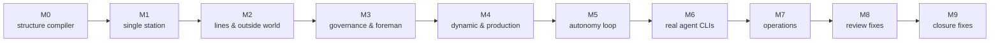

**English** | [日本語](../ja/development.md) | [한국어](../ko/development.md) | [Français](../fr/development.md) | [Deutsch](../de/development.md) | [Español](../es/development.md) | [Português (BR)](../pt-BR/development.md) | [Русский](../ru/development.md) | [简体中文](../zh-CN/development.md)

# Development

Machine Agent Org is built with an explicit **designer / implementer** split. A deterministic harness, `tools/harness.py`, enforces it, so neither side can quietly move the goalposts.

## 1. Roles

| Role | Owns | Cannot |
|---|---|---|
| **Designer** | specs (`spec/`), plan and task cards (`plan/`), acceptance tests (`tests/acceptance/`), reviews | implement production code |
| **Implementer** | `src/`, system tests (`tests/system/`), journal entries | change specs, acceptance tests or acceptance criteria; invent interfaces; work ahead of the milestone |
| **Human** | the constitution, ADRs, and **re-registering protected files** (`harness lock --update`) | — |

Protected files are listed by glob in `plan/protected.lock` and pinned by SHA-256. A PreToolUse hook (`.claude/settings.json`) rejects agent edits to them, and `harness lock --verify` detects any change. When an implementer finds a contradiction, they stop, write `plan/journal/`, and run `harness task block`. The designer fixes the protected file, and a human re-registers the lock.

## 2. The harness loop

```bash
uv run python tools/harness.py doctor            # environment
uv run python tools/harness.py status            # milestones, tasks, gates
uv run python tools/harness.py task next         # first task whose dependencies are done
uv run python tools/harness.py task show M9-01   # the task card and its required reading
uv run python tools/harness.py task start M9-01
# … implement …
uv run python tools/harness.py accept M9-01      # runs the task's acceptance checks, records evidence
uv run python tools/harness.py gate M9           # stage gate: all checks of the milestone (and inherited ones)
```

Other subcommands:
- `doccheck`: spec chapter-7 test tables must match the test functions.
- `check`: one named check.
- `scenario`: scripted scenarios in `plan/scenarios/`.
- `pytest`: runs pytest and prints a JSON summary. Always use it instead of plain `pytest`, because it sets up the import path for the `tests` package.
- `lock --verify`: compares protected files against the lock.

Evidence (commands, exit codes, output digests, git commit) is written to `plan/state.json`.

## 3. Milestones



Every milestone ends in a usable, hand-over-ready state, and every stage gate inherits the checks of the gate before it. M5, M8 and M9 are *correction* milestones. Each came out of a designer review that found capabilities which passed their tests but were not wired into the production path (`plan/drift.md`, `plan/review-m5-m7.md`, `plan/review-closure.md`). The lesson, now a rule for acceptance tests: **drive the production entry points, and make fakes verify behaviour.** A fake S3 recomputes SigV4, a fake `psql` logs every call, and a fake `factoryctl` forwards the real method and path.

## 4. Tests

| Tier | Where | What |
|---|---|---|
| Acceptance | `tests/acceptance/m0…m9/` | one file per task, named in the spec's chapter 7; protected |
| System | `tests/system/` | implementer-owned unit and integration tests |
| Conformance | `spec/mrl/conformance/`, `tests/test_conformance.py` | MRL expression, rule and factory cases; existing cases are append-only |
| Policy | `tests/test_codebase_policy.py`, `tests/test_hooks.py` | static rules on `src/mao` (no monkey-patching imports, no cwd access, no private cross-module access, …) |

Test doubles live in `tests/fakes/`:
- `fake_agent.py` is a scripted Claude Code look-alike. Its behaviour comes from the task bean's `task.json`.
- `fake_llm.py` is a model upstream for the live tier.
- `tools/` holds the fixture tools.

The fixture registries are `tests/fixtures/registry-m1` and `registry-m2`. Docker tiers need `uv run python tools/build_test_images.py`. They skip without Docker; set `MAO_REQUIRE_DOCKER=1` to make them fail instead. Stage gates require zero skips.

## 5. Code rules

These come from `spec/system/README.md` (decisions D1–D14) and `plan/README.md` § 6:

- Python ≥ 3.12. Runtime dependencies are only the standard library, `pyyaml`, `jsonschema` and the in-repo `mrl`. A new dependency needs an ADR. The Docker CLI is called as a subprocess, and SQLite through `sqlite3`.
- No `shell=True`. No LLM API calls: intelligence only comes from operator CLIs.
- **MRL is the only expression and template language.** Spec templates are compiled with `mrl.expr`; `eval`, Jinja and `str.format` are forbidden for Spec content.
- Library code takes paths from `Context.root` or its caller, never from the current directory.
- Runtime SQL must be portable between SQLite and PostgreSQL. SQLite-specific forms are allowed only in `db.py`, `backends.py` and `backup.py`.
- `uv run ruff check src tests tools` and `uv run ruff format --check` must pass; the line length is 110.

## 6. Where to read next

| Topic | Document |
|---|---|
| Workflow rules, journal format, forbidden actions | [`plan/README.md`](../../plan/README.md) |
| Milestones and exit criteria | [`plan/milestones.md`](../../plan/milestones.md), [`plan/gates.yaml`](../../plan/gates.yaml) |
| Cross-component decisions and conventions | [`spec/system/README.md`](../../spec/system/README.md) |
| MRL language | [`spec/mrl/mrl-1.0.md`](../../spec/mrl/mrl-1.0.md), [`spec/mrl/factory-profile.md`](../../spec/mrl/factory-profile.md) |
| Implementer instructions | [`AGENTS.md`](../../AGENTS.md) |
