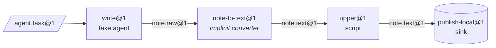

**English** | [简体中文](../zh-CN/getting-started.md) | [日本語](../ja/getting-started.md)

# Getting Started

This guide installs the project, runs the checks, and runs a real three-station line through the `factory` CLI. Neither Docker nor a model API key is needed: the line uses the local sandbox provider and the scripted fake agent from `tests/fakes/`.

<p align="center"></p>

## 1. Prerequisites

| Tool | Needed for | Notes |
|---|---|---|
| Python 3.12+ | everything | |
| [uv](https://docs.astral.sh/uv/) | dependency and venv management | `uv sync` installs the runtime and dev groups |
| Docker | the default `docker` provider, Docker test tiers, `serve` | optional for this guide |
| Claude Code / Codex | real agent stations | optional; the tests use `tests/fakes/fake_agent.py` |

Runtime dependencies are deliberately limited to `pyyaml` and `jsonschema`. Development adds `pytest` and `ruff`.

## 2. Install and verify

```bash
git clone https://github.com/rywsl/Company-Machine.git
cd Company-Machine
uv sync

uv run factory --version                   # control plane CLI
uv run mrl --version                       # MRL toolkit (prints "mrl 1.0.0")
uv run python tools/harness.py doctor      # environment check
uv run python tools/harness.py status      # milestones and stage gates
```

Run a fast subset of the tests, then the whole suite if you have time:

```bash
uv run python tools/harness.py pytest tests/acceptance/m1   # 98 tests, about a minute
uv run python tools/harness.py pytest tests                 # the full suite (~1450 tests, ~15 min with Docker)
```

Always run tests through `harness.py pytest`. It sets up the import path for the `tests` package; plain `pytest` fails with `ModuleNotFoundError: tests`.

## 3. Prepare a workspace

The fixture registry `tests/fixtures/registry-m2` contains small machines (`toolbox`, `studio`, …), stations and lines that the acceptance tests use. Copy it into a scratch directory, and create the command map the local provider needs. The map tells the provider which host command runs each command name used in a recipe.

```bash
W=/tmp/mao-demo                            # any scratch directory
mkdir -p $W && cp -r tests/fixtures/registry-m2 $W/registry

uv run python -c "import json; from tests.fakes.fakelib import local_commands; print(json.dumps(local_commands()))" > $W/commands.json

export FACTORY_ROOT=$W/factory             # state: SQLite, CAS, job workspaces
export FACTORY_REGISTRY=$W/registry        # structure: the Specs
F="uv run factory --provider local --local-commands $W/commands.json"
```

The first station, `write@1`, is operated by the fake agent. Its behaviour comes from the task bean's `task.json`. This script writes one draft:

```bash
cat > $W/task.json <<'EOF'
{"cost_usd": 0.02, "default": [{"do": "write", "path": "drafts/note.txt", "text": "hello factory\n"}]}
EOF
```

## 4. Compile, import, plan, run

```bash
$F check $W/registry                       # exit 0 = registry compiles; 3 = invalid

TASK=$($F bean import --type agent.task@1 --file task.json=$W/task.json)
echo $TASK                                 # sha256:… (content address of the new bean)

$F line plan note-pipeline@1               # compiled node list, budgets, converter resolution
$F line run  note-pipeline@1 --in task=$TASK
```

`line run` prints the run as JSON. Look for `"state":"SUCCEEDED"`, `"spent_usd":0.02` and the pinned `"epoch"`.



The line's YAML only names `write`, `upper` and `publish`. `write@1` produces `note.raw@1`, while `upper@1` requires `note.text@1`, so the compiler resolved the converter `note-to-text@1` and inserted it as the node `upper.in.note~note-to-text@1`.

## 5. Inspect

```bash
RUN=r-xxxxxxxxxx                           # the "id" from line run
$F line nodes $RUN                         # every node: state, job, outputs, cache_hit
$F bean lineage --direction up <bean-id>   # which jobs and beans produced it
$F job show <job-id>                       # one job: attempts, transcript cost, gate report
$F status                                  # jobs/runs by state, spend, alerts, serve health
$F events --limit 20                       # event log: job.state, run.node, sink.claimed, …
```

Everything is stored under `$FACTORY_ROOT`:

```
factory.db          SQLite state: jobs, runs, nodes, events, receipts, epochs, changesets …
cas/sha256/…        content-addressed blobs (bean payloads)
jobs/<job-id>/      per-job workspaces, kept on failure for resume
tmp/                sandboxes and gate scratch space
tools/factory/bin/  factoryctl, mounted into sandboxes
```

## 6. Switch to Docker

The default provider is `docker`. Build the test images once, then drop `--provider local`:

```bash
uv run python tools/build_test_images.py   # builds mao-test/<name>:dev and prints their image IDs
uv run python tools/harness.py pytest tests/acceptance   # Docker tiers now run instead of skipping
```

In Docker, every station runs as a non-root container with `cap-drop ALL`, read-only inputs, resource limits and no `docker.sock`. Network access goes through the factory's egress proxy, and model traffic goes through its model proxy.

## 7. Run unattended

```bash
uv run factory serve               # one process: triggers, runs, jobs, governance, audit, canaries, wake tickets
uv run factory serve --once        # a single tick, handy for cron or debugging
uv run factory console             # read-only web console on http://127.0.0.1:8090
uv run factory metrics             # Prometheus text format
```

The console only binds to `127.0.0.1` and requires the token stored in `$FACTORY_ROOT/console.token`.

`serve` reads its settings from the `serve` section of `$FACTORY_ROOT/factory.json` and refuses to start without one. See [Runtime § 1](runtime.md#1-processes) for the fields.

## Next steps

- [Concepts](concepts.md): how to write your own types, stations and lines.
- [Runtime](runtime.md): what each process does, and how failures are handled.
- `spec/examples/registry/`: complete machine packages for OpenMontage, MoneyPrinterTurbo, ffmpeg, rclone and git.
