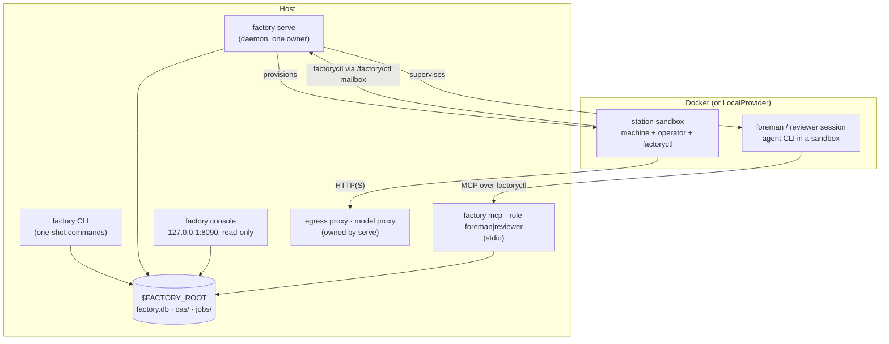
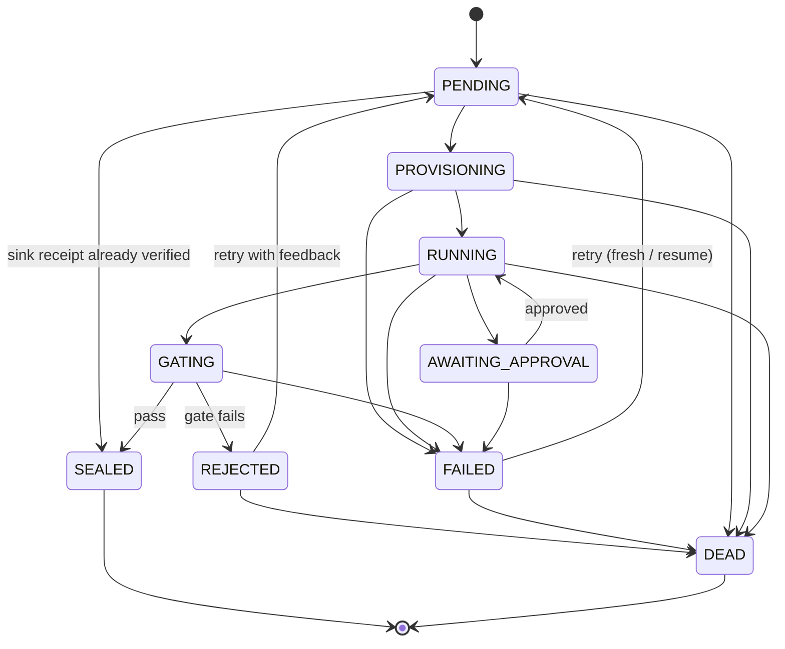

**English** | [简体中文](../zh-CN/runtime.md) | [日本語](../ja/runtime.md)

# Runtime

This page describes what actually runs: the processes, the job and run lifecycles, how a station is isolated, where state lives, and how to watch it all. It ends with the gaps found while preparing this documentation (2026-11-13).

<p align="center"></p>

## 1. Processes



- **`factory` CLI.** Each command opens a `Context` on `$FACTORY_ROOT`, loads a registry snapshot, does its work and exits. `job run` and `line run` execute inline, which is how the [getting-started](getting-started.md) demo works without a daemon.
- **`factory serve`.** The long-running owner of the factory. It holds a lease (heartbeat in `$FACTORY_ROOT/serve.json`), starts the proxies it owns, and ticks. It needs a `serve` section in `$FACTORY_ROOT/factory.json` and refuses to start without one (`SERVE_CONFIG_MISSING`):

  ```json
  {"serve": {"tick_s": 2.0, "max_parallel_jobs": 4, "audit_every_s": 600,
             "canary_every_s": 86400, "docker_timeout_s": 60, "supervise": true}}
  ```

- **`factory console`.** A local, read-only web UI with token authentication, bound only to `127.0.0.1`.
- **`factory mcp`.** The foreman's and reviewer's operating surface, served over stdio only.

### One `serve` tick

Each tick is reported as a `TickReport` and runs these phases in order:

| Phase | What happens |
|---|---|
| `epochs` | refresh the live epochs (active and canary) |
| `recovered` | take over jobs whose lease expired, e.g. after a crash (`mao.durable`) |
| `triggered` | fire line triggers: bean arrivals, `cron`, `every` |
| `advanced` | tick every running line run (`LineRunner.tick`): expand dynamic constructs, submit ready nodes |
| `dispatched` / `finished` | hand jobs to the scheduler within `max_parallel_jobs`, collect results |
| `governance` | advance ChangeSets: verify → shadow → canary → active, and evaluate safe mode |
| `audited` | run the invariant audit every `audit_every_s` |
| `canaries` | run V4 canaries every `canary_every_s` |
| `wakes` | turn signals into wake tickets; with `supervise: true`, start foreman sessions for them |

## 2. Job lifecycle



These edges are exactly `mao.jobs.EDGES`. `SEALED` and `DEAD` are terminal. Retry limits come from the station's `limits.retries`, and a dead job lands in the dead-letter queue (`factory schedule dlq`). A bean that repeatedly makes downstream jobs fail can be quarantined (`factory schedule quarantine`).

**Line runs** move through `PENDING → RUNNING → SUCCEEDED`. A failure drains through `FAILING → FAILED`, and a cancellation through `CANCELLING → CANCELLED`. Each node is `WAITING → SUBMITTED → DONE`, `FAILED` or `SKIPPED`. Control nodes (`map`, `switch`, `until`, `subline`, `plan`) never submit jobs themselves. They create child nodes instead; a plan's steps, for example, appear as `<planner>/<step>`, such as `plan/shout`.

## 3. Inside a station

1. **Intake check:** type match, then `requires` evaluated on the real input beans.
2. **Provision:**
   - Inputs are materialised read-only under `/factory/in/<port>/`.
   - The job gets a writable workspace, kept on failure so the job can resume.
   - The sandbox runs non-root with `cap-drop ALL`, CPU and memory limits, and no `docker.sock`.
3. **Brief:** the operator receives a Station Brief made of the factory contract, the task template, the output contract, the budget and approval policy, and any feedback from the previous rejection.
4. **Operate:**
   - The operator CLI runs headlessly. Its only channel to the host is `factoryctl` (`inputs`, `contract`, `check`, `submit`, `approval`, `budget`, `log`, `fail`, `harvest`, `mcp`), which writes to the `/factory/ctl` mailbox.
   - Service machines (form B) are driven by the host's `ServiceGateway`: *submit → poll → fetch*.
5. **Harvest and gate:**
   - Outputs are collected by harvest rules or explicit `submit`.
   - The gate checks structure → validators → acceptance expressions (MRL) → optional judge, then seals or rejects.
6. **Seal:** the payload goes into the CAS, and the bean, its lineage and the gate report into `factory.db`.

**Network.** Stations have no network by default. A policy can grant an egress tier: `providers`, `web_read`, `publish` (sinks only) or `ingress` (sources only). Traffic goes through the factory's egress proxy, which allows or denies each request by domain and method. Model calls go through the model proxy, which injects the key; model keys never enter a sandbox.

**Sinks** are two-phase (*propose*, then *execute*) and idempotent. A sink claims a receipt keyed by its `idempotency_key` before doing anything external.

## 4. State and storage

```
$FACTORY_ROOT/
├── factory.json        operator config: serve, retention, governance registry …
├── factory.db          SQLite: jobs, runs, run_nodes, events, receipts, job_keys, epochs, changesets, wakes …
├── cas/sha256/…        content-addressed blobs
├── jobs/<job-id>/      job workspaces
├── tmp/                sandboxes, gate scratch
├── tools/factory/bin/  factoryctl (mounted read-only into sandboxes)
├── serve.json          serve heartbeat (owner, tick, running jobs)
└── console.token       console access token
```

| Backend | Default | Production | Switch |
|---|---|---|---|
| Blobs (CAS) | local filesystem | S3 / MinIO with SigV4 signing | `factory backend migrate`, recorded in `backend-active.json`; every command reads that pointer |
| State | SQLite | PostgreSQL, driven through `psql` (no driver dependency) | same; `factory backend verify` checks the copy |

Data hygiene is handled by `factory gc [--dry-run]`, which applies retention, tombstones and blob sweeping, and by `factory backup {create,verify,restore}`.

## 5. Observability

| Tool | Gives you |
|---|---|
| `factory status` | jobs and runs by state, pending approvals, spend today, alerts, `serve` and supervisor health, safe mode |
| `factory metrics` | Prometheus text exposition |
| `factory events [--since] [--kind] [--limit]` | the append-only event log (`job.state`, `run.node`, `run.budget`, `sink.claimed`, `run.plan`, …) |
| `factory console` | the same data as a local web page |
| `factory bean lineage` / `factory cache explain` | why a bean exists; why a job was or was not reused |

## 6. Known gaps (2026-11-13)

These were found while running the walkthrough for this documentation. They are runtime defects, not documentation choices, and are tracked for the designer and implementer. The guides above describe the intended behaviour.

| # | Gap | Effect you will see |
|---|---|---|
| 1 | Sink receipts are claimed but never published or verified on the production path: `ReceiptStore.publish`, `ReceiptStore.settle` and `connectors.verify` have no callers in `src/mao`. | Sink jobs seal without receipt verification. Running the same sink again with the same idempotency key fails with `IDEMPOTENCY_CONFLICT` instead of being recognised as a duplicate. |
| 2 | No production code passes a `JobCache` to `LineRunner`. | `cache_hit` is always `false` and `factory cache ls` stays empty, even for identical transform jobs. |
| 3 | `factory trigger process`, the console, ChangeSet rebuilds and shadow runs build `Runner` without the `ServiceGateway`. | Service (form B) stations fail with `FORM_UNSUPPORTED` on those paths. |
| 4 | `factory receipt {ls,show,verify,void}` and `factory source run` (`spec/system/connectors.md`) are not implemented. | Receipts can't be re-verified or voided from the CLI. |
