[English](../en/development.md) | [日本語](../ja/development.md) | [한국어](../ko/development.md) | [Français](../fr/development.md) | [Deutsch](../de/development.md) | **Español** | [Português (BR)](../pt-BR/development.md) | [Русский](../ru/development.md) | [简体中文](../zh-CN/development.md)

# Desarrollo

Machine Agent Org se construye con una separación explícita entre **diseñador e implementador**. Un harness determinista, `tools/harness.py`, la hace cumplir, de modo que ninguna de las partes puede mover la portería sin que se note.

## 1. Roles

| Rol | Es responsable de | No puede |
|---|---|---|
| **Diseñador** | las especificaciones (`spec/`), el plan y las fichas de tareas (`plan/`), las pruebas de aceptación (`tests/acceptance/`), las revisiones | implementar código de producción |
| **Implementador** | `src/`, las pruebas de sistema (`tests/system/`), las entradas del diario | cambiar especificaciones, pruebas de aceptación o criterios de aceptación; inventar interfaces; adelantarse al hito |
| **Persona** | la constitución, los ADR y el **nuevo registro de los archivos protegidos** (`harness lock --update`) | — |

Los archivos protegidos se enumeran por glob en `plan/protected.lock` y se fijan por SHA-256. Un hook PreToolUse (`.claude/settings.json`) rechaza las ediciones que los agentes intenten hacer en ellos, y `harness lock --verify` detecta cualquier cambio. Cuando un implementador encuentra una contradicción, se detiene, escribe en `plan/journal/` y ejecuta `harness task block`. El diseñador corrige el archivo protegido y una persona vuelve a registrar el bloqueo.

## 2. El bucle del harness

```bash
uv run python tools/harness.py doctor            # entorno
uv run python tools/harness.py status            # hitos, tareas, gates
uv run python tools/harness.py task next         # primera tarea cuyas dependencias están terminadas
uv run python tools/harness.py task show M9-01   # la ficha de la tarea y sus lecturas obligatorias
uv run python tools/harness.py task start M9-01
# … implementar …
uv run python tools/harness.py accept M9-01      # ejecuta las comprobaciones de aceptación de la tarea y registra las evidencias
uv run python tools/harness.py gate M9           # stage gate: todas las comprobaciones del hito (y las heredadas)
```

Otros subcomandos:
- `doccheck`: las tablas de pruebas del capítulo 7 de las especificaciones deben coincidir con las funciones de prueba.
- `check`: una comprobación concreta por nombre.
- `scenario`: escenarios con guion en `plan/scenarios/`.
- `pytest`: ejecuta pytest e imprime un resumen en JSON. Úsalo siempre en lugar de un `pytest` a secas, porque configura la ruta de importación del paquete `tests`.
- `lock --verify`: compara los archivos protegidos con el bloqueo.

Las evidencias (comandos, códigos de salida, resúmenes de las salidas, commit de git) se escriben en `plan/state.json`.

## 3. Hitos

```mermaid
flowchart LR
    M0["M0<br/>compilador de estructura"] --> M1["M1<br/>estación única"] --> M2["M2<br/>líneas y mundo exterior"] --> M3["M3<br/>gobernanza y Foreman"] --> M4["M4<br/>dinámica y producción"]
    M4 --> M5["M5<br/>bucle de autonomía"] --> M6["M6<br/>agentes CLI reales"] --> M7["M7<br/>operación"] --> M8["M8<br/>correcciones de revisión"] --> M9["M9<br/>correcciones de cierre"]
```



Cada hito termina en un estado utilizable y listo para entregar, y cada stage gate hereda las comprobaciones del gate anterior. M5, M8 y M9 son hitos de *corrección*. Cada uno surgió de una revisión del diseñador que encontró capacidades que pasaban sus pruebas pero no estaban conectadas a la ruta de producción (`plan/drift.md`, `plan/review-m5-m7.md`, `plan/review-closure.md`). La lección, convertida ya en regla para las pruebas de aceptación: **ejercitar los puntos de entrada de producción y hacer que los dobles verifiquen el comportamiento.** Un S3 falso recalcula SigV4, un `psql` falso registra cada llamada y un `factoryctl` falso reenvía el método y la ruta reales.

## 4. Pruebas

| Nivel | Dónde | Qué |
|---|---|---|
| Aceptación | `tests/acceptance/m0…m9/` | un archivo por tarea, nombrado en el capítulo 7 de la especificación; protegidas |
| Sistema | `tests/system/` | pruebas unitarias y de integración a cargo del implementador |
| Conformidad | `spec/mrl/conformance/`, `tests/test_conformance.py` | casos MRL de expresiones, reglas y fábrica; los casos existentes solo admiten añadidos |
| Políticas | `tests/test_codebase_policy.py`, `tests/test_hooks.py` | reglas estáticas sobre `src/mao` (sin imports mediante monkey-patching, sin acceso al directorio actual, sin acceso privado entre módulos, …) |

Los dobles de prueba están en `tests/fakes/`:
- `fake_agent.py` es un imitador de Claude Code con guion. Su comportamiento lo define el `task.json` del bean de tarea.
- `fake_llm.py` es un upstream de modelo para el nivel live.
- `tools/` contiene las herramientas de los fixtures.

Los registros de fixtures son `tests/fixtures/registry-m1` y `registry-m2`. Los niveles de Docker necesitan `uv run python tools/build_test_images.py`. Sin Docker se omiten; define `MAO_REQUIRE_DOCKER=1` para que fallen en su lugar. Los stage gates exigen cero pruebas omitidas.

## 5. Reglas de código

Proceden de `spec/system/README.md` (decisiones D1–D14) y de `plan/README.md` § 6:

- Python ≥ 3.12. Las dependencias de ejecución son solo la biblioteca estándar, `pyyaml`, `jsonschema` y el `mrl` del propio repositorio. Una dependencia nueva requiere un ADR. La CLI de Docker se invoca como subproceso, y SQLite mediante `sqlite3`.
- Nada de `shell=True`. Nada de llamadas a APIs de LLM: la inteligencia solo procede de las CLI de los operadores.
- **MRL es el único lenguaje de expresiones y plantillas.** Las plantillas de las Specs se compilan con `mrl.expr`; `eval`, Jinja y `str.format` están prohibidos para el contenido de las Specs.
- El código de biblioteca obtiene las rutas de `Context.root` o de quien lo llama, nunca del directorio actual.
- El SQL de ejecución debe ser portable entre SQLite y PostgreSQL. Las formas específicas de SQLite solo se permiten en `db.py`, `backends.py` y `backup.py`.
- `uv run ruff check src tests tools` y `uv run ruff format --check` deben pasar; la longitud de línea es 110.

## 6. Qué leer después

| Tema | Documento |
|---|---|
| Reglas del flujo de trabajo, formato del diario, acciones prohibidas | [`plan/README.md`](../../plan/README.md) |
| Hitos y criterios de salida | [`plan/milestones.md`](../../plan/milestones.md), [`plan/gates.yaml`](../../plan/gates.yaml) |
| Decisiones y convenciones transversales a los componentes | [`spec/system/README.md`](../../spec/system/README.md) |
| Lenguaje MRL | [`spec/mrl/mrl-1.0.md`](../../spec/mrl/mrl-1.0.md), [`spec/mrl/factory-profile.md`](../../spec/mrl/factory-profile.md) |
| Instrucciones para implementadores | [`AGENTS.md`](../../AGENTS.md) |
