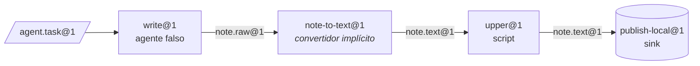

[English](../en/getting-started.md) | [日本語](../ja/getting-started.md) | [한국어](../ko/getting-started.md) | [Français](../fr/getting-started.md) | [Deutsch](../de/getting-started.md) | **Español** | [Português (BR)](../pt-BR/getting-started.md) | [Русский](../ru/getting-started.md) | [简体中文](../zh-CN/getting-started.md)

# Primeros pasos

Esta guía instala el proyecto, ejecuta las comprobaciones y lanza una línea real de tres estaciones con la CLI `factory`. No hace falta ni Docker ni una clave de API de modelo: la línea usa el proveedor de sandbox local y el agente falso con guion de `tests/fakes/`.

<p align="center"></p>

## 1. Requisitos previos

| Herramienta | Necesaria para | Notas |
|---|---|---|
| Python 3.12+ | todo | |
| [uv](https://docs.astral.sh/uv/) | gestión de dependencias y del venv | `uv sync` instala los grupos runtime y dev |
| Docker | el proveedor predeterminado `docker`, los niveles de pruebas con Docker, `serve` | opcional para esta guía |
| Claude Code / Codex | estaciones con agentes reales | opcional; las pruebas usan `tests/fakes/fake_agent.py` |

Las dependencias de ejecución se limitan a propósito a `pyyaml` y `jsonschema`. El desarrollo añade `pytest` y `ruff`.

## 2. Instalar y verificar

```bash
git clone https://github.com/rywsl/Company-Machine.git
cd Company-Machine
uv sync

uv run factory --version                   # CLI del plano de control
uv run mrl --version                       # kit de herramientas MRL (imprime "mrl 1.0.0")
uv run python tools/harness.py doctor      # comprobación del entorno
uv run python tools/harness.py status      # hitos y stage gates
```

Ejecuta un subconjunto rápido de las pruebas y, si tienes tiempo, la batería completa:

```bash
uv run python tools/harness.py pytest tests/acceptance/m1   # 98 pruebas, alrededor de un minuto
uv run python tools/harness.py pytest tests                 # la batería completa (~1450 pruebas, ~15 min con Docker)
```

Ejecuta siempre las pruebas mediante `harness.py pytest`. Configura la ruta de importación del paquete `tests`; un `pytest` a secas falla con `ModuleNotFoundError: tests`.

## 3. Preparar un espacio de trabajo

El registro de fixtures `tests/fixtures/registry-m2` contiene máquinas pequeñas (`toolbox`, `studio`, …), estaciones y líneas que usan las pruebas de aceptación. Cópialo en un directorio temporal y crea el mapa de comandos que necesita el proveedor local. El mapa indica al proveedor qué comando del host ejecuta cada nombre de comando usado en una receta.

```bash
W=/tmp/mao-demo                            # cualquier directorio temporal
mkdir -p $W && cp -r tests/fixtures/registry-m2 $W/registry

uv run python -c "import json; from tests.fakes.fakelib import local_commands; print(json.dumps(local_commands()))" > $W/commands.json

export FACTORY_ROOT=$W/factory             # estado: SQLite, CAS, espacios de trabajo de los jobs
export FACTORY_REGISTRY=$W/registry        # estructura: las Specs
F="uv run factory --provider local --local-commands $W/commands.json"
```

La primera estación, `write@1`, la maneja el agente falso. Su comportamiento lo define el `task.json` del bean de tarea. Este guion escribe un borrador:

```bash
cat > $W/task.json <<'EOF'
{"cost_usd": 0.02, "default": [{"do": "write", "path": "drafts/note.txt", "text": "hello factory\n"}]}
EOF
```

## 4. Compilar, importar, planificar, ejecutar

```bash
$F check $W/registry                       # código 0 = el registro compila; 3 = inválido

TASK=$($F bean import --type agent.task@1 --file task.json=$W/task.json)
echo $TASK                                 # sha256:… (dirección de contenido del nuevo bean)

$F line plan note-pipeline@1               # lista de nodos compilada, presupuestos, resolución de convertidores
$F line run  note-pipeline@1 --in task=$TASK
```

`line run` imprime la ejecución en JSON. Busca `"state":"SUCCEEDED"`, `"spent_usd":0.02` y la `"epoch"` fijada.



El YAML de la línea solo nombra `write`, `upper` y `publish`. `write@1` produce `note.raw@1`, mientras que `upper@1` requiere `note.text@1`, así que el compilador resolvió el convertidor `note-to-text@1` y lo insertó como el nodo `upper.in.note~note-to-text@1`.

## 5. Inspeccionar

```bash
RUN=r-xxxxxxxxxx                           # el "id" que devuelve line run
$F line nodes $RUN                         # cada nodo: estado, job, salidas, cache_hit
$F bean lineage --direction up <bean-id>   # qué jobs y beans lo produjeron
$F job show <job-id>                       # un job: intentos, coste del transcript, informe del gate
$F status                                  # jobs/ejecuciones por estado, gasto, alertas, salud de serve
$F events --limit 20                       # registro de eventos: job.state, run.node, sink.claimed, …
```

Todo se guarda bajo `$FACTORY_ROOT`:

```
factory.db          estado SQLite: jobs, ejecuciones, nodos, eventos, recibos, epochs, changesets …
cas/sha256/…        blobs direccionados por contenido (cargas útiles de los beans)
jobs/<job-id>/      espacios de trabajo por job, conservados si fallan para poder reanudar
tmp/                sandboxes y espacio temporal del gate
tools/factory/bin/  factoryctl, montado en los sandboxes
```

## 6. Pasar a Docker

El proveedor predeterminado es `docker`. Construye las imágenes de prueba una vez y después quita `--provider local`:

```bash
uv run python tools/build_test_images.py   # construye mao-test/<name>:dev e imprime los ID de las imágenes
uv run python tools/harness.py pytest tests/acceptance   # ahora los niveles de Docker se ejecutan en lugar de omitirse
```

En Docker, cada estación se ejecuta como un contenedor no root con `cap-drop ALL`, entradas de solo lectura, límites de recursos y sin `docker.sock`. El acceso a la red pasa por el proxy de salida de la fábrica, y el tráfico hacia los modelos, por su proxy de modelos.

## 7. Funcionamiento desatendido

```bash
uv run factory serve               # un solo proceso: disparadores, ejecuciones, jobs, gobernanza, auditoría, canarios, tickets de activación
uv run factory serve --once        # un único tick, útil para cron o para depurar
uv run factory console             # consola web de solo lectura en http://127.0.0.1:8090
uv run factory metrics             # formato de texto de Prometheus
```

La consola solo escucha en `127.0.0.1` y exige el token guardado en `$FACTORY_ROOT/console.token`.

`serve` lee su configuración de la sección `serve` de `$FACTORY_ROOT/factory.json` y se niega a arrancar si no existe. Consulta los campos en [Runtime § 1](runtime.md#1-procesos).

## Próximos pasos

- [Conceptos](concepts.md): cómo escribir tus propios tipos, estaciones y líneas.
- [Runtime](runtime.md): qué hace cada proceso y cómo se gestionan los fallos.
- `spec/examples/registry/`: paquetes de máquinas completos para OpenMontage, MoneyPrinterTurbo, ffmpeg, rclone y git.
