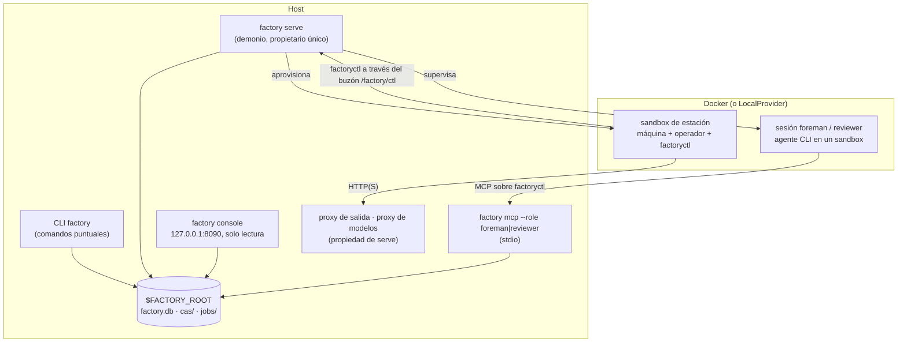
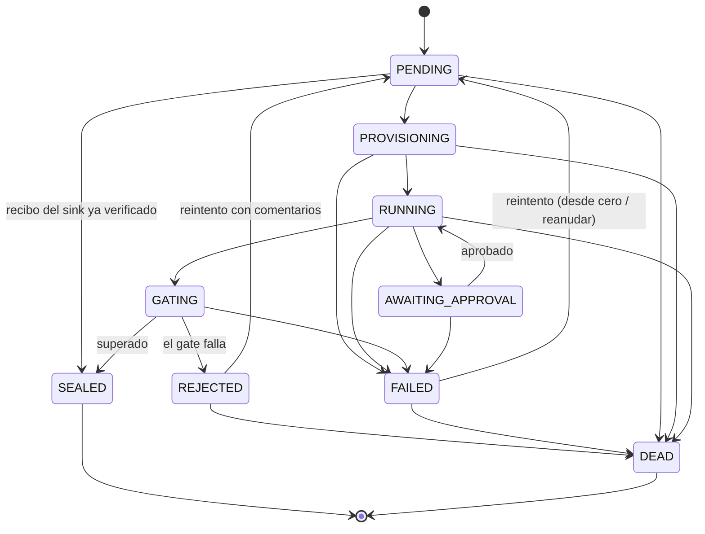

[English](../en/runtime.md) | [日本語](../ja/runtime.md) | [한국어](../ko/runtime.md) | [Français](../fr/runtime.md) | [Deutsch](../de/runtime.md) | **Español** | [Português (BR)](../pt-BR/runtime.md) | [Русский](../ru/runtime.md) | [简体中文](../zh-CN/runtime.md)

# Runtime

Esta página describe lo que se ejecuta realmente: los procesos, los ciclos de vida de los jobs y de las ejecuciones, cómo se aísla una estación, dónde vive el estado y cómo vigilarlo todo. Termina con las carencias detectadas al preparar esta documentación (2026-11-13).

<p align="center"></p>

## 1. Procesos



- **CLI `factory`.** Cada comando abre un `Context` sobre `$FACTORY_ROOT`, carga un snapshot del registro, hace su trabajo y termina. `job run` y `line run` se ejecutan en línea; por eso la demo de [primeros pasos](getting-started.md) funciona sin demonio.
- **`factory serve`.** El propietario de larga duración de la fábrica. Mantiene un arrendamiento (heartbeat en `$FACTORY_ROOT/serve.json`), arranca los proxies que le pertenecen y avanza por ticks. Necesita una sección `serve` en `$FACTORY_ROOT/factory.json` y se niega a arrancar sin ella (`SERVE_CONFIG_MISSING`):

  ```json
  {"serve": {"tick_s": 2.0, "max_parallel_jobs": 4, "audit_every_s": 600,
             "canary_every_s": 86400, "docker_timeout_s": 60, "supervise": true}}
  ```

- **`factory console`.** Una interfaz web local de solo lectura con autenticación por token, ligada únicamente a `127.0.0.1`.
- **`factory mcp`.** La superficie de trabajo del Foreman (capataz) y del revisor, servida solo por stdio.

### Un tick de `serve`

Cada tick se notifica como un `TickReport` y ejecuta estas fases en orden:

| Fase | Qué ocurre |
|---|---|
| `epochs` | actualizar las epochs en servicio (activa y canario) |
| `recovered` | hacerse cargo de los jobs cuyo arrendamiento ha caducado, p. ej. tras una caída (`mao.durable`) |
| `triggered` | lanzar los disparadores de líneas: llegadas de beans, `cron`, `every` |
| `advanced` | avanzar cada ejecución de línea en curso (`LineRunner.tick`): expandir construcciones dinámicas, enviar los nodos listos |
| `dispatched` / `finished` | entregar jobs al planificador dentro de `max_parallel_jobs`, recoger resultados |
| `governance` | avanzar los ChangeSets: verificación → shadow → canario → activo, y evaluar el modo seguro |
| `audited` | ejecutar la auditoría de invariantes cada `audit_every_s` segundos |
| `canaries` | ejecutar los canarios V4 cada `canary_every_s` segundos |
| `wakes` | convertir señales en tickets de activación; con `supervise: true`, iniciar sesiones del Foreman para atenderlos |

## 2. Ciclo de vida de un job



Estas transiciones son exactamente `mao.jobs.EDGES`. `SEALED` y `DEAD` son terminales. Los límites de reintentos proceden de `limits.retries` de la estación, y un job muerto acaba en la cola de mensajes muertos (`factory schedule dlq`). Un bean que hace fallar repetidamente a los jobs aguas abajo puede ponerse en cuarentena (`factory schedule quarantine`).

Las **ejecuciones de línea** pasan por `PENDING → RUNNING → SUCCEEDED`. Un fallo se drena por `FAILING → FAILED`, y una cancelación por `CANCELLING → CANCELLED`. Cada nodo es `WAITING → SUBMITTED → DONE`, `FAILED` o `SKIPPED`. Los nodos de control (`map`, `switch`, `until`, `subline`, `plan`) nunca envían jobs por sí mismos. En su lugar crean nodos hijos; los pasos de un plan, por ejemplo, aparecen como `<planner>/<step>`, como `plan/shout`.

## 3. Dentro de una estación

1. **Comprobación de entrada:** coincidencia de tipos y, después, evaluación de `requires` sobre los beans de entrada reales.
2. **Aprovisionamiento:**
   - Las entradas se materializan en solo lectura bajo `/factory/in/<port>/`.
   - El job recibe un espacio de trabajo con escritura, que se conserva si falla para poder reanudarlo.
   - El sandbox se ejecuta sin root, con `cap-drop ALL`, límites de CPU y memoria y sin `docker.sock`.
3. **Brief:** el operador recibe un Station Brief compuesto por el contrato de la fábrica, la plantilla de la tarea, el contrato de salida, el presupuesto y la política de aprobación, y los comentarios del rechazo anterior, si los hay.
4. **Operación:**
   - La CLI del operador se ejecuta en modo headless. Su único canal hacia el host es `factoryctl` (`inputs`, `contract`, `check`, `submit`, `approval`, `budget`, `log`, `fail`, `harvest`, `mcp`), que escribe en el buzón `/factory/ctl`.
   - Las máquinas de servicio (forma B) las maneja el `ServiceGateway` del host: *submit → poll → fetch*.
5. **Recolección y gate:**
   - Las salidas se recogen mediante reglas de recolección o con un `submit` explícito.
   - El gate comprueba estructura → validadores → expresiones de aceptación (MRL) → juez opcional, y después sella o rechaza.
6. **Sellado:** la carga útil va al CAS; el bean, su linaje y el informe del gate van a `factory.db`.

**Red.** Por defecto, las estaciones no tienen red. Una política puede conceder un nivel de salida de red: `providers`, `web_read`, `publish` (solo sinks) o `ingress` (solo sources). El tráfico pasa por el proxy de salida de la fábrica, que permite o deniega cada petición según el dominio y el método. Las llamadas a modelos pasan por el proxy de modelos, que inyecta la clave; las claves de los modelos nunca entran en un sandbox.

**Los sinks** funcionan en dos fases (*propose* y luego *execute*) y son idempotentes. Un sink reclama un recibo indexado por su `idempotency_key` antes de hacer nada externo.

## 4. Estado y almacenamiento

```
$FACTORY_ROOT/
├── factory.json        configuración de explotación: serve, retención, registro de gobernanza …
├── factory.db          SQLite: jobs, runs, run_nodes, events, receipts, job_keys, epochs, changesets, wakes …
├── cas/sha256/…        blobs direccionados por contenido
├── jobs/<job-id>/      espacios de trabajo de los jobs
├── tmp/                sandboxes, espacio temporal del gate
├── tools/factory/bin/  factoryctl (montado en solo lectura en los sandboxes)
├── serve.json          heartbeat de serve (propietario, tick, jobs en curso)
└── console.token       token de acceso a la consola
```

| Backend | Predeterminado | Producción | Cambio |
|---|---|---|---|
| Blobs (CAS) | sistema de archivos local | S3 / MinIO con firma SigV4 | `factory backend migrate`, registrado en `backend-active.json`; todos los comandos leen ese puntero |
| Estado | SQLite | PostgreSQL, manejado mediante `psql` (sin dependencia de driver) | igual; `factory backend verify` comprueba la copia |

La higiene de los datos corre a cargo de `factory gc [--dry-run]`, que aplica la retención, las lápidas (tombstones) y el barrido de blobs, y de `factory backup {create,verify,restore}`.

## 5. Observabilidad

| Herramienta | Qué ofrece |
|---|---|
| `factory status` | jobs y ejecuciones por estado, aprobaciones pendientes, gasto del día, alertas, salud de `serve` y del supervisor, modo seguro |
| `factory metrics` | exposición en formato de texto de Prometheus |
| `factory events [--since] [--kind] [--limit]` | el registro de eventos de solo anexado (`job.state`, `run.node`, `run.budget`, `sink.claimed`, `run.plan`, …) |
| `factory console` | los mismos datos como página web local |
| `factory bean lineage` / `factory cache explain` | por qué existe un bean; por qué un job se reutilizó o no |

## 6. Carencias conocidas (2026-11-13)

Se detectaron al recorrer la guía de esta documentación. Son defectos del runtime, no decisiones de la documentación, y se siguen para el diseñador y el implementador. Las guías anteriores describen el comportamiento previsto.

| # | Carencia | Efecto que verás |
|---|---|---|
| 1 | Los recibos de los sinks se reclaman, pero nunca se publican ni se verifican en la ruta de producción: `ReceiptStore.publish`, `ReceiptStore.settle` y `connectors.verify` no tienen llamadores en `src/mao`. | Los jobs de sink se sellan sin verificar el recibo. Volver a ejecutar el mismo sink con la misma clave de idempotencia falla con `IDEMPOTENCY_CONFLICT` en lugar de reconocerse como duplicado. |
| 2 | Ningún código de producción pasa un `JobCache` a `LineRunner`. | `cache_hit` siempre es `false` y `factory cache ls` sigue vacío, incluso con jobs de transformación idénticos. |
| 3 | `factory trigger process`, la consola, las reconstrucciones de ChangeSets y las ejecuciones shadow crean `Runner` sin el `ServiceGateway`. | Las estaciones de servicio (forma B) fallan con `FORM_UNSUPPORTED` en esas rutas. |
| 4 | `factory receipt {ls,show,verify,void}` y `factory source run` (`spec/system/connectors.md`) no están implementados. | Los recibos no se pueden volver a verificar ni anular desde la CLI. |
