[English](../en/development.md) | [日本語](../ja/development.md) | [한국어](../ko/development.md) | **Français** | [Deutsch](../de/development.md) | [Español](../es/development.md) | [Português (BR)](../pt-BR/development.md) | [Русский](../ru/development.md) | [简体中文](../zh-CN/development.md)

# Développement

Machine Agent Org est développé avec une séparation explicite **concepteur / implémenteur**. Un harness déterministe, `tools/harness.py`, la fait respecter : aucune des deux parties ne peut déplacer discrètement les objectifs.

## 1. Rôles

| Rôle | Responsable de | Ne peut pas |
|---|---|---|
| **Concepteur** | les specs (`spec/`), le plan et les fiches de tâches (`plan/`), les tests d'acceptation (`tests/acceptance/`), les revues | implémenter le code de production |
| **Implémenteur** | `src/`, les tests système (`tests/system/`), les entrées du journal | modifier les specs, les tests d'acceptation ou les critères d'acceptation ; inventer des interfaces ; prendre de l'avance sur le jalon |
| **Humain** | la constitution, les ADR et le **réenregistrement des fichiers protégés** (`harness lock --update`) | — |

Les fichiers protégés sont listés par glob dans `plan/protected.lock` et épinglés par SHA-256. Un hook PreToolUse (`.claude/settings.json`) rejette les modifications que les agents tentent d'y apporter, et `harness lock --verify` détecte tout changement. Quand un implémenteur tombe sur une contradiction, il s'arrête, écrit dans `plan/journal/` et lance `harness task block`. Le concepteur corrige le fichier protégé, puis un humain réenregistre le verrou.

## 2. La boucle du harness

```bash
uv run python tools/harness.py doctor            # environnement
uv run python tools/harness.py status            # jalons, tâches, gates
uv run python tools/harness.py task next         # première tâche dont les dépendances sont terminées
uv run python tools/harness.py task show M9-01   # la fiche de tâche et ses lectures obligatoires
uv run python tools/harness.py task start M9-01
# … implémenter …
uv run python tools/harness.py accept M9-01      # lance les contrôles d'acceptation de la tâche, enregistre les preuves
uv run python tools/harness.py gate M9           # stage gate : tous les contrôles du jalon (et ceux hérités)
```

Autres sous-commandes :
- `doccheck` : les tableaux de tests du chapitre 7 des specs doivent correspondre aux fonctions de test.
- `check` : un contrôle nommé.
- `scenario` : les scénarios scriptés de `plan/scenarios/`.
- `pytest` : lance pytest et affiche un résumé JSON. Utilisez-le toujours à la place d'un simple `pytest`, car il configure le chemin d'import du paquet `tests`.
- `lock --verify` : compare les fichiers protégés au verrou.

Les preuves (commandes, codes de sortie, empreintes des sorties, commit git) sont écrites dans `plan/state.json`.

## 3. Jalons

```mermaid
flowchart LR
    M0["M0<br/>compilateur de structure"] --> M1["M1<br/>station unique"] --> M2["M2<br/>lignes et monde extérieur"] --> M3["M3<br/>gouvernance et Foreman"] --> M4["M4<br/>dynamique et production"]
    M4 --> M5["M5<br/>boucle d'autonomie"] --> M6["M6<br/>vrais agents CLI"] --> M7["M7<br/>exploitation"] --> M8["M8<br/>corrections de revue"] --> M9["M9<br/>corrections de bouclage"]
```



Chaque jalon se termine dans un état utilisable et prêt à être transmis, et chaque stage gate hérite des contrôles du gate précédent. M5, M8 et M9 sont des jalons de *correction*. Chacun est issu d'une revue du concepteur qui a trouvé des capacités passant leurs tests sans être raccordées au chemin de production (`plan/drift.md`, `plan/review-m5-m7.md`, `plan/review-closure.md`). La leçon, devenue une règle pour les tests d'acceptation : **piloter les points d'entrée de production, et faire vérifier le comportement par les doublures.** Un faux S3 recalcule SigV4, un faux `psql` journalise chaque appel, et un faux `factoryctl` transmet la vraie méthode et le vrai chemin.

## 4. Tests

| Niveau | Où | Quoi |
|---|---|---|
| Acceptation | `tests/acceptance/m0…m9/` | un fichier par tâche, nommé dans le chapitre 7 de la spec ; protégés |
| Système | `tests/system/` | tests unitaires et d'intégration détenus par l'implémenteur |
| Conformité | `spec/mrl/conformance/`, `tests/test_conformance.py` | cas d'expressions, de règles et d'usine MRL ; les cas existants sont en ajout seul |
| Politique | `tests/test_codebase_policy.py`, `tests/test_hooks.py` | règles statiques sur `src/mao` (pas d'imports par monkey-patching, pas d'accès au répertoire courant, pas d'accès privé entre modules, …) |

Les doublures de test se trouvent dans `tests/fakes/` :
- `fake_agent.py` est un sosie scripté de Claude Code. Son comportement est défini par le `task.json` du bean de tâche.
- `fake_llm.py` est un amont de modèle pour le niveau live.
- `tools/` contient les outils des fixtures.

Les registres de fixtures sont `tests/fixtures/registry-m1` et `registry-m2`. Les niveaux Docker nécessitent `uv run python tools/build_test_images.py`. Sans Docker, ils sont ignorés ; définissez `MAO_REQUIRE_DOCKER=1` pour qu'ils échouent à la place. Les stage gates exigent zéro test ignoré.

## 5. Règles de code

Elles proviennent de `spec/system/README.md` (décisions D1–D14) et de `plan/README.md` § 6 :

- Python ≥ 3.12. Les dépendances d'exécution se limitent à la bibliothèque standard, `pyyaml`, `jsonschema` et le `mrl` du dépôt. Toute nouvelle dépendance nécessite un ADR. La CLI Docker est appelée en sous-processus, et SQLite via `sqlite3`.
- Pas de `shell=True`. Pas d'appels à des API de LLM : l'intelligence ne vient que des CLI des opérateurs.
- **MRL est le seul langage d'expressions et de templates.** Les templates des Specs sont compilés avec `mrl.expr` ; `eval`, Jinja et `str.format` sont interdits pour le contenu des Specs.
- Le code de bibliothèque obtient ses chemins de `Context.root` ou de son appelant, jamais du répertoire courant.
- Le SQL d'exécution doit être portable entre SQLite et PostgreSQL. Les formes propres à SQLite ne sont autorisées que dans `db.py`, `backends.py` et `backup.py`.
- `uv run ruff check src tests tools` et `uv run ruff format --check` doivent passer ; la longueur de ligne est de 110.

## 6. Pour aller plus loin

| Sujet | Document |
|---|---|
| Règles de workflow, format du journal, actions interdites | [`plan/README.md`](../../plan/README.md) |
| Jalons et critères de sortie | [`plan/milestones.md`](../../plan/milestones.md), [`plan/gates.yaml`](../../plan/gates.yaml) |
| Décisions et conventions transverses aux composants | [`spec/system/README.md`](../../spec/system/README.md) |
| Langage MRL | [`spec/mrl/mrl-1.0.md`](../../spec/mrl/mrl-1.0.md), [`spec/mrl/factory-profile.md`](../../spec/mrl/factory-profile.md) |
| Instructions pour les implémenteurs | [`AGENTS.md`](../../AGENTS.md) |
