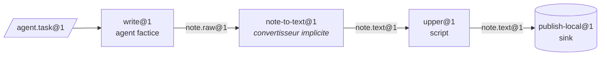

[English](../en/getting-started.md) | [日本語](../ja/getting-started.md) | [한국어](../ko/getting-started.md) | **Français** | [Deutsch](../de/getting-started.md) | [Español](../es/getting-started.md) | [Português (BR)](../pt-BR/getting-started.md) | [Русский](../ru/getting-started.md) | [简体中文](../zh-CN/getting-started.md)

# Prise en main

Ce guide installe le projet, lance les vérifications et exécute une vraie ligne de trois stations avec la CLI `factory`. Ni Docker ni clé d'API de modèle ne sont nécessaires : la ligne utilise le fournisseur de sandbox local et l'agent factice scripté de `tests/fakes/`.

<p align="center"></p>

## 1. Prérequis

| Outil | Nécessaire pour | Remarques |
|---|---|---|
| Python 3.12+ | tout | |
| [uv](https://docs.astral.sh/uv/) | gestion des dépendances et du venv | `uv sync` installe les groupes runtime et dev |
| Docker | le fournisseur par défaut `docker`, les niveaux de tests Docker, `serve` | facultatif pour ce guide |
| Claude Code / Codex | les vraies stations à agent | facultatif ; les tests utilisent `tests/fakes/fake_agent.py` |

Les dépendances d'exécution se limitent volontairement à `pyyaml` et `jsonschema`. Le développement ajoute `pytest` et `ruff`.

## 2. Installer et vérifier

```bash
git clone https://github.com/rywsl/Company-Machine.git
cd Company-Machine
uv sync

uv run factory --version                   # CLI du plan de contrôle
uv run mrl --version                       # boîte à outils MRL (affiche "mrl 1.0.0")
uv run python tools/harness.py doctor      # vérification de l'environnement
uv run python tools/harness.py status      # jalons et stage gates
```

Lancez un sous-ensemble rapide des tests, puis la suite complète si vous avez le temps :

```bash
uv run python tools/harness.py pytest tests/acceptance/m1   # 98 tests, environ une minute
uv run python tools/harness.py pytest tests                 # la suite complète (~1450 tests, ~15 min avec Docker)
```

Lancez toujours les tests via `harness.py pytest`. Il configure le chemin d'import du paquet `tests` ; un simple `pytest` échoue avec `ModuleNotFoundError: tests`.

## 3. Préparer un espace de travail

Le registre de fixtures `tests/fixtures/registry-m2` contient de petites machines (`toolbox`, `studio`, …), des stations et des lignes utilisées par les tests d'acceptation. Copiez-le dans un répertoire temporaire et créez la table de commandes dont le fournisseur local a besoin. Cette table indique au fournisseur quelle commande de l'hôte exécute chaque nom de commande utilisé dans une recette.

```bash
W=/tmp/mao-demo                            # n'importe quel répertoire temporaire
mkdir -p $W && cp -r tests/fixtures/registry-m2 $W/registry

uv run python -c "import json; from tests.fakes.fakelib import local_commands; print(json.dumps(local_commands()))" > $W/commands.json

export FACTORY_ROOT=$W/factory             # état : SQLite, CAS, espaces de travail des jobs
export FACTORY_REGISTRY=$W/registry        # structure : les Specs
F="uv run factory --provider local --local-commands $W/commands.json"
```

La première station, `write@1`, est pilotée par l'agent factice. Son comportement est défini par le `task.json` du bean de tâche. Ce script écrit un brouillon :

```bash
cat > $W/task.json <<'EOF'
{"cost_usd": 0.02, "default": [{"do": "write", "path": "drafts/note.txt", "text": "hello factory\n"}]}
EOF
```

## 4. Compiler, importer, planifier, exécuter

```bash
$F check $W/registry                       # code 0 = le registre compile ; 3 = invalide

TASK=$($F bean import --type agent.task@1 --file task.json=$W/task.json)
echo $TASK                                 # sha256:… (adresse de contenu du nouveau bean)

$F line plan note-pipeline@1               # liste des nœuds compilés, budgets, résolution des convertisseurs
$F line run  note-pipeline@1 --in task=$TASK
```

`line run` affiche l'exécution en JSON. Cherchez `"state":"SUCCEEDED"`, `"spent_usd":0.02` et l'`"epoch"` épinglée.



Le YAML de la ligne ne nomme que `write`, `upper` et `publish`. `write@1` produit `note.raw@1` alors que `upper@1` exige `note.text@1` ; le compilateur a donc résolu le convertisseur `note-to-text@1` et l'a inséré comme nœud `upper.in.note~note-to-text@1`.

## 5. Inspecter

```bash
RUN=r-xxxxxxxxxx                           # l'"id" renvoyé par line run
$F line nodes $RUN                         # chaque nœud : état, job, sorties, cache_hit
$F bean lineage --direction up <bean-id>   # quels jobs et quels beans l'ont produit
$F job show <job-id>                       # un job : tentatives, coût du transcript, rapport du gate
$F status                                  # jobs/exécutions par état, dépenses, alertes, santé de serve
$F events --limit 20                       # journal d'événements : job.state, run.node, sink.claimed, …
```

Tout est stocké sous `$FACTORY_ROOT` :

```
factory.db          état SQLite : jobs, exécutions, nœuds, événements, reçus, epochs, changesets …
cas/sha256/…        blobs adressés par contenu (charges utiles des beans)
jobs/<job-id>/      espaces de travail par job, conservés en cas d'échec pour la reprise
tmp/                sandboxes et espace de travail temporaire du gate
tools/factory/bin/  factoryctl, monté dans les sandboxes
```

## 6. Passer à Docker

Le fournisseur par défaut est `docker`. Construisez une fois les images de test, puis retirez `--provider local` :

```bash
uv run python tools/build_test_images.py   # construit mao-test/<name>:dev et affiche les ID des images
uv run python tools/harness.py pytest tests/acceptance   # les niveaux Docker s'exécutent désormais au lieu d'être ignorés
```

Sous Docker, chaque station tourne dans un conteneur non root avec `cap-drop ALL`, des entrées en lecture seule, des limites de ressources et sans `docker.sock`. L'accès réseau passe par le proxy de sortie de l'usine, et le trafic vers les modèles passe par son proxy de modèle.

## 7. Fonctionnement sans surveillance

```bash
uv run factory serve               # un seul processus : déclencheurs, exécutions, jobs, gouvernance, audit, canaris, tickets de réveil
uv run factory serve --once        # un seul tick, pratique pour cron ou le débogage
uv run factory console             # console web en lecture seule sur http://127.0.0.1:8090
uv run factory metrics             # format texte Prometheus
```

La console n'écoute que sur `127.0.0.1` et exige le jeton stocké dans `$FACTORY_ROOT/console.token`.

`serve` lit sa configuration dans la section `serve` de `$FACTORY_ROOT/factory.json` et refuse de démarrer si elle est absente. Voir [Runtime § 1](runtime.md#1-processus) pour les champs.

## Étapes suivantes

- [Concepts](concepts.md) : comment écrire vos propres types, stations et lignes.
- [Runtime](runtime.md) : ce que fait chaque processus et comment les échecs sont traités.
- `spec/examples/registry/` : des packages de machines complets pour OpenMontage, MoneyPrinterTurbo, ffmpeg, rclone et git.
