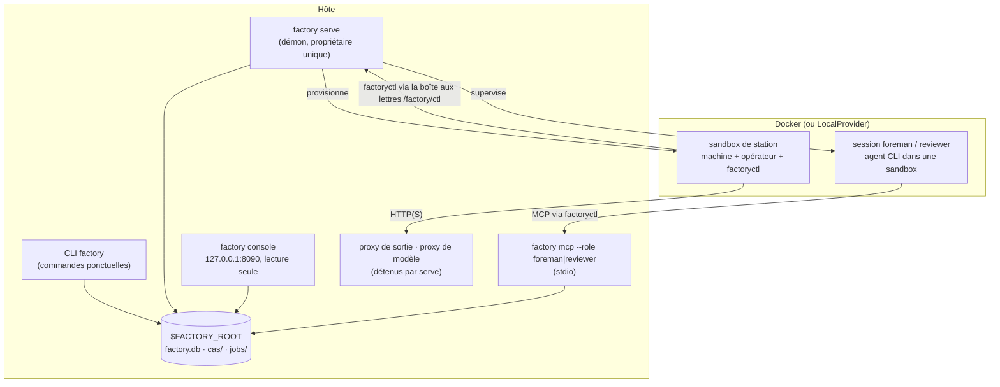
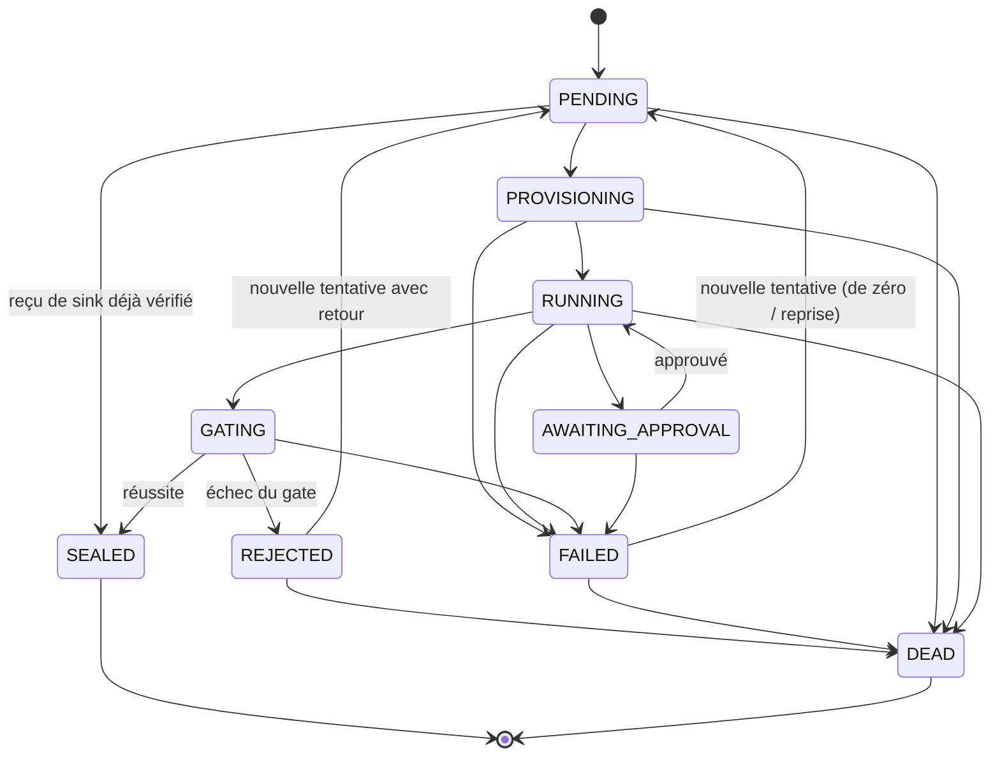

[English](../en/runtime.md) | [日本語](../ja/runtime.md) | [한국어](../ko/runtime.md) | **Français** | [Deutsch](../de/runtime.md) | [Español](../es/runtime.md) | [Português (BR)](../pt-BR/runtime.md) | [Русский](../ru/runtime.md) | [简体中文](../zh-CN/runtime.md)

# Runtime

Cette page décrit ce qui s'exécute réellement : les processus, les cycles de vie des jobs et des exécutions, l'isolation d'une station, l'emplacement de l'état et les moyens de tout surveiller. Elle se termine par les lacunes découvertes lors de la préparation de cette documentation (2026-11-13).

<p align="center"></p>

## 1. Processus



- **CLI `factory`.** Chaque commande ouvre un `Context` sur `$FACTORY_ROOT`, charge un snapshot du registre, fait son travail et se termine. `job run` et `line run` s'exécutent en ligne, ce qui permet à la démo de [prise en main](getting-started.md) de fonctionner sans démon.
- **`factory serve`.** Le propriétaire permanent de l'usine. Il détient un bail (heartbeat dans `$FACTORY_ROOT/serve.json`), démarre les proxys qu'il possède, puis enchaîne les ticks. Il a besoin d'une section `serve` dans `$FACTORY_ROOT/factory.json` et refuse de démarrer sans elle (`SERVE_CONFIG_MISSING`) :

  ```json
  {"serve": {"tick_s": 2.0, "max_parallel_jobs": 4, "audit_every_s": 600,
             "canary_every_s": 86400, "docker_timeout_s": 60, "supervise": true}}
  ```

- **`factory console`.** Une interface web locale en lecture seule, avec authentification par jeton, qui n'écoute que sur `127.0.0.1`.
- **`factory mcp`.** La surface de travail du Foreman (contremaître) et du reviewer, servie uniquement sur stdio.

### Un tick de `serve`

Chaque tick est restitué sous forme de `TickReport` et exécute ces phases dans l'ordre :

| Phase | Ce qui se passe |
|---|---|
| `epochs` | rafraîchir les epochs en service (active et canari) |
| `recovered` | reprendre les jobs dont le bail a expiré, par exemple après un crash (`mao.durable`) |
| `triggered` | déclencher les lignes : arrivées de beans, `cron`, `every` |
| `advanced` | faire avancer chaque exécution de ligne en cours (`LineRunner.tick`) : déplier les constructions dynamiques, soumettre les nœuds prêts |
| `dispatched` / `finished` | confier les jobs à l'ordonnanceur dans la limite de `max_parallel_jobs`, collecter les résultats |
| `governance` | faire avancer les ChangeSets : vérification → shadow → canari → active, et évaluer le mode sûr |
| `audited` | lancer l'audit des invariants toutes les `audit_every_s` secondes |
| `canaries` | lancer les canaris V4 toutes les `canary_every_s` secondes |
| `wakes` | transformer les signaux en tickets de réveil ; avec `supervise: true`, démarrer des sessions du Foreman pour les traiter |

## 2. Cycle de vie d'un job



Ces transitions correspondent exactement à `mao.jobs.EDGES`. `SEALED` et `DEAD` sont terminaux. Les limites de tentatives viennent de `limits.retries` de la station, et un job mort atterrit dans la file de lettres mortes (`factory schedule dlq`). Un bean qui fait échouer à répétition les jobs en aval peut être mis en quarantaine (`factory schedule quarantine`).

Les **exécutions de ligne** passent par `PENDING → RUNNING → SUCCEEDED`. Un échec s'écoule par `FAILING → FAILED`, et une annulation par `CANCELLING → CANCELLED`. Chaque nœud est `WAITING → SUBMITTED → DONE`, `FAILED` ou `SKIPPED`. Les nœuds de contrôle (`map`, `switch`, `until`, `subline`, `plan`) ne soumettent jamais de jobs eux-mêmes. Ils créent à la place des nœuds enfants ; les étapes d'un plan, par exemple, apparaissent sous la forme `<planner>/<step>`, comme `plan/shout`.

## 3. À l'intérieur d'une station

1. **Contrôle d'entrée :** correspondance des types, puis évaluation de `requires` sur les beans d'entrée réels.
2. **Provisionnement :**
   - Les entrées sont matérialisées en lecture seule sous `/factory/in/<port>/`.
   - Le job reçoit un espace de travail accessible en écriture, conservé en cas d'échec pour permettre la reprise.
   - La sandbox tourne en non root avec `cap-drop ALL`, des limites de CPU et de mémoire, et sans `docker.sock`.
3. **Brief :** l'opérateur reçoit un Station Brief composé du contrat de l'usine, du template de tâche, du contrat de sortie, du budget et de la politique d'approbation, ainsi que de tout retour issu du rejet précédent.
4. **Opération :**
   - La CLI de l'opérateur tourne en mode headless. Son seul canal vers l'hôte est `factoryctl` (`inputs`, `contract`, `check`, `submit`, `approval`, `budget`, `log`, `fail`, `harvest`, `mcp`), qui écrit dans la boîte aux lettres `/factory/ctl`.
   - Les machines de type service (forme B) sont pilotées par le `ServiceGateway` de l'hôte : *submit → poll → fetch*.
5. **Récolte et gate :**
   - Les sorties sont collectées par des règles de récolte ou par un `submit` explicite.
   - Le gate vérifie structure → validateurs → expressions d'acceptation (MRL) → juge facultatif, puis scelle ou rejette.
6. **Scellement :** la charge utile va dans le CAS ; le bean, son lignage et le rapport du gate vont dans `factory.db`.

**Réseau.** Par défaut, les stations n'ont pas de réseau. Une politique peut accorder un niveau de sortie réseau : `providers`, `web_read`, `publish` (sinks uniquement) ou `ingress` (sources uniquement). Le trafic passe par le proxy de sortie de l'usine, qui autorise ou refuse chaque requête selon le domaine et la méthode. Les appels aux modèles passent par le proxy de modèle, qui injecte la clé ; les clés de modèle n'entrent jamais dans une sandbox.

**Les sinks** fonctionnent en deux phases (*propose*, puis *execute*) et sont idempotents. Un sink réserve un reçu indexé par sa `idempotency_key` avant toute action externe.

## 4. État et stockage

```
$FACTORY_ROOT/
├── factory.json        configuration de l'exploitant : serve, rétention, registre de gouvernance …
├── factory.db          SQLite : jobs, runs, run_nodes, events, receipts, job_keys, epochs, changesets, wakes …
├── cas/sha256/…        blobs adressés par contenu
├── jobs/<job-id>/      espaces de travail des jobs
├── tmp/                sandboxes, espace temporaire du gate
├── tools/factory/bin/  factoryctl (monté en lecture seule dans les sandboxes)
├── serve.json          heartbeat de serve (propriétaire, tick, jobs en cours)
└── console.token       jeton d'accès à la console
```

| Backend | Par défaut | Production | Bascule |
|---|---|---|---|
| Blobs (CAS) | système de fichiers local | S3 / MinIO avec signature SigV4 | `factory backend migrate`, enregistré dans `backend-active.json` ; chaque commande lit ce pointeur |
| État | SQLite | PostgreSQL, piloté via `psql` (aucune dépendance de pilote) | idem ; `factory backend verify` vérifie la copie |

L'hygiène des données est assurée par `factory gc [--dry-run]`, qui applique la rétention, les tombstones et le nettoyage des blobs, ainsi que par `factory backup {create,verify,restore}`.

## 5. Observabilité

| Outil | Ce qu'il apporte |
|---|---|
| `factory status` | jobs et exécutions par état, approbations en attente, dépenses du jour, alertes, santé de `serve` et du superviseur, mode sûr |
| `factory metrics` | exposition au format texte Prometheus |
| `factory events [--since] [--kind] [--limit]` | le journal d'événements en ajout seul (`job.state`, `run.node`, `run.budget`, `sink.claimed`, `run.plan`, …) |
| `factory console` | les mêmes données sous forme de page web locale |
| `factory bean lineage` / `factory cache explain` | pourquoi un bean existe ; pourquoi un job a été réutilisé ou non |

## 6. Lacunes connues (2026-11-13)

Elles ont été découvertes en déroulant le pas-à-pas de cette documentation. Ce sont des défauts du runtime, pas des choix de documentation, et elles sont suivies pour le concepteur et l'implémenteur. Les guides ci-dessus décrivent le comportement attendu.

| # | Lacune | Effet observable |
|---|---|---|
| 1 | Les reçus de sink sont réservés mais jamais publiés ni vérifiés sur le chemin de production : `ReceiptStore.publish`, `ReceiptStore.settle` et `connectors.verify` n'ont aucun appelant dans `src/mao`. | Les jobs de sink sont scellés sans vérification de reçu. Relancer le même sink avec la même clé d'idempotence échoue avec `IDEMPOTENCY_CONFLICT` au lieu d'être reconnu comme un doublon. |
| 2 | Aucun code de production ne passe de `JobCache` à `LineRunner`. | `cache_hit` vaut toujours `false` et `factory cache ls` reste vide, même pour des jobs de transformation identiques. |
| 3 | `factory trigger process`, la console, les reconstructions de ChangeSets et les exécutions shadow construisent `Runner` sans le `ServiceGateway`. | Les stations de type service (forme B) échouent avec `FORM_UNSUPPORTED` sur ces chemins. |
| 4 | `factory receipt {ls,show,verify,void}` et `factory source run` (`spec/system/connectors.md`) ne sont pas implémentés. | Les reçus ne peuvent être ni revérifiés ni annulés depuis la CLI. |
