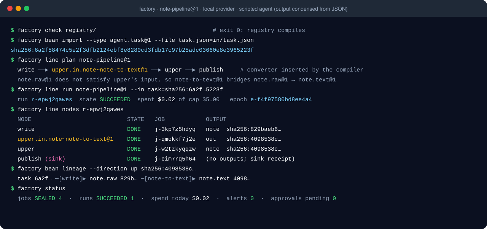
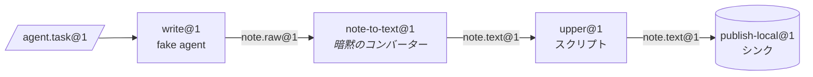

[English](../en/getting-started.md) | **日本語** | [한국어](../ko/getting-started.md) | [Français](../fr/getting-started.md) | [Deutsch](../de/getting-started.md) | [Español](../es/getting-started.md) | [Português (BR)](../pt-BR/getting-started.md) | [Русский](../ru/getting-started.md) | [简体中文](../zh-CN/getting-started.md)

# はじめに

このガイドでは、プロジェクトをインストールしてチェックを実行し、`factory` CLI で実際の 3 ステーションのラインを動かします。Docker もモデル API キーも要りません。ラインはローカルのサンドボックスプロバイダーと、`tests/fakes/` のスクリプト化された fake agent を使います。

<p align="center"></p>

## 1. 前提条件

| ツール | 用途 | 備考 |
|---|---|---|
| Python 3.12+ | すべて | |
| [uv](https://docs.astral.sh/uv/) | 依存関係と仮想環境の管理 | `uv sync` でランタイムと開発グループを入れる |
| Docker | 既定の `docker` プロバイダー、Docker テスト層、`serve` | このガイドでは任意 |
| Claude Code / Codex | 実際のエージェントステーション | 任意。テストは `tests/fakes/fake_agent.py` を使う |

ランタイム依存は意図的に `pyyaml` と `jsonschema` の 2 つだけです。開発時は `pytest` と `ruff` が加わります。

## 2. インストールと確認

```bash
git clone https://github.com/rywsl/Company-Machine.git
cd Company-Machine
uv sync

uv run factory --version                   # コントロールプレーン CLI
uv run mrl --version                       # MRL ツールキット（"mrl 1.0.0" と表示）
uv run python tools/harness.py doctor      # 環境チェック
uv run python tools/harness.py status      # マイルストーンとステージゲート
```

まず一部のテストを実行し、時間があれば全体を回します。

```bash
uv run python tools/harness.py pytest tests/acceptance/m1   # 98 テスト、約 1 分
uv run python tools/harness.py pytest tests                 # 全体（約 1450 テスト、Docker ありで約 15 分）
```

テストは必ず `harness.py pytest` 経由で実行してください。`tests` パッケージのインポートパスを設定してくれます。素の `pytest` では `ModuleNotFoundError: tests` になります。

## 3. 作業場所の準備

フィクスチャ registry `tests/fixtures/registry-m2` には、受け入れテストで使う小さなマシン（`toolbox`、`studio` など）、ステーション、ラインが入っています。これを一時ディレクトリにコピーし、ローカルプロバイダーが必要とするコマンド対応表を作ります。対応表は、レシピで使う各コマンド名をホストのどのコマンドで実行するかをプロバイダーに伝えます。

```bash
W=/tmp/mao-demo                            # 任意の一時ディレクトリ
mkdir -p $W && cp -r tests/fixtures/registry-m2 $W/registry

uv run python -c "import json; from tests.fakes.fakelib import local_commands; print(json.dumps(local_commands()))" > $W/commands.json

export FACTORY_ROOT=$W/factory             # 状態：SQLite、CAS、job の作業領域
export FACTORY_REGISTRY=$W/registry        # 構造：Spec 群
F="uv run factory --provider local --local-commands $W/commands.json"
```

最初のステーション `write@1` は fake agent が操作します。その振る舞いはタスク Bean の `task.json` で決まります。このスクリプトは下書きを 1 つ書くだけです。

```bash
cat > $W/task.json <<'EOF'
{"cost_usd": 0.02, "default": [{"do": "write", "path": "drafts/note.txt", "text": "hello factory\n"}]}
EOF
```

## 4. コンパイル、取り込み、計画、実行

```bash
$F check $W/registry                       # 終了コード 0 = コンパイル成功、3 = 不正

TASK=$($F bean import --type agent.task@1 --file task.json=$W/task.json)
echo $TASK                                 # sha256:…（新しい Bean の内容アドレス）

$F line plan note-pipeline@1               # コンパイル済みのノード一覧、予算、変換の解決結果
$F line run  note-pipeline@1 --in task=$TASK
```

`line run` は run を JSON で出力します。`"state":"SUCCEEDED"`、`"spent_usd":0.02`、固定された `"epoch"` を確認してください。



ラインの YAML に書かれているのは `write`、`upper`、`publish` だけです。`write@1` は `note.raw@1` を出力しますが、`upper@1` は `note.text@1` を要求します。そこでコンパイラーがコンバーター `note-to-text@1` を解決し、ノード `upper.in.note~note-to-text@1` として挿入しました。

## 5. 確認

```bash
RUN=r-xxxxxxxxxx                           # line run の出力の "id"
$F line nodes $RUN                         # 各ノード：状態、job、成果物、cache_hit
$F bean lineage --direction up <bean-id>   # どの job と Bean から生まれたか
$F job show <job-id>                       # 1 つの job：試行回数、transcript の費用、ゲートの報告
$F status                                  # 状態別の job/run、費用、アラート、serve の健全性
$F events --limit 20                       # イベントログ：job.state、run.node、sink.claimed など
```

すべての状態は `$FACTORY_ROOT` の下にあります。

```
factory.db          SQLite の状態：jobs、runs、nodes、events、receipts、epochs、changesets など
cas/sha256/…        内容アドレス方式の blob（Bean の payload）
jobs/<job-id>/      job ごとの作業領域。失敗時は再開用に残す
tmp/                サンドボックスとゲートの一時領域
tools/factory/bin/  factoryctl。サンドボックスにマウントされる
```

## 6. Docker に切り替える

既定のプロバイダーは `docker` です。テストイメージを一度ビルドしたら、`--provider local` を外すだけです。

```bash
uv run python tools/build_test_images.py   # mao-test/<名前>:dev をビルドし、image ID を表示
uv run python tools/harness.py pytest tests/acceptance   # Docker テスト層がスキップされず実行される
```

Docker では、各ステーションが 1 つのコンテナとして動きます。
- 非 root で、`cap-drop ALL` が付きます。
- 入力は読み取り専用で、リソース制限があります。
- `docker.sock` はマウントしません。

ネットワークアクセスは工場の出口プロキシを、モデルへの通信はモデルプロキシを通ります。

## 7. 無人運転

```bash
uv run factory serve               # 1 つのプロセスで：トリガー、run、job、ガバナンス、監査、カナリア、ウェイクチケット
uv run factory serve --once        # 1 ティックだけ。cron やデバッグに便利
uv run factory console             # 読み取り専用 Web コンソール http://127.0.0.1:8090
uv run factory metrics             # Prometheus テキスト形式
```

コンソールは `127.0.0.1` にのみバインドし、`$FACTORY_ROOT/console.token` のトークンが必要です。

`serve` は `$FACTORY_ROOT/factory.json` の `serve` セクションから設定を読み、このセクションがないと起動しません。項目は [ランタイム § 1](runtime.md#1-プロセス) を参照してください。

## 次のステップ

- [コンセプト](concepts.md)：自分の型、ステーション、ラインの書き方。
- [ランタイム](runtime.md)：各プロセスの役割と、失敗の扱い。
- `spec/examples/registry/`：OpenMontage、MoneyPrinterTurbo、ffmpeg、rclone、git の完全なマシンパッケージ。
