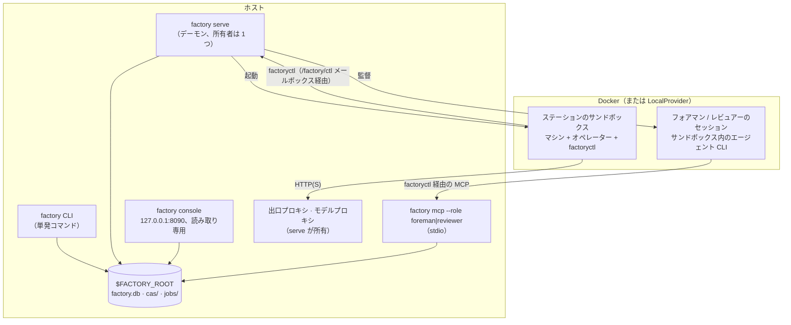
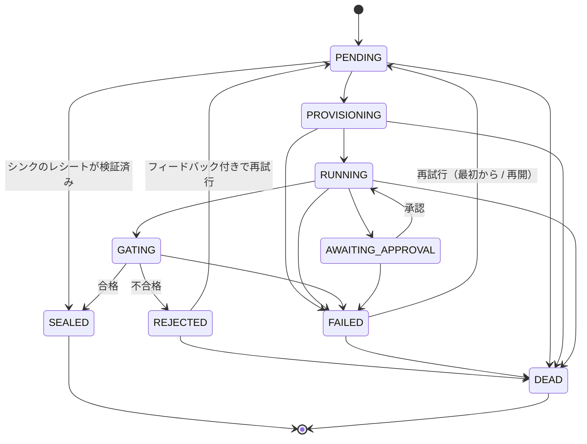

[English](../en/runtime.md) | **日本語** | [한국어](../ko/runtime.md) | [Français](../fr/runtime.md) | [Deutsch](../de/runtime.md) | [Español](../es/runtime.md) | [Português (BR)](../pt-BR/runtime.md) | [Русский](../ru/runtime.md) | [简体中文](../zh-CN/runtime.md)

# ランタイム

このページでは、実際に動いている部分を説明します。プロセス、job と run のライフサイクル、ステーションの隔離方法、状態の置き場所、そしてそれらを観察する方法です。最後の節には、このドキュメントの作成中に見つかったギャップ（2026-11-13）をまとめています。

<p align="center"></p>

## 1. プロセス



- **`factory` CLI。** 各コマンドは `$FACTORY_ROOT` 上に `Context` を開き、registry のスナップショットを読み込み、処理を終えると終了します。`job run` と `line run` はそのプロセス内で実行されるので、[はじめに](getting-started.md)のデモはデーモンなしで動きます。
- **`factory serve`。** 工場の常駐の所有者です。リースを保持し（ハートビートは `$FACTORY_ROOT/serve.json`）、自分が所有するプロキシを起動して、ティックを刻みます。`$FACTORY_ROOT/factory.json` に `serve` セクションが必要で、ないと起動しません（`SERVE_CONFIG_MISSING`）。

  ```json
  {"serve": {"tick_s": 2.0, "max_parallel_jobs": 4, "audit_every_s": 600,
             "canary_every_s": 86400, "docker_timeout_s": 60, "supervise": true}}
  ```

- **`factory console`。** トークン認証付きのローカル読み取り専用 Web UI で、`127.0.0.1` にのみバインドします。
- **`factory mcp`。** フォアマンとレビュアーの操作面で、stdio のみで提供します。

### `serve` の 1 ティック

各ティックの結果は `TickReport` に記録され、次のフェーズを順に実行します。

| フェーズ | 内容 |
|---|---|
| `epochs` | 有効なエポック（現行版とカナリア）を更新 |
| `recovered` | リースが切れた job を引き継ぐ（クラッシュ後など、`mao.durable`） |
| `triggered` | ラインのトリガーを発火：Bean の到着、`cron`、`every` |
| `advanced` | 実行中の各 run を進める（`LineRunner.tick`）：動的構造を展開し、準備のできたノードを投入 |
| `dispatched` / `finished` | `max_parallel_jobs` の範囲で job をスケジューラーに渡し、結果を回収 |
| `governance` | ChangeSet を進める：検証 → シャドー → カナリア → 有効化。セーフモードも評価 |
| `audited` | `audit_every_s` ごとに不変条件監査を実行 |
| `canaries` | `canary_every_s` ごとに V4 カナリアを実行 |
| `wakes` | シグナルをウェイクチケットに変換。`supervise: true` ならフォアマンのセッションを起動 |

## 2. job のライフサイクル



図の遷移は `mao.jobs.EDGES` とまったく同じです。`SEALED` と `DEAD` が終端状態です。再試行回数はステーションの `limits.retries` で決まり、DEAD になった job はデッドレターキュー（`factory schedule dlq`）に入ります。下流の失敗を繰り返し引き起こす Bean は隔離できます（`factory schedule quarantine`）。

**ラインの run** は `PENDING → RUNNING → SUCCEEDED` と進みます。失敗時は `FAILING → FAILED`、キャンセル時は `CANCELLING → CANCELLED` を経ます。各ノードは `WAITING → SUBMITTED → DONE`、`FAILED`、`SKIPPED` のいずれかです。制御ノード（`map`、`switch`、`until`、`subline`、`plan`）は自分では job を投入せず、子ノードを作ります。たとえば Plan のステップは `<planner>/<step>`（`plan/shout` など）として現れます。

## 3. ステーションの内部

1. **入力検査：** まず型の一致を確認し、次に実際の入力 Bean で `requires` を評価します。
2. **準備：**
   - 入力は `/factory/in/<port>/` に読み取り専用で展開されます。
   - job には書き込み可能な作業領域があり、失敗時は再開のために残ります。
   - サンドボックスは非 root、`cap-drop ALL`、CPU とメモリの制限付きで、`docker.sock` はありません。
3. **Brief：** オペレーターは Station Brief を受け取ります。中身は工場契約、タスクテンプレート、出力契約、予算と承認のポリシー、前回の差し戻しのフィードバックです。
4. **操作：**
   - オペレーター CLI はヘッドレスで動きます。ホストへの唯一の経路は `factoryctl`（`inputs`、`contract`、`check`、`submit`、`approval`、`budget`、`log`、`fail`、`harvest`、`mcp`）で、`/factory/ctl` メールボックスに書き込みます。
   - サービス型マシン（形態 B）は、ホストの `ServiceGateway` が「投入 → ポーリング → 取得」で駆動します。
5. **収穫とゲート：**
   - 成果物は収穫ルールか明示的な `submit` で集めます。
   - ゲートは構造 → validator → 受け入れ式（MRL）→ 任意の judge の順に検査し、封印するか差し戻します。
6. **封印：** payload は CAS に、Bean・系譜・ゲートの報告は `factory.db` に入ります。

**ネットワーク。** ステーションには既定でネットワークがありません。ポリシーで出口ティアを与えられます：`providers`、`web_read`、`publish`（シンクのみ）、`ingress`（ソースのみ）。通信は工場の出口プロキシを通り、ドメインとメソッドごとに許可または拒否されます。モデルへの呼び出しはモデルプロキシを通り、キーはプロキシが注入します。モデルのキーがサンドボックスに入ることはありません。

**シンク**は 2 段階（*propose* してから *execute*）で、冪等です。外部への操作を行う前に、`idempotency_key` をキーとしてレシートを確保します。

## 4. 状態とストレージ

```
$FACTORY_ROOT/
├── factory.json        運用者の設定：serve、retention、governance registry など
├── factory.db          SQLite：jobs、runs、run_nodes、events、receipts、job_keys、epochs、changesets、wakes など
├── cas/sha256/…        内容アドレス方式の blob
├── jobs/<job-id>/      job の作業領域
├── tmp/                サンドボックス、ゲートの一時領域
├── tools/factory/bin/  factoryctl（サンドボックスに読み取り専用でマウント）
├── serve.json          serve のハートビート（所有者、ティック、実行中の job）
└── console.token       コンソールのアクセストークン
```

| バックエンド | 既定 | 本番 | 切り替え方 |
|---|---|---|---|
| Blob（CAS） | ローカルファイルシステム | S3 / MinIO（SigV4 署名） | `factory backend migrate`。結果は `backend-active.json` に記録され、すべてのコマンドがこのポインターを読む |
| 状態 | SQLite | PostgreSQL（`psql` 経由で操作し、ドライバー依存なし） | 同上。`factory backend verify` で移行結果を検証 |

データの整理は 2 つのコマンドが担います。`factory gc [--dry-run]` は保持期間、トゥームストーン、blob の掃除を、`factory backup {create,verify,restore}` はバックアップと復元を扱います。

## 5. 可観測性

| ツール | 得られるもの |
|---|---|
| `factory status` | 状態別の job と run、承認待ち、本日の費用、アラート、`serve` と監督の健全性、セーフモード |
| `factory metrics` | Prometheus テキスト形式 |
| `factory events [--since] [--kind] [--limit]` | 追記専用のイベントログ（`job.state`、`run.node`、`run.budget`、`sink.claimed`、`run.plan` など） |
| `factory console` | 同じ情報をローカルの Web ページで |
| `factory bean lineage` / `factory cache explain` | ある Bean がなぜ存在するか。ある job がなぜ再利用された（されなかった）か |

## 6. 既知のギャップ（2026-11-13）

このドキュメントの手順を実行する中で、以下の 4 つが見つかりました。いずれもランタイムの不具合で、ドキュメント上の選択ではありません。設計者と実装者が対応を追跡しています。上の各節は仕様が定める振る舞いを説明しています。

| # | ギャップ | 見える現象 |
|---|---|---|
| 1 | シンクのレシートは本番経路で確保されるだけで、公開も検証もされない：`ReceiptStore.publish`、`ReceiptStore.settle`、`connectors.verify` は `src/mao` に呼び出し元がない | シンクの job がレシート検証なしで封印される。同じ冪等キーで同じシンクをもう一度実行すると、重複として扱われずに `IDEMPOTENCY_CONFLICT` になる |
| 2 | 本番コードのどこも `LineRunner` に `JobCache` を渡していない | 同一の transform job でも `cache_hit` は常に `false`、`factory cache ls` は空のまま |
| 3 | `factory trigger process`、コンソール、ChangeSet の再構築、シャドー実行が `ServiceGateway` なしで `Runner` を作っている | これらの経路ではサービス型（形態 B）のステーションが `FORM_UNSUPPORTED` で失敗する |
| 4 | `spec/system/connectors.md` にある `factory receipt {ls,show,verify,void}` と `factory source run` が未実装 | CLI からレシートを再検証・無効化できない |
