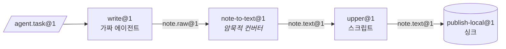

[English](../en/getting-started.md) | [日本語](../ja/getting-started.md) | **한국어** | [Français](../fr/getting-started.md) | [Deutsch](../de/getting-started.md) | [Español](../es/getting-started.md) | [Português (BR)](../pt-BR/getting-started.md) | [Русский](../ru/getting-started.md) | [简体中文](../zh-CN/getting-started.md)

# 시작하기

이 가이드에서는 프로젝트를 설치하고 점검을 실행한 뒤, `factory` CLI로 실제 3-스테이션 라인을 실행합니다. Docker도 모델 API 키도 필요 없습니다. 라인은 로컬 샌드박스 프로바이더와 `tests/fakes/`의 스크립트형 가짜 에이전트를 사용합니다.

<p align="center"></p>

## 1. 사전 준비

| 도구 | 용도 | 비고 |
|---|---|---|
| Python 3.12+ | 전부 | |
| [uv](https://docs.astral.sh/uv/) | 의존성과 가상 환경 관리 | `uv sync`가 runtime과 dev 그룹을 설치 |
| Docker | 기본 `docker` 프로바이더, Docker 테스트 계층, `serve` | 이 가이드에서는 선택 |
| Claude Code / Codex | 실제 에이전트 스테이션 | 선택. 테스트는 `tests/fakes/fake_agent.py`를 사용 |

런타임 의존성은 의도적으로 `pyyaml`과 `jsonschema` 두 개로 제한되어 있습니다. 개발 시에는 `pytest`와 `ruff`가 추가됩니다.

## 2. 설치와 확인

```bash
git clone https://github.com/rywsl/Company-Machine.git
cd Company-Machine
uv sync

uv run factory --version                   # 컨트롤 플레인 CLI
uv run mrl --version                       # MRL 툴킷("mrl 1.0.0" 출력)
uv run python tools/harness.py doctor      # 환경 점검
uv run python tools/harness.py status      # 마일스톤과 스테이지 게이트
```

빠른 테스트 일부를 먼저 실행하고, 시간이 있으면 전체 스위트를 돌려 보세요.

```bash
uv run python tools/harness.py pytest tests/acceptance/m1   # 테스트 98개, 약 1분
uv run python tools/harness.py pytest tests                 # 전체 스위트(테스트 약 1450개, Docker 사용 시 약 15분)
```

테스트는 항상 `harness.py pytest`로 실행하세요. `tests` 패키지의 import 경로를 설정해 주기 때문입니다. 그냥 `pytest`를 실행하면 `ModuleNotFoundError: tests`로 실패합니다.

## 3. 작업 공간 준비

fixture 레지스트리 `tests/fixtures/registry-m2`에는 인수 테스트에서 쓰는 작은 머신(`toolbox`, `studio` 등), 스테이션, 라인이 들어 있습니다. 이를 임시 디렉터리에 복사하고, 로컬 프로바이더에 필요한 명령 매핑 파일을 만듭니다. 이 매핑은 레시피에서 쓰는 각 명령 이름을 호스트의 어떤 명령으로 실행할지 프로바이더에게 알려 줍니다.

```bash
W=/tmp/mao-demo                            # 아무 임시 디렉터리
mkdir -p $W && cp -r tests/fixtures/registry-m2 $W/registry

uv run python -c "import json; from tests.fakes.fakelib import local_commands; print(json.dumps(local_commands()))" > $W/commands.json

export FACTORY_ROOT=$W/factory             # 상태: SQLite, CAS, job 작업 공간
export FACTORY_REGISTRY=$W/registry        # 구조: Spec들
F="uv run factory --provider local --local-commands $W/commands.json"
```

첫 번째 스테이션 `write@1`은 가짜 에이전트가 조작합니다. 그 동작은 태스크 Bean의 `task.json`으로 정해집니다. 아래 스크립트는 초안 하나를 작성합니다.

```bash
cat > $W/task.json <<'EOF'
{"cost_usd": 0.02, "default": [{"do": "write", "path": "drafts/note.txt", "text": "hello factory\n"}]}
EOF
```

## 4. 컴파일, 가져오기, 계획, 실행

```bash
$F check $W/registry                       # 종료 코드 0 = 레지스트리 컴파일 성공, 3 = 유효하지 않음

TASK=$($F bean import --type agent.task@1 --file task.json=$W/task.json)
echo $TASK                                 # sha256:…(새 Bean의 내용 주소)

$F line plan note-pipeline@1               # 컴파일된 노드 목록, 예산, 컨버터 해석 결과
$F line run  note-pipeline@1 --in task=$TASK
```

`line run`은 실행 결과를 JSON으로 출력합니다. `"state":"SUCCEEDED"`, `"spent_usd":0.02`, 그리고 고정된 `"epoch"`를 확인하세요.



라인의 YAML에는 `write`, `upper`, `publish`만 적혀 있습니다. `write@1`은 `note.raw@1`을 만들고 `upper@1`은 `note.text@1`을 요구하므로, 컴파일러가 컨버터 `note-to-text@1`을 찾아 `upper.in.note~note-to-text@1` 노드로 끼워 넣었습니다.

## 5. 확인

```bash
RUN=r-xxxxxxxxxx                           # line run 출력의 "id"
$F line nodes $RUN                         # 모든 노드: 상태, job, 출력, cache_hit
$F bean lineage --direction up <bean-id>   # 어떤 job과 Bean이 이것을 만들었는지
$F job show <job-id>                       # job 하나: 시도 횟수, 트랜스크립트 비용, 게이트 보고서
$F status                                  # 상태별 job/실행, 지출, 경보, serve 상태
$F events --limit 20                       # 이벤트 로그: job.state, run.node, sink.claimed, …
```

모든 것은 `$FACTORY_ROOT` 아래에 저장됩니다.

```
factory.db          SQLite 상태: job, 실행, 노드, 이벤트, 영수증, 에포크, changeset …
cas/sha256/…        내용 주소 방식의 blob(Bean 페이로드)
jobs/<job-id>/      job별 작업 공간, 실패 시 재개를 위해 보존
tmp/                샌드박스와 게이트의 임시 공간
tools/factory/bin/  factoryctl, 샌드박스에 마운트됨
```

## 6. Docker로 전환

기본 프로바이더는 `docker`입니다. 테스트 이미지를 한 번 빌드한 뒤 `--provider local`을 빼면 됩니다.

```bash
uv run python tools/build_test_images.py   # mao-test/<name>:dev를 빌드하고 이미지 ID를 출력
uv run python tools/harness.py pytest tests/acceptance   # 이제 Docker 계층이 건너뛰지 않고 실행됨
```

Docker에서는 모든 스테이션이 비 root 컨테이너로 실행되며 `cap-drop ALL`, 읽기 전용 입력, 리소스 제한이 적용되고 `docker.sock`은 없습니다. 네트워크 접근은 공장의 이그레스 프록시를, 모델 트래픽은 모델 프록시를 거칩니다.

## 7. 무인 운영

```bash
uv run factory serve               # 하나의 프로세스: 트리거, 실행, job, 거버넌스, 감사, 카나리, 웨이크 티켓
uv run factory serve --once        # 틱 한 번만 실행, cron이나 디버깅에 편리
uv run factory console             # http://127.0.0.1:8090의 읽기 전용 웹 콘솔
uv run factory metrics             # Prometheus 텍스트 형식
```

콘솔은 `127.0.0.1`에만 바인딩되며 `$FACTORY_ROOT/console.token`에 저장된 토큰이 필요합니다.

`serve`는 `$FACTORY_ROOT/factory.json`의 `serve` 섹션에서 설정을 읽으며, 이 섹션이 없으면 시작을 거부합니다. 필드 설명은 [런타임 § 1](runtime.md#1-프로세스)을 참고하세요.

## 다음 단계

- [핵심 개념](concepts.md): 직접 타입, 스테이션, 라인을 작성하는 방법.
- [런타임](runtime.md): 각 프로세스가 하는 일과 실패를 처리하는 방식.
- `spec/examples/registry/`: OpenMontage, MoneyPrinterTurbo, ffmpeg, rclone, git의 완전한 머신 패키지.
