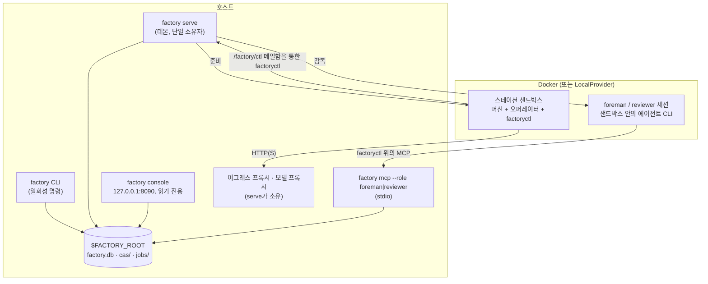
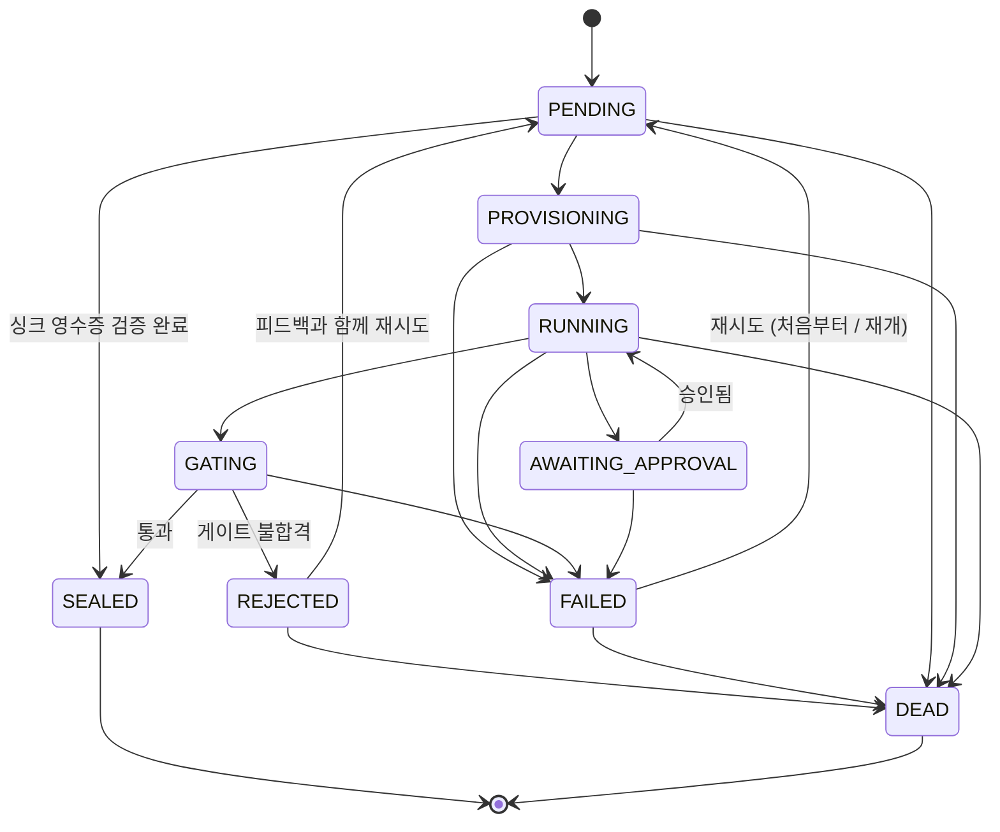

[English](../en/runtime.md) | [日本語](../ja/runtime.md) | **한국어** | [Français](../fr/runtime.md) | [Deutsch](../de/runtime.md) | [Español](../es/runtime.md) | [Português (BR)](../pt-BR/runtime.md) | [Русский](../ru/runtime.md) | [简体中文](../zh-CN/runtime.md)

# 런타임

이 페이지는 실제로 무엇이 실행되는지 설명합니다. 프로세스, job과 실행의 생명주기, 스테이션 격리 방식, 상태가 저장되는 위치, 그리고 모든 것을 관찰하는 방법입니다. 마지막에는 이 문서를 준비하면서(2026-11-13) 발견한 미비점을 정리했습니다.

<p align="center"></p>

## 1. 프로세스



- **`factory` CLI.** 각 명령은 `$FACTORY_ROOT`에 대한 `Context`를 열고, 레지스트리 스냅샷을 불러와 작업을 수행한 뒤 종료합니다. `job run`과 `line run`은 명령 프로세스 안에서 바로 실행되므로, [시작하기](getting-started.md)의 데모는 데몬 없이도 동작합니다.
- **`factory serve`.** 공장의 장기 실행 소유자입니다. 리스를 보유하고(하트비트는 `$FACTORY_ROOT/serve.json`), 자신이 소유한 프록시를 시작한 뒤 틱 단위로 동작합니다. `$FACTORY_ROOT/factory.json`에 `serve` 섹션이 있어야 하며, 없으면 시작을 거부합니다(`SERVE_CONFIG_MISSING`).

  ```json
  {"serve": {"tick_s": 2.0, "max_parallel_jobs": 4, "audit_every_s": 600,
             "canary_every_s": 86400, "docker_timeout_s": 60, "supervise": true}}
  ```

- **`factory console`.** 토큰 인증을 쓰는 로컬 읽기 전용 웹 UI로, `127.0.0.1`에만 바인딩됩니다.
- **`factory mcp`.** Foreman(현장 감독)과 리뷰어의 작업 인터페이스로, stdio로만 제공됩니다.

### `serve` 틱 한 번

각 틱은 `TickReport`로 보고되며 다음 단계를 순서대로 실행합니다.

| 단계 | 하는 일 |
|---|---|
| `epochs` | 살아 있는 에포크(활성과 카나리)를 갱신 |
| `recovered` | 리스가 만료된 job을 인수, 예를 들어 크래시 이후(`mao.durable`) |
| `triggered` | 라인 트리거 발동: Bean 도착, `cron`, `every` |
| `advanced` | 실행 중인 모든 라인 실행을 진행(`LineRunner.tick`): 동적 구조를 펼치고 준비된 노드를 제출 |
| `dispatched` / `finished` | `max_parallel_jobs` 범위 안에서 job을 스케줄러에 넘기고 결과를 수집 |
| `governance` | ChangeSet 진행: 검증 → 섀도 → 카나리 → 활성, 그리고 안전 모드 평가 |
| `audited` | `audit_every_s`초마다 불변식 감사 실행 |
| `canaries` | `canary_every_s`초마다 V4 카나리 실행 |
| `wakes` | 신호를 웨이크 티켓으로 변환. `supervise: true`이면 이를 처리할 Foreman 세션을 시작 |

## 2. job 생명주기



이 전이는 `mao.jobs.EDGES`와 정확히 일치합니다. `SEALED`와 `DEAD`는 종료 상태입니다. 재시도 한도는 스테이션의 `limits.retries`에서 오며, DEAD가 된 job은 데드 레터 큐(`factory schedule dlq`)로 들어갑니다. 다운스트림 job을 반복해서 실패하게 만드는 Bean은 격리할 수 있습니다(`factory schedule quarantine`).

**라인 실행**은 `PENDING → RUNNING → SUCCEEDED`로 진행합니다. 실패는 `FAILING → FAILED`를, 취소는 `CANCELLING → CANCELLED`를 거쳐 정리됩니다. 각 노드는 `WAITING → SUBMITTED → DONE`, `FAILED`, `SKIPPED` 중 하나가 됩니다. 제어 노드(`map`, `switch`, `until`, `subline`, `plan`)는 직접 job을 제출하지 않습니다. 대신 자식 노드를 만듭니다. 예를 들어 plan의 단계는 `<planner>/<step>` 형태, 즉 `plan/shout`처럼 나타납니다.

## 3. 스테이션 내부

1. **입력 검사:** 타입 일치를 확인한 뒤, 실제 입력 Bean에 대해 `requires`를 평가합니다.
2. **준비:**
   - 입력은 `/factory/in/<port>/` 아래에 읽기 전용으로 배치됩니다.
   - job은 쓰기 가능한 작업 공간을 받으며, 실패하면 재개할 수 있도록 보존됩니다.
   - 샌드박스는 비 root로 실행되며 `cap-drop ALL`, CPU·메모리 제한이 적용되고 `docker.sock`은 없습니다.
3. **Brief:** 오퍼레이터는 Station Brief를 받습니다. 여기에는 공장 계약, 태스크 템플릿, 출력 계약, 예산과 승인 정책, 그리고 직전 반려 시의 피드백(있다면)이 담깁니다.
4. **조작:**
   - 오퍼레이터 CLI는 헤드리스로 실행됩니다. 호스트와의 유일한 통로는 `factoryctl`(`inputs`, `contract`, `check`, `submit`, `approval`, `budget`, `log`, `fail`, `harvest`, `mcp`)이며, `/factory/ctl` 메일함에 기록합니다.
   - 서비스 머신(형태 B)은 호스트의 `ServiceGateway`가 *submit → poll → fetch*로 구동합니다.
5. **수확과 게이트:**
   - 출력은 수확 규칙이나 명시적인 `submit`으로 수집됩니다.
   - 게이트는 구조 → validator → 수락 표현식(MRL) → 선택적 judge 순으로 검사한 뒤 봉인하거나 반려합니다.
6. **봉인:** 페이로드는 CAS에, Bean과 그 계보, 게이트 보고서는 `factory.db`에 저장됩니다.

**네트워크.** 스테이션에는 기본적으로 네트워크가 없습니다. 정책으로 이그레스 등급을 부여할 수 있습니다: `providers`, `web_read`, `publish`(싱크 전용), `ingress`(소스 전용). 트래픽은 공장의 이그레스 프록시를 거치며, 프록시는 도메인과 메서드별로 각 요청을 허용하거나 거부합니다. 모델 호출은 키를 주입하는 모델 프록시를 거치므로 모델 키는 절대 샌드박스 안으로 들어가지 않습니다.

**싱크**는 두 단계(*propose* 후 *execute*)로 동작하며 멱등적입니다. 싱크는 외부에 무언가를 하기 전에 `idempotency_key`를 키로 하는 영수증을 먼저 확보합니다.

## 4. 상태와 저장소

```
$FACTORY_ROOT/
├── factory.json        운영 설정: serve, 보존, 거버넌스 레지스트리 …
├── factory.db          SQLite: jobs, runs, run_nodes, events, receipts, job_keys, epochs, changesets, wakes …
├── cas/sha256/…        내용 주소 방식의 blob
├── jobs/<job-id>/      job 작업 공간
├── tmp/                샌드박스, 게이트 임시 공간
├── tools/factory/bin/  factoryctl(샌드박스에 읽기 전용으로 마운트)
├── serve.json          serve 하트비트(소유자, 틱, 실행 중인 job)
└── console.token       콘솔 접근 토큰
```

| 백엔드 | 기본값 | 프로덕션 | 전환 |
|---|---|---|---|
| Blob(CAS) | 로컬 파일 시스템 | SigV4 서명을 쓰는 S3 / MinIO | `factory backend migrate`, `backend-active.json`에 기록되며 모든 명령이 이 포인터를 읽음 |
| 상태 | SQLite | `psql`로 구동하는 PostgreSQL(드라이버 의존성 없음) | 동일. `factory backend verify`가 사본을 검사 |

데이터 위생은 보존 정책, 톰스톤, blob 정리를 적용하는 `factory gc [--dry-run]`과 `factory backup {create,verify,restore}`가 담당합니다.

## 5. 관측성

| 도구 | 제공하는 것 |
|---|---|
| `factory status` | 상태별 job과 실행, 대기 중인 승인, 오늘의 지출, 경보, `serve`와 슈퍼바이저 상태, 안전 모드 |
| `factory metrics` | Prometheus 텍스트 형식 노출 |
| `factory events [--since] [--kind] [--limit]` | 추가 전용 이벤트 로그(`job.state`, `run.node`, `run.budget`, `sink.claimed`, `run.plan`, …) |
| `factory console` | 같은 데이터를 로컬 웹 페이지로 |
| `factory bean lineage` / `factory cache explain` | Bean이 존재하는 이유, job이 재사용되었거나 되지 않은 이유 |

## 6. 알려진 미비점 (2026-11-13)

이 문서의 단계별 안내를 실행하면서 발견한 항목입니다. 문서상의 선택이 아니라 런타임 결함이며, 설계자와 구현자가 추적하고 있습니다. 위의 가이드는 의도된 동작을 기준으로 설명합니다.

| # | 미비점 | 보게 될 영향 |
|---|---|---|
| 1 | 싱크 영수증은 확보되지만 프로덕션 경로에서 게시되거나 검증되지 않습니다. `ReceiptStore.publish`, `ReceiptStore.settle`, `connectors.verify`는 `src/mao` 안에 호출하는 곳이 없습니다. | 싱크 job이 영수증 검증 없이 봉인됩니다. 같은 멱등성 키로 같은 싱크를 다시 실행하면 중복으로 인식되지 않고 `IDEMPOTENCY_CONFLICT`로 실패합니다. |
| 2 | 프로덕션 코드 어디에서도 `LineRunner`에 `JobCache`를 넘기지 않습니다. | 동일한 transform job이라도 `cache_hit`는 항상 `false`이고 `factory cache ls`는 비어 있습니다. |
| 3 | `factory trigger process`, 콘솔, ChangeSet 재빌드, 섀도 실행은 `ServiceGateway` 없이 `Runner`를 만듭니다. | 이 경로에서는 서비스(형태 B) 스테이션이 `FORM_UNSUPPORTED`로 실패합니다. |
| 4 | `factory receipt {ls,show,verify,void}`와 `factory source run`(`spec/system/connectors.md`)이 구현되어 있지 않습니다. | CLI에서 영수증을 다시 검증하거나 무효화할 수 없습니다. |
