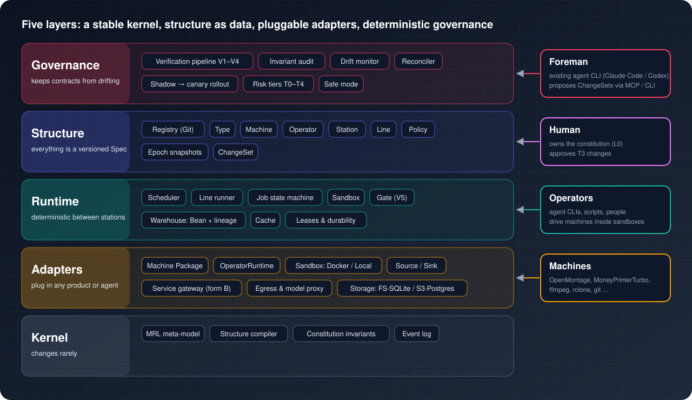

[English](../en/README.md) | [日本語](../ja/README.md) | [한국어](../ko/README.md) | [Français](../fr/README.md) | [Deutsch](../de/README.md) | [Español](../es/README.md) | **Português (BR)** | [Русский](../ru/README.md) | [简体中文](../zh-CN/README.md)

# Documentação

Estes guias explicam como usar o Machine Agent Org e como contribuir com ele. As fontes normativas são as specs: [`spec/system/`](../../spec/system/README.md) para o plano de controle e [`spec/mrl/`](../../spec/mrl/) para a linguagem MRL. A justificativa completa do design está em [`docs/architecture.md`](../architecture.md), escrito em chinês. Quando um guia e uma spec divergem, vale a spec.

| Guia | Leia quando quiser… |
|---|---|
| [Primeiros passos](getting-started.md) | instalar, verificar e executar sua primeira linha em cerca de dez minutos |
| [Conceitos](concepts.md) | entender beans, tipos, máquinas, estações, linhas, contratos, epochs e as camadas de verificação |
| [Runtime](runtime.md) | ver o que acontece em tempo de execução: processos, ciclo de vida dos jobs, sandboxes, armazenamento, observabilidade, lacunas conhecidas |
| [Referência da CLI](cli.md) | consultar um comando do `factory` ou do `mrl` |
| [Desenvolvimento](development.md) | contribuir: fluxo de trabalho do harness, marcos, arquivos protegidos, testes |

## Ordem de leitura sugerida

1. **Novos usuários:** Primeiros passos → Conceitos → Referência da CLI.
2. **Quem opera a fábrica sem supervisão:** Runtime (seções sobre `serve`, observabilidade e backup) → Referência da CLI.
3. **Contribuidores:** Desenvolvimento → Conceitos → a spec do componente que você vai alterar.

## Outros idiomas

English: [README](../../README.md) · [docs/en](../en/README.md) | 日本語: [README](../../README_ja.md) · [docs/ja](../ja/README.md) | 한국어: [README](../../README_ko.md) · [docs/ko](../ko/README.md) | Français: [README](../../README_fr.md) · [docs/fr](../fr/README.md) | Deutsch: [README](../../README_de.md) · [docs/de](../de/README.md) | Español: [README](../../README_es.md) · [docs/es](../es/README.md) | Português (BR): [README](../../README_pt-BR.md) · [docs/pt-BR](../pt-BR/README.md) | Русский: [README](../../README_ru.md) · [docs/ru](../ru/README.md) | 简体中文: [README](../../README_zh-CN.md) · [docs/zh-CN](../zh-CN/README.md)
