[English](../en/development.md) | [日本語](../ja/development.md) | [한국어](../ko/development.md) | [Français](../fr/development.md) | [Deutsch](../de/development.md) | [Español](../es/development.md) | **Português (BR)** | [Русский](../ru/development.md) | [简体中文](../zh-CN/development.md)

# Desenvolvimento

O Machine Agent Org é construído com uma divisão explícita entre **designer e implementador**. Um harness determinístico, `tools/harness.py`, faz essa divisão valer, para que nenhum dos lados possa mudar as regras do jogo às escondidas.

## 1. Papéis

| Papel | É dono de | Não pode |
|---|---|---|
| **Designer** | specs (`spec/`), plano e cartões de tarefa (`plan/`), testes de aceitação (`tests/acceptance/`), revisões | implementar código de produção |
| **Implementador** | `src/`, testes de sistema (`tests/system/`), entradas do diário | alterar specs, testes de aceitação ou critérios de aceitação; inventar interfaces; adiantar-se ao marco |
| **Humano** | a constituição, os ADRs e o **novo registro dos arquivos protegidos** (`harness lock --update`) | — |

Os arquivos protegidos são listados por glob em `plan/protected.lock` e fixados por SHA-256. Um hook PreToolUse (`.claude/settings.json`) rejeita edições de agentes nesses arquivos, e `harness lock --verify` detecta qualquer alteração. Quando um implementador encontra uma contradição, ele para, escreve em `plan/journal/` e executa `harness task block`. O designer corrige o arquivo protegido, e um humano registra a trava novamente.

## 2. O ciclo do harness

```bash
uv run python tools/harness.py doctor            # ambiente
uv run python tools/harness.py status            # marcos, tarefas, gates
uv run python tools/harness.py task next         # primeira tarefa cujas dependências estão concluídas
uv run python tools/harness.py task show M9-01   # o cartão da tarefa e suas leituras obrigatórias
uv run python tools/harness.py task start M9-01
# … implementar …
uv run python tools/harness.py accept M9-01      # roda as verificações de aceitação da tarefa e registra as evidências
uv run python tools/harness.py gate M9           # stage gate: todas as verificações do marco (e as herdadas)
```

Outros subcomandos:
- `doccheck`: as tabelas de testes do capítulo 7 das specs precisam corresponder às funções de teste.
- `check`: uma verificação específica, pelo nome.
- `scenario`: cenários roteirizados em `plan/scenarios/`.
- `pytest`: roda o pytest e imprime um resumo em JSON. Use-o sempre no lugar de um `pytest` puro, porque ele configura o caminho de importação do pacote `tests`.
- `lock --verify`: compara os arquivos protegidos com a trava.

As evidências (comandos, códigos de saída, digests das saídas, commit do git) são gravadas em `plan/state.json`.

## 3. Marcos

```mermaid
flowchart LR
    M0["M0<br/>compilador de estrutura"] --> M1["M1<br/>estação única"] --> M2["M2<br/>linhas e mundo externo"] --> M3["M3<br/>governança e Foreman"] --> M4["M4<br/>dinâmica e produção"]
    M4 --> M5["M5<br/>loop de autonomia"] --> M6["M6<br/>agentes CLI reais"] --> M7["M7<br/>operação"] --> M8["M8<br/>correções da revisão"] --> M9["M9<br/>correções de fechamento"]
```



Cada marco termina em um estado utilizável e pronto para ser entregue, e cada stage gate herda as verificações do gate anterior. M5, M8 e M9 são marcos de *correção*. Cada um surgiu de uma revisão do designer que encontrou capacidades que passavam nos testes, mas não estavam ligadas ao caminho de produção (`plan/drift.md`, `plan/review-m5-m7.md`, `plan/review-closure.md`). A lição, que agora é regra para os testes de aceitação: **exercitar os pontos de entrada de produção e fazer os dublês verificarem o comportamento.** Um S3 falso recalcula o SigV4, um `psql` falso registra cada chamada e um `factoryctl` falso repassa o método e o caminho reais.

## 4. Testes

| Nível | Onde | O quê |
|---|---|---|
| Aceitação | `tests/acceptance/m0…m9/` | um arquivo por tarefa, nomeado no capítulo 7 da spec; protegidos |
| Sistema | `tests/system/` | testes unitários e de integração de responsabilidade do implementador |
| Conformidade | `spec/mrl/conformance/`, `tests/test_conformance.py` | casos MRL de expressões, regras e fábrica; os casos existentes só aceitam acréscimos |
| Políticas | `tests/test_codebase_policy.py`, `tests/test_hooks.py` | regras estáticas sobre `src/mao` (sem imports via monkey-patching, sem acesso ao diretório atual, sem acesso privado entre módulos, …) |

Os dublês de teste ficam em `tests/fakes/`:
- `fake_agent.py` é um sósia roteirizado do Claude Code. O comportamento dele vem do `task.json` do bean de tarefa.
- `fake_llm.py` é um upstream de modelo para o nível live.
- `tools/` contém as ferramentas das fixtures.

Os registros de fixtures são `tests/fixtures/registry-m1` e `registry-m2`. Os níveis de Docker precisam de `uv run python tools/build_test_images.py`. Sem Docker, eles são pulados; defina `MAO_REQUIRE_DOCKER=1` para que falhem em vez disso. Os stage gates exigem zero testes pulados.

## 5. Regras de código

Elas vêm de `spec/system/README.md` (decisões D1–D14) e de `plan/README.md` § 6:

- Python ≥ 3.12. As dependências de runtime são apenas a biblioteca padrão, `pyyaml`, `jsonschema` e o `mrl` do próprio repositório. Uma nova dependência exige um ADR. A CLI do Docker é chamada como subprocesso, e o SQLite via `sqlite3`.
- Nada de `shell=True`. Nada de chamadas a APIs de LLM: a inteligência vem apenas das CLIs dos operadores.
- **MRL é a única linguagem de expressões e templates.** Os templates das Specs são compilados com `mrl.expr`; `eval`, Jinja e `str.format` são proibidos para o conteúdo das Specs.
- O código de biblioteca obtém caminhos de `Context.root` ou de quem o chama, nunca do diretório atual.
- O SQL de runtime precisa ser portável entre SQLite e PostgreSQL. Formas específicas do SQLite só são permitidas em `db.py`, `backends.py` e `backup.py`.
- `uv run ruff check src tests tools` e `uv run ruff format --check` precisam passar; o comprimento de linha é 110.

## 6. O que ler em seguida

| Tópico | Documento |
|---|---|
| Regras do fluxo de trabalho, formato do diário, ações proibidas | [`plan/README.md`](../../plan/README.md) |
| Marcos e critérios de saída | [`plan/milestones.md`](../../plan/milestones.md), [`plan/gates.yaml`](../../plan/gates.yaml) |
| Decisões e convenções entre componentes | [`spec/system/README.md`](../../spec/system/README.md) |
| Linguagem MRL | [`spec/mrl/mrl-1.0.md`](../../spec/mrl/mrl-1.0.md), [`spec/mrl/factory-profile.md`](../../spec/mrl/factory-profile.md) |
| Instruções para implementadores | [`AGENTS.md`](../../AGENTS.md) |
