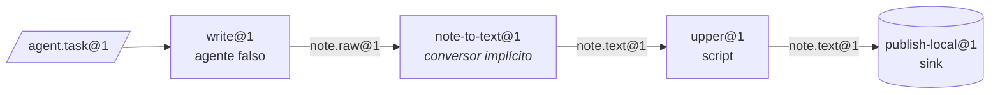

[English](../en/getting-started.md) | [日本語](../ja/getting-started.md) | [한국어](../ko/getting-started.md) | [Français](../fr/getting-started.md) | [Deutsch](../de/getting-started.md) | [Español](../es/getting-started.md) | **Português (BR)** | [Русский](../ru/getting-started.md) | [简体中文](../zh-CN/getting-started.md)

# Primeiros passos

Este guia instala o projeto, executa as verificações e roda uma linha real de três estações pela CLI `factory`. Não é preciso Docker nem chave de API de modelo: a linha usa o provedor de sandbox local e o agente falso roteirizado de `tests/fakes/`.

<p align="center"></p>

## 1. Pré-requisitos

| Ferramenta | Necessária para | Observações |
|---|---|---|
| Python 3.12+ | tudo | |
| [uv](https://docs.astral.sh/uv/) | gerenciamento de dependências e do venv | `uv sync` instala os grupos runtime e dev |
| Docker | o provedor padrão `docker`, os níveis de teste com Docker, `serve` | opcional para este guia |
| Claude Code / Codex | estações com agentes reais | opcional; os testes usam `tests/fakes/fake_agent.py` |

As dependências de runtime se limitam de propósito a `pyyaml` e `jsonschema`. O desenvolvimento acrescenta `pytest` e `ruff`.

## 2. Instalar e verificar

```bash
git clone https://github.com/rywsl/Company-Machine.git
cd Company-Machine
uv sync

uv run factory --version                   # CLI do plano de controle
uv run mrl --version                       # kit de ferramentas MRL (imprime "mrl 1.0.0")
uv run python tools/harness.py doctor      # verificação do ambiente
uv run python tools/harness.py status      # marcos e stage gates
```

Rode um subconjunto rápido dos testes e, se tiver tempo, a suíte inteira:

```bash
uv run python tools/harness.py pytest tests/acceptance/m1   # 98 testes, cerca de um minuto
uv run python tools/harness.py pytest tests                 # a suíte completa (~1450 testes, ~15 min com Docker)
```

Sempre rode os testes via `harness.py pytest`. Ele configura o caminho de importação do pacote `tests`; um `pytest` puro falha com `ModuleNotFoundError: tests`.

## 3. Preparar um espaço de trabalho

O registro de fixtures `tests/fixtures/registry-m2` contém máquinas pequenas (`toolbox`, `studio`, …), estações e linhas usadas pelos testes de aceitação. Copie-o para um diretório temporário e crie o mapa de comandos de que o provedor local precisa. O mapa informa ao provedor qual comando do host executa cada nome de comando usado em uma receita.

```bash
W=/tmp/mao-demo                            # qualquer diretório temporário
mkdir -p $W && cp -r tests/fixtures/registry-m2 $W/registry

uv run python -c "import json; from tests.fakes.fakelib import local_commands; print(json.dumps(local_commands()))" > $W/commands.json

export FACTORY_ROOT=$W/factory             # estado: SQLite, CAS, espaços de trabalho dos jobs
export FACTORY_REGISTRY=$W/registry        # estrutura: as Specs
F="uv run factory --provider local --local-commands $W/commands.json"
```

A primeira estação, `write@1`, é operada pelo agente falso. O comportamento dele vem do `task.json` do bean de tarefa. Este roteiro escreve um rascunho:

```bash
cat > $W/task.json <<'EOF'
{"cost_usd": 0.02, "default": [{"do": "write", "path": "drafts/note.txt", "text": "hello factory\n"}]}
EOF
```

## 4. Compilar, importar, planejar, executar

```bash
$F check $W/registry                       # código 0 = o registro compila; 3 = inválido

TASK=$($F bean import --type agent.task@1 --file task.json=$W/task.json)
echo $TASK                                 # sha256:… (endereço de conteúdo do novo bean)

$F line plan note-pipeline@1               # lista de nós compilada, orçamentos, resolução de conversores
$F line run  note-pipeline@1 --in task=$TASK
```

`line run` imprime a execução em JSON. Procure `"state":"SUCCEEDED"`, `"spent_usd":0.02` e a `"epoch"` fixada.



O YAML da linha só cita `write`, `upper` e `publish`. `write@1` produz `note.raw@1`, enquanto `upper@1` exige `note.text@1`; por isso o compilador resolveu o conversor `note-to-text@1` e o inseriu como o nó `upper.in.note~note-to-text@1`.

## 5. Inspecionar

```bash
RUN=r-xxxxxxxxxx                           # o "id" retornado por line run
$F line nodes $RUN                         # cada nó: estado, job, saídas, cache_hit
$F bean lineage --direction up <bean-id>   # quais jobs e beans o produziram
$F job show <job-id>                       # um job: tentativas, custo do transcript, relatório do gate
$F status                                  # jobs/execuções por estado, gastos, alertas, saúde do serve
$F events --limit 20                       # log de eventos: job.state, run.node, sink.claimed, …
```

Tudo fica armazenado em `$FACTORY_ROOT`:

```
factory.db          estado SQLite: jobs, execuções, nós, eventos, recibos, epochs, changesets …
cas/sha256/…        blobs endereçados por conteúdo (payloads dos beans)
jobs/<job-id>/      espaços de trabalho por job, mantidos em caso de falha para retomada
tmp/                sandboxes e área temporária do gate
tools/factory/bin/  factoryctl, montado nos sandboxes
```

## 6. Mudar para o Docker

O provedor padrão é `docker`. Construa as imagens de teste uma vez e depois remova `--provider local`:

```bash
uv run python tools/build_test_images.py   # constrói mao-test/<name>:dev e imprime os IDs das imagens
uv run python tools/harness.py pytest tests/acceptance   # os níveis de Docker agora rodam em vez de serem pulados
```

No Docker, cada estação roda como um contêiner não root com `cap-drop ALL`, entradas somente leitura, limites de recursos e sem `docker.sock`. O acesso à rede passa pelo proxy de saída da fábrica, e o tráfego para modelos passa pelo proxy de modelo dela.

## 7. Operar sem supervisão

```bash
uv run factory serve               # um único processo: gatilhos, execuções, jobs, governança, auditoria, canários, tickets de despertar
uv run factory serve --once        # um único tick, útil para cron ou depuração
uv run factory console             # console web somente leitura em http://127.0.0.1:8090
uv run factory metrics             # formato de texto do Prometheus
```

O console escuta apenas em `127.0.0.1` e exige o token armazenado em `$FACTORY_ROOT/console.token`.

O `serve` lê suas configurações da seção `serve` de `$FACTORY_ROOT/factory.json` e se recusa a iniciar sem ela. Veja os campos em [Runtime § 1](runtime.md#1-processos).

## Próximos passos

- [Conceitos](concepts.md): como escrever seus próprios tipos, estações e linhas.
- [Runtime](runtime.md): o que cada processo faz e como as falhas são tratadas.
- `spec/examples/registry/`: pacotes de máquinas completos para OpenMontage, MoneyPrinterTurbo, ffmpeg, rclone e git.
