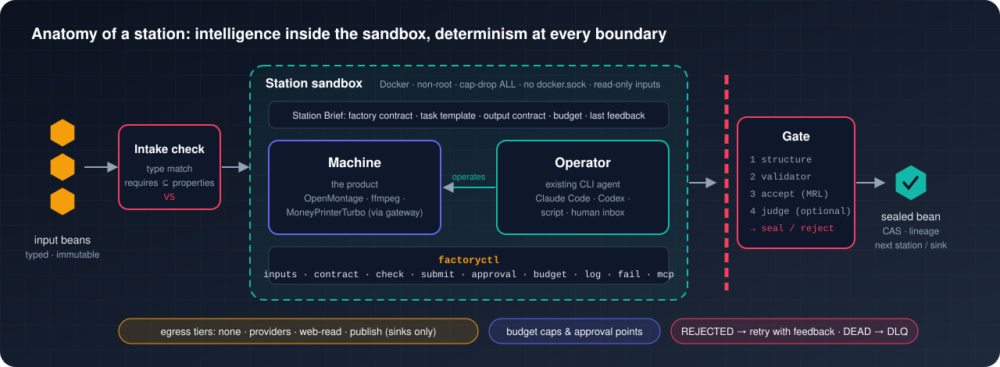
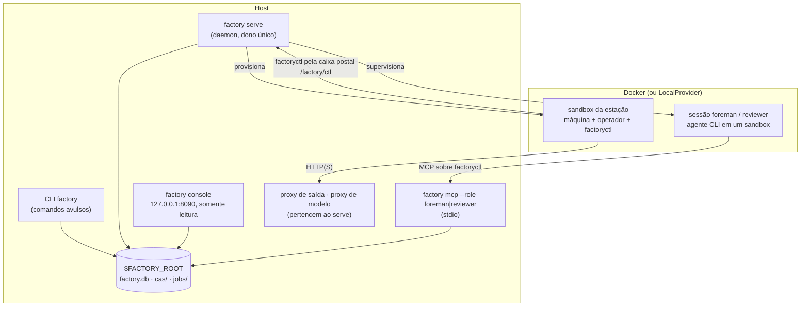
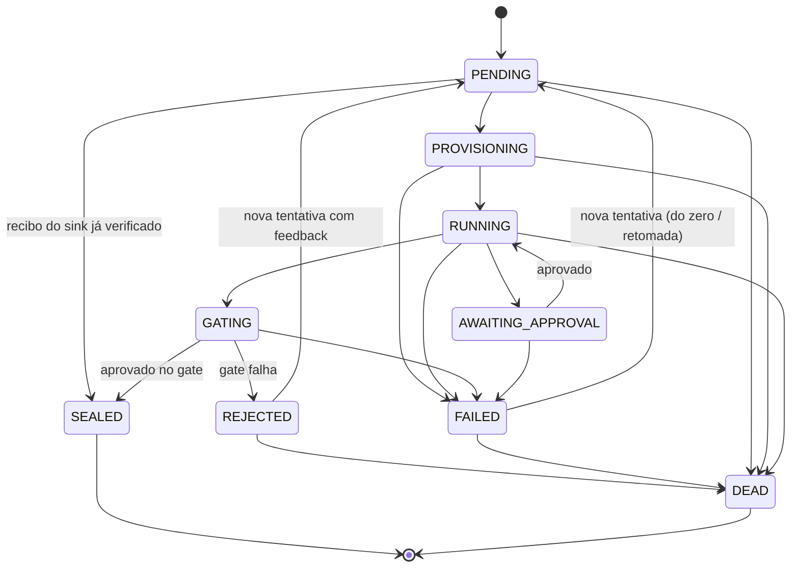

[English](../en/runtime.md) | [日本語](../ja/runtime.md) | [한국어](../ko/runtime.md) | [Français](../fr/runtime.md) | [Deutsch](../de/runtime.md) | [Español](../es/runtime.md) | **Português (BR)** | [Русский](../ru/runtime.md) | [简体中文](../zh-CN/runtime.md)

# Runtime

Esta página descreve o que de fato roda: os processos, os ciclos de vida de jobs e execuções, como uma estação é isolada, onde fica o estado e como acompanhar tudo. Ela termina com as lacunas encontradas durante a preparação desta documentação (2026-11-13).

<p align="center"></p>

## 1. Processos



- **CLI `factory`.** Cada comando abre um `Context` em `$FACTORY_ROOT`, carrega um snapshot do registro, faz seu trabalho e termina. `job run` e `line run` executam inline; é assim que a demo de [primeiros passos](getting-started.md) funciona sem daemon.
- **`factory serve`.** O dono de longa duração da fábrica. Ele mantém um lease (heartbeat em `$FACTORY_ROOT/serve.json`), inicia os proxies que lhe pertencem e avança em ticks. Ele precisa de uma seção `serve` em `$FACTORY_ROOT/factory.json` e se recusa a iniciar sem ela (`SERVE_CONFIG_MISSING`):

  ```json
  {"serve": {"tick_s": 2.0, "max_parallel_jobs": 4, "audit_every_s": 600,
             "canary_every_s": 86400, "docker_timeout_s": 60, "supervise": true}}
  ```

- **`factory console`.** Uma interface web local, somente leitura, com autenticação por token, vinculada apenas a `127.0.0.1`.
- **`factory mcp`.** A superfície de trabalho do Foreman (capataz) e do revisor, servida apenas por stdio.

### Um tick do `serve`

Cada tick é relatado como um `TickReport` e executa estas fases, em ordem:

| Fase | O que acontece |
|---|---|
| `epochs` | atualizar as epochs em operação (ativa e canário) |
| `recovered` | assumir jobs cujo lease expirou, por exemplo após uma queda (`mao.durable`) |
| `triggered` | disparar os gatilhos das linhas: chegadas de beans, `cron`, `every` |
| `advanced` | avançar cada execução de linha em andamento (`LineRunner.tick`): expandir construções dinâmicas, submeter os nós prontos |
| `dispatched` / `finished` | entregar jobs ao agendador dentro de `max_parallel_jobs`, coletar resultados |
| `governance` | avançar os ChangeSets: verificação → shadow → canário → ativo, e avaliar o modo seguro |
| `audited` | rodar a auditoria de invariantes a cada `audit_every_s` segundos |
| `canaries` | rodar os canários V4 a cada `canary_every_s` segundos |
| `wakes` | transformar sinais em tickets de despertar; com `supervise: true`, iniciar sessões do Foreman para eles |

## 2. Ciclo de vida do job



Essas transições são exatamente `mao.jobs.EDGES`. `SEALED` e `DEAD` são terminais. Os limites de tentativas vêm de `limits.retries` da estação, e um job morto cai na fila de mensagens mortas (`factory schedule dlq`). Um bean que faz jobs a jusante falharem repetidamente pode ser colocado em quarentena (`factory schedule quarantine`).

As **execuções de linha** passam por `PENDING → RUNNING → SUCCEEDED`. Uma falha escoa por `FAILING → FAILED`, e um cancelamento por `CANCELLING → CANCELLED`. Cada nó é `WAITING → SUBMITTED → DONE`, `FAILED` ou `SKIPPED`. Os nós de controle (`map`, `switch`, `until`, `subline`, `plan`) nunca submetem jobs por conta própria. Em vez disso, criam nós filhos; as etapas de um plano, por exemplo, aparecem como `<planner>/<step>`, como `plan/shout`.

## 3. Dentro de uma estação

1. **Verificação de entrada:** correspondência de tipos e, em seguida, avaliação de `requires` sobre os beans de entrada reais.
2. **Provisionamento:**
   - As entradas são materializadas como somente leitura em `/factory/in/<port>/`.
   - O job recebe um espaço de trabalho gravável, mantido em caso de falha para que o job possa ser retomado.
   - O sandbox roda sem root, com `cap-drop ALL`, limites de CPU e memória e sem `docker.sock`.
3. **Brief:** o operador recebe um Station Brief composto pelo contrato da fábrica, pelo template da tarefa, pelo contrato de saída, pelo orçamento e pela política de aprovação, além de qualquer feedback da rejeição anterior.
4. **Operação:**
   - A CLI do operador roda em modo headless. Seu único canal com o host é o `factoryctl` (`inputs`, `contract`, `check`, `submit`, `approval`, `budget`, `log`, `fail`, `harvest`, `mcp`), que escreve na caixa postal `/factory/ctl`.
   - Máquinas de serviço (forma B) são operadas pelo `ServiceGateway` do host: *submit → poll → fetch*.
5. **Coleta e gate:**
   - As saídas são coletadas por regras de coleta ou por um `submit` explícito.
   - O gate verifica estrutura → validadores → expressões de aceitação (MRL) → juiz opcional, e então sela ou rejeita.
6. **Selagem:** o payload vai para o CAS; o bean, sua linhagem e o relatório do gate vão para `factory.db`.

**Rede.** Por padrão, as estações não têm rede. Uma política pode conceder um nível de saída de rede: `providers`, `web_read`, `publish` (somente sinks) ou `ingress` (somente sources). O tráfego passa pelo proxy de saída da fábrica, que permite ou nega cada requisição por domínio e método. Chamadas a modelos passam pelo proxy de modelo, que injeta a chave; chaves de modelo nunca entram em um sandbox.

**Os sinks** funcionam em duas fases (*propose*, depois *execute*) e são idempotentes. Um sink reivindica um recibo indexado pela sua `idempotency_key` antes de fazer qualquer coisa externa.

## 4. Estado e armazenamento

```
$FACTORY_ROOT/
├── factory.json        configuração de operação: serve, retenção, registro de governança …
├── factory.db          SQLite: jobs, runs, run_nodes, events, receipts, job_keys, epochs, changesets, wakes …
├── cas/sha256/…        blobs endereçados por conteúdo
├── jobs/<job-id>/      espaços de trabalho dos jobs
├── tmp/                sandboxes, área temporária do gate
├── tools/factory/bin/  factoryctl (montado como somente leitura nos sandboxes)
├── serve.json          heartbeat do serve (dono, tick, jobs em execução)
└── console.token       token de acesso ao console
```

| Backend | Padrão | Produção | Troca |
|---|---|---|---|
| Blobs (CAS) | sistema de arquivos local | S3 / MinIO com assinatura SigV4 | `factory backend migrate`, registrado em `backend-active.json`; todo comando lê esse ponteiro |
| Estado | SQLite | PostgreSQL, operado via `psql` (sem dependência de driver) | idem; `factory backend verify` confere a cópia |

A higiene dos dados fica por conta de `factory gc [--dry-run]`, que aplica a retenção, os tombstones e a varredura de blobs, e de `factory backup {create,verify,restore}`.

## 5. Observabilidade

| Ferramenta | O que oferece |
|---|---|
| `factory status` | jobs e execuções por estado, aprovações pendentes, gasto do dia, alertas, saúde do `serve` e do supervisor, modo seguro |
| `factory metrics` | exposição em formato de texto do Prometheus |
| `factory events [--since] [--kind] [--limit]` | o log de eventos somente de acréscimo (`job.state`, `run.node`, `run.budget`, `sink.claimed`, `run.plan`, …) |
| `factory console` | os mesmos dados como página web local |
| `factory bean lineage` / `factory cache explain` | por que um bean existe; por que um job foi ou não reutilizado |

## 6. Lacunas conhecidas (2026-11-13)

Elas foram encontradas ao percorrer o passo a passo desta documentação. São defeitos do runtime, não escolhas da documentação, e estão sendo acompanhadas para o designer e o implementador. Os guias acima descrevem o comportamento pretendido.

| # | Lacuna | Efeito que você verá |
|---|---|---|
| 1 | Os recibos dos sinks são reivindicados, mas nunca publicados nem verificados no caminho de produção: `ReceiptStore.publish`, `ReceiptStore.settle` e `connectors.verify` não têm chamadores em `src/mao`. | Os jobs de sink são selados sem verificação do recibo. Executar o mesmo sink de novo com a mesma chave de idempotência falha com `IDEMPOTENCY_CONFLICT`, em vez de ser reconhecido como duplicata. |
| 2 | Nenhum código de produção passa um `JobCache` para o `LineRunner`. | `cache_hit` é sempre `false` e `factory cache ls` continua vazio, mesmo para jobs de transformação idênticos. |
| 3 | `factory trigger process`, o console, os rebuilds de ChangeSets e as execuções shadow constroem o `Runner` sem o `ServiceGateway`. | Estações de serviço (forma B) falham com `FORM_UNSUPPORTED` nesses caminhos. |
| 4 | `factory receipt {ls,show,verify,void}` e `factory source run` (`spec/system/connectors.md`) não estão implementados. | Os recibos não podem ser verificados de novo nem anulados pela CLI. |
