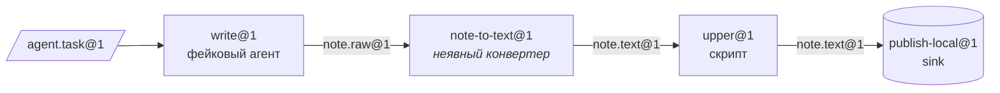

[English](../en/getting-started.md) | [日本語](../ja/getting-started.md) | [한국어](../ko/getting-started.md) | [Français](../fr/getting-started.md) | [Deutsch](../de/getting-started.md) | [Español](../es/getting-started.md) | [Português (BR)](../pt-BR/getting-started.md) | **Русский** | [简体中文](../zh-CN/getting-started.md)

# Начало работы

В этом руководстве вы установите проект, выполните проверки и запустите через CLI `factory` настоящую линию из трёх станций. Ни Docker, ни ключ API модели не нужны: линия использует локальный провайдер песочниц и сценарного фейкового агента из `tests/fakes/`.

<p align="center"></p>

## 1. Требования

| Инструмент | Для чего нужен | Примечания |
|---|---|---|
| Python 3.12+ | для всего | |
| [uv](https://docs.astral.sh/uv/) | управление зависимостями и venv | `uv sync` устанавливает группы runtime и dev |
| Docker | провайдер `docker` по умолчанию, уровни тестов с Docker, `serve` | для этого руководства не обязателен |
| Claude Code / Codex | станции с настоящими агентами | необязательно; тесты используют `tests/fakes/fake_agent.py` |

Зависимости времени выполнения намеренно ограничены `pyyaml` и `jsonschema`. Для разработки добавляются `pytest` и `ruff`.

## 2. Установка и проверка

```bash
git clone https://github.com/rywsl/Company-Machine.git
cd Company-Machine
uv sync

uv run factory --version                   # CLI плоскости управления
uv run mrl --version                       # инструментарий MRL (выводит "mrl 1.0.0")
uv run python tools/harness.py doctor      # проверка окружения
uv run python tools/harness.py status      # вехи и контрольные точки этапов
```

Запустите быстрое подмножество тестов, а если есть время — весь набор:

```bash
uv run python tools/harness.py pytest tests/acceptance/m1   # 98 тестов, около минуты
uv run python tools/harness.py pytest tests                 # полный набор (~1450 тестов, ~15 мин с Docker)
```

Всегда запускайте тесты через `harness.py pytest`. Он настраивает путь импорта для пакета `tests`; обычный `pytest` падает с `ModuleNotFoundError: tests`.

## 3. Подготовка рабочего каталога

Реестр фикстур `tests/fixtures/registry-m2` содержит небольшие машины (`toolbox`, `studio`, …), станции и линии, которые используют приёмочные тесты. Скопируйте его во временный каталог и создайте таблицу команд, нужную локальному провайдеру. Таблица сообщает провайдеру, какая команда хоста выполняет каждое имя команды, используемое в рецепте.

```bash
W=/tmp/mao-demo                            # любой временный каталог
mkdir -p $W && cp -r tests/fixtures/registry-m2 $W/registry

uv run python -c "import json; from tests.fakes.fakelib import local_commands; print(json.dumps(local_commands()))" > $W/commands.json

export FACTORY_ROOT=$W/factory             # состояние: SQLite, CAS, рабочие каталоги заданий
export FACTORY_REGISTRY=$W/registry        # структура: Spec
F="uv run factory --provider local --local-commands $W/commands.json"
```

Первой станцией, `write@1`, управляет фейковый агент. Его поведение задаётся файлом `task.json` в Bean с задачей. Этот сценарий пишет один черновик:

```bash
cat > $W/task.json <<'EOF'
{"cost_usd": 0.02, "default": [{"do": "write", "path": "drafts/note.txt", "text": "hello factory\n"}]}
EOF
```

## 4. Компиляция, импорт, план, запуск

```bash
$F check $W/registry                       # код 0 = реестр компилируется; 3 = некорректен

TASK=$($F bean import --type agent.task@1 --file task.json=$W/task.json)
echo $TASK                                 # sha256:… (адрес содержимого нового Bean)

$F line plan note-pipeline@1               # скомпилированный список узлов, бюджеты, подбор конвертеров
$F line run  note-pipeline@1 --in task=$TASK
```

`line run` выводит запуск в формате JSON. Ищите `"state":"SUCCEEDED"`, `"spent_usd":0.02` и закреплённую `"epoch"`.



В YAML линии упомянуты только `write`, `upper` и `publish`. `write@1` выдаёт `note.raw@1`, а `upper@1` требует `note.text@1`, поэтому компилятор подобрал конвертер `note-to-text@1` и вставил его как узел `upper.in.note~note-to-text@1`.

## 5. Просмотр результатов

```bash
RUN=r-xxxxxxxxxx                           # "id" из вывода line run
$F line nodes $RUN                         # каждый узел: состояние, задание, выходы, cache_hit
$F bean lineage --direction up <bean-id>   # какие задания и Bean его произвели
$F job show <job-id>                       # одно задание: попытки, стоимость по транскрипту, отчёт выходного контроля
$F status                                  # задания/запуски по состояниям, расходы, оповещения, здоровье serve
$F events --limit 20                       # журнал событий: job.state, run.node, sink.claimed, …
```

Всё хранится в `$FACTORY_ROOT`:

```
factory.db          состояние в SQLite: задания, запуски, узлы, события, квитанции, эпохи, changesets …
cas/sha256/…        блобы с адресацией по содержимому (полезная нагрузка Bean)
jobs/<job-id>/      рабочие каталоги заданий; при сбое сохраняются для возобновления
tmp/                песочницы и временное пространство выходного контроля
tools/factory/bin/  factoryctl, монтируется в песочницы
```

## 6. Переход на Docker

Провайдер по умолчанию — `docker`. Один раз соберите тестовые образы, затем уберите `--provider local`:

```bash
uv run python tools/build_test_images.py   # собирает mao-test/<name>:dev и выводит ID образов
uv run python tools/harness.py pytest tests/acceptance   # уровни с Docker теперь выполняются, а не пропускаются
```

В Docker каждая станция работает в контейнере без root с `cap-drop ALL`, входными данными только для чтения, ограничениями ресурсов и без `docker.sock`. Сетевой доступ идёт через прокси исходящего трафика фабрики, а трафик к моделям — через её прокси моделей.

## 7. Работа без присмотра

```bash
uv run factory serve               # один процесс: триггеры, запуски, задания, управление, аудит, канарейки, тикеты пробуждения
uv run factory serve --once        # один такт; удобно для cron или отладки
uv run factory console             # веб-консоль только для чтения на http://127.0.0.1:8090
uv run factory metrics             # текстовый формат Prometheus
```

Консоль слушает только `127.0.0.1` и требует токен из `$FACTORY_ROOT/console.token`.

`serve` читает настройки из раздела `serve` файла `$FACTORY_ROOT/factory.json` и без него не запускается. Поля описаны в разделе [Среда выполнения § 1](runtime.md#1-процессы).

## Что дальше

- [Основные понятия](concepts.md): как писать собственные типы, станции и линии.
- [Среда выполнения](runtime.md): что делает каждый процесс и как обрабатываются сбои.
- `spec/examples/registry/`: полные пакеты машин для OpenMontage, MoneyPrinterTurbo, ffmpeg, rclone и git.
