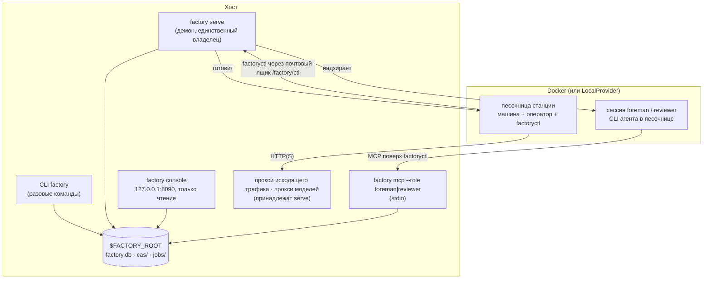
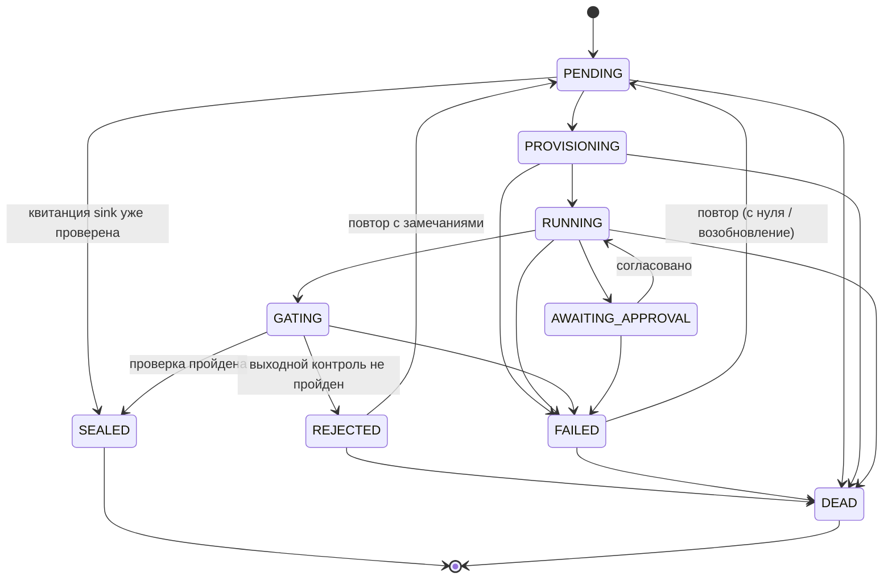

[English](../en/runtime.md) | [日本語](../ja/runtime.md) | [한국어](../ko/runtime.md) | [Français](../fr/runtime.md) | [Deutsch](../de/runtime.md) | [Español](../es/runtime.md) | [Português (BR)](../pt-BR/runtime.md) | **Русский** | [简体中文](../zh-CN/runtime.md)

# Среда выполнения

Эта страница описывает, что на самом деле работает: процессы, жизненные циклы заданий и запусков, изоляцию станции, место хранения состояния и способы за всем этим следить. В конце перечислены недоработки, обнаруженные при подготовке этой документации (2026-11-13).

<p align="center"></p>

## 1. Процессы



- **CLI `factory`.** Каждая команда открывает `Context` в `$FACTORY_ROOT`, загружает снимок реестра, выполняет свою работу и завершается. `job run` и `line run` выполняются прямо в процессе команды; поэтому демонстрация из раздела [Начало работы](getting-started.md) обходится без демона.
- **`factory serve`.** Долгоживущий владелец фабрики. Он держит аренду (heartbeat в `$FACTORY_ROOT/serve.json`), запускает принадлежащие ему прокси и работает тактами. Ему нужен раздел `serve` в `$FACTORY_ROOT/factory.json`; без него он не запускается (`SERVE_CONFIG_MISSING`):

  ```json
  {"serve": {"tick_s": 2.0, "max_parallel_jobs": 4, "audit_every_s": 600,
             "canary_every_s": 86400, "docker_timeout_s": 60, "supervise": true}}
  ```

- **`factory console`.** Локальный веб-интерфейс только для чтения с аутентификацией по токену; слушает только `127.0.0.1`.
- **`factory mcp`.** Рабочий интерфейс бригадира (Foreman) и ревьюера, доступен только через stdio.

### Один такт `serve`

Каждый такт оформляется как `TickReport` и проходит эти фазы по порядку:

| Фаза | Что происходит |
|---|---|
| `epochs` | обновить действующие эпохи (активную и канареечную) |
| `recovered` | перехватить задания, у которых истекла аренда, например после сбоя (`mao.durable`) |
| `triggered` | сработать триггерам линий: поступление Bean, `cron`, `every` |
| `advanced` | продвинуть каждый идущий запуск линии (`LineRunner.tick`): развернуть динамические конструкции, отправить готовые узлы |
| `dispatched` / `finished` | передать задания планировщику в пределах `max_parallel_jobs`, собрать результаты |
| `governance` | продвинуть ChangeSet: проверка → теневой запуск → канарейка → активная эпоха, а также оценить безопасный режим |
| `audited` | запускать аудит инвариантов каждые `audit_every_s` секунд |
| `canaries` | запускать канарейки V4 каждые `canary_every_s` секунд |
| `wakes` | превратить сигналы в тикеты пробуждения; при `supervise: true` запустить для них сессии бригадира |

## 2. Жизненный цикл задания



Эти переходы в точности соответствуют `mao.jobs.EDGES`. `SEALED` и `DEAD` — конечные состояния. Лимит повторов берётся из `limits.retries` станции, а «мёртвое» задание попадает в очередь мёртвых писем (`factory schedule dlq`). Bean, из-за которого раз за разом падают нижестоящие задания, можно поместить в карантин (`factory schedule quarantine`).

**Запуски линий** проходят путь `PENDING → RUNNING → SUCCEEDED`. Сбой проходит через `FAILING → FAILED`, отмена — через `CANCELLING → CANCELLED`. Каждый узел проходит `WAITING → SUBMITTED → DONE`, `FAILED` или `SKIPPED`. Управляющие узлы (`map`, `switch`, `until`, `subline`, `plan`) сами никогда не отправляют задания. Вместо этого они создают дочерние узлы; например, шаги плана появляются как `<planner>/<step>`, скажем `plan/shout`.

## 3. Внутри станции

1. **Проверка на входе:** сопоставление типов, затем вычисление `requires` на реальных входных Bean.
2. **Подготовка:**
   - Входные данные материализуются только для чтения в `/factory/in/<port>/`.
   - Задание получает рабочий каталог с правом записи; при сбое он сохраняется, чтобы задание можно было возобновить.
   - Песочница работает без root, с `cap-drop ALL`, ограничениями CPU и памяти и без `docker.sock`.
3. **Brief:** оператор получает Station Brief, который состоит из контракта фабрики, шаблона задачи, контракта на выход, бюджета и политики согласования, а также замечаний после предыдущего отклонения, если они есть.
4. **Работа:**
   - CLI оператора работает в headless-режиме. Его единственный канал связи с хостом — `factoryctl` (`inputs`, `contract`, `check`, `submit`, `approval`, `budget`, `log`, `fail`, `harvest`, `mcp`), который пишет в почтовый ящик `/factory/ctl`.
   - Машинами-сервисами (форма B) управляет `ServiceGateway` хоста: *submit → poll → fetch*.
5. **Сбор и выходной контроль:**
   - Выходные данные собираются по правилам сбора или явным `submit`.
   - Выходной контроль проверяет структуру → валидаторы → выражения приёмки (MRL) → необязательного судью, после чего запечатывает результат или отклоняет его.
6. **Запечатывание:** полезная нагрузка уходит в CAS, а Bean, его история происхождения и отчёт выходного контроля — в `factory.db`.

**Сеть.** По умолчанию у станций нет сети. Политика может выдать уровень выхода в сеть: `providers`, `web_read`, `publish` (только для sink) или `ingress` (только для source). Трафик идёт через прокси исходящего трафика фабрики, который разрешает или запрещает каждый запрос по домену и методу. Вызовы моделей идут через прокси моделей, который подставляет ключ; ключи моделей никогда не попадают в песочницу.

**Sink** работают в две фазы (*propose*, затем *execute*) и идемпотентны. Прежде чем сделать что-либо во внешнем мире, sink резервирует квитанцию с ключом `idempotency_key`.

## 4. Состояние и хранение

```
$FACTORY_ROOT/
├── factory.json        эксплуатационная конфигурация: serve, сроки хранения, реестр управления …
├── factory.db          SQLite: jobs, runs, run_nodes, events, receipts, job_keys, epochs, changesets, wakes …
├── cas/sha256/…        блобы с адресацией по содержимому
├── jobs/<job-id>/      рабочие каталоги заданий
├── tmp/                песочницы, временное пространство выходного контроля
├── tools/factory/bin/  factoryctl (монтируется в песочницы только для чтения)
├── serve.json          heartbeat serve (владелец, такт, выполняемые задания)
└── console.token       токен доступа к консоли
```

| Бэкенд | По умолчанию | В продакшене | Переключение |
|---|---|---|---|
| Блобы (CAS) | локальная файловая система | S3 / MinIO с подписью SigV4 | `factory backend migrate`, записывается в `backend-active.json`; каждая команда читает этот указатель |
| Состояние | SQLite | PostgreSQL через `psql` (без зависимости от драйвера) | так же; `factory backend verify` проверяет копию |

За гигиену данных отвечают `factory gc [--dry-run]`, который применяет сроки хранения, tombstone-записи и очистку блобов, и `factory backup {create,verify,restore}`.

## 5. Наблюдаемость

| Инструмент | Что даёт |
|---|---|
| `factory status` | задания и запуски по состояниям, ожидающие согласования, расходы за сегодня, оповещения, здоровье `serve` и супервизора, безопасный режим |
| `factory metrics` | метрики в текстовом формате Prometheus |
| `factory events [--since] [--kind] [--limit]` | журнал событий только на добавление (`job.state`, `run.node`, `run.budget`, `sink.claimed`, `run.plan`, …) |
| `factory console` | те же данные в виде локальной веб-страницы |
| `factory bean lineage` / `factory cache explain` | почему существует Bean; почему задание было или не было взято из кеша |

## 6. Известные недоработки (2026-11-13)

Они обнаружены при прохождении пошагового сценария для этой документации. Это дефекты среды выполнения, а не решения документации, и они взяты на контроль для проектировщика и исполнителя. Руководства выше описывают задуманное поведение.

| # | Недоработка | Что вы увидите |
|---|---|---|
| 1 | Квитанции sink резервируются, но на промышленном пути никогда не публикуются и не проверяются: у `ReceiptStore.publish`, `ReceiptStore.settle` и `connectors.verify` нет вызывающих в `src/mao`. | Задания sink запечатываются без проверки квитанции. Повторный запуск того же sink с тем же ключом идемпотентности падает с `IDEMPOTENCY_CONFLICT`, вместо того чтобы распознаваться как дубликат. |
| 2 | Ни один промышленный код не передаёт `JobCache` в `LineRunner`. | `cache_hit` всегда `false`, а `factory cache ls` остаётся пустым даже для одинаковых заданий-преобразований. |
| 3 | `factory trigger process`, консоль, пересборки ChangeSet и теневые запуски создают `Runner` без `ServiceGateway`. | Станции-сервисы (форма B) на этих путях падают с `FORM_UNSUPPORTED`. |
| 4 | `factory receipt {ls,show,verify,void}` и `factory source run` (`spec/system/connectors.md`) не реализованы. | Квитанции нельзя повторно проверить или аннулировать из CLI. |
