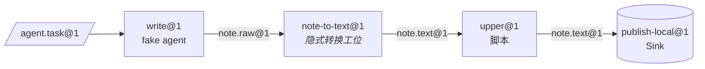

[English](../en/getting-started.md) | [日本語](../ja/getting-started.md) | [한국어](../ko/getting-started.md) | [Français](../fr/getting-started.md) | [Deutsch](../de/getting-started.md) | [Español](../es/getting-started.md) | [Português (BR)](../pt-BR/getting-started.md) | [Русский](../ru/getting-started.md) | **简体中文**

# 快速上手

本指南完成安装和检查，然后通过 `factory` 命令行跑通一条真实的三工位产线。不需要 Docker，也不需要模型 API 密钥：产线使用本地沙箱提供者，以及 `tests/fakes/` 里的脚本化 fake agent。

<p align="center"></p>

## 1. 前置条件

| 工具 | 用途 | 说明 |
|---|---|---|
| Python 3.12+ | 全部 | |
| [uv](https://docs.astral.sh/uv/) | 依赖与虚拟环境管理 | `uv sync` 安装运行时依赖和开发依赖组 |
| Docker | 默认的 `docker` 提供者、Docker 测试层、`serve` | 本指南可选 |
| Claude Code / Codex | 真实的 agent 工位 | 可选；测试使用 `tests/fakes/fake_agent.py` |

运行时依赖刻意只有 `pyyaml` 和 `jsonschema` 两个。开发时额外需要 `pytest` 和 `ruff`。

## 2. 安装与验证

```bash
git clone https://github.com/rywsl/Company-Machine.git
cd Company-Machine
uv sync

uv run factory --version                   # 控制面命令行
uv run mrl --version                       # MRL 工具（输出 "mrl 1.0.0"）
uv run python tools/harness.py doctor      # 环境检查
uv run python tools/harness.py status      # 里程碑与阶段门
```

先运行一小部分测试，有时间再跑全套：

```bash
uv run python tools/harness.py pytest tests/acceptance/m1   # 98 个测试，约 1 分钟
uv run python tools/harness.py pytest tests                 # 全套（约 1450 个，有 Docker 时约 15 分钟）
```

请始终通过 `harness.py pytest` 运行测试。它会设置好 `tests` 包的导入路径，直接运行 `pytest` 会出现 `ModuleNotFoundError: tests`。

## 3. 准备工作区

夹具 registry `tests/fixtures/registry-m2` 包含验收测试用的小机器（`toolbox`、`studio` 等）、工位和产线。把它复制到一个临时目录，再生成本地提供者需要的命令映射。这份映射告诉提供者，配方里的每个命令名由宿主机上的哪条命令执行。

```bash
W=/tmp/mao-demo                            # 任意临时目录
mkdir -p $W && cp -r tests/fixtures/registry-m2 $W/registry

uv run python -c "import json; from tests.fakes.fakelib import local_commands; print(json.dumps(local_commands()))" > $W/commands.json

export FACTORY_ROOT=$W/factory             # 状态：SQLite、CAS、job 工作区
export FACTORY_REGISTRY=$W/registry        # 结构：各类 Spec
F="uv run factory --provider local --local-commands $W/commands.json"
```

第一个工位 `write@1` 由 fake agent 操作，它的行为来自任务 Bean 的 `task.json`。下面这份脚本只写出一份草稿：

```bash
cat > $W/task.json <<'EOF'
{"cost_usd": 0.02, "default": [{"do": "write", "path": "drafts/note.txt", "text": "hello factory\n"}]}
EOF
```

## 4. 编译、导入、规划、运行

```bash
$F check $W/registry                       # 退出码 0 = 编译通过；3 = 不合法

TASK=$($F bean import --type agent.task@1 --file task.json=$W/task.json)
echo $TASK                                 # sha256:…（新 Bean 的内容地址）

$F line plan note-pipeline@1               # 编译后的节点列表、预算、转换解析
$F line run  note-pipeline@1 --in task=$TASK
```

`line run` 以 JSON 输出这次 run。留意 `"state":"SUCCEEDED"`、`"spent_usd":0.02` 和固定的 `"epoch"`。



产线 YAML 里只写了 `write`、`upper`、`publish`。`write@1` 产出 `note.raw@1`，而 `upper@1` 要求 `note.text@1`，所以编译器解析出转换工位 `note-to-text@1`，并以节点 `upper.in.note~note-to-text@1` 插入。

## 5. 查看

```bash
RUN=r-xxxxxxxxxx                           # line run 输出中的 "id"
$F line nodes $RUN                         # 每个节点：状态、job、产物、cache_hit
$F bean lineage --direction up <bean-id>   # 它由哪些 job 和 Bean 产生
$F job show <job-id>                       # 单个 job：尝试次数、transcript 成本、检验报告
$F status                                  # 按状态统计的 job/run、花费、告警、serve 健康
$F events --limit 20                       # 事件日志：job.state、run.node、sink.claimed……
```

所有状态都在 `$FACTORY_ROOT` 下：

```
factory.db          SQLite 状态：jobs、runs、nodes、events、receipts、epochs、changesets……
cas/sha256/…        内容寻址的 blob（Bean 的 payload）
jobs/<job-id>/      每个 job 的工作区，失败时保留以便续跑
tmp/                沙箱与检验的临时空间
tools/factory/bin/  factoryctl，挂载进沙箱
```

## 6. 切换到 Docker

默认提供者是 `docker`。先构建一次测试镜像，之后去掉 `--provider local` 即可：

```bash
uv run python tools/build_test_images.py   # 构建 mao-test/<名字>:dev 并输出 image ID
uv run python tools/harness.py pytest tests/acceptance   # Docker 测试层不再跳过，而是实际运行
```

在 Docker 中，每个工位都是一个容器：
- 以非 root 身份运行，`cap-drop ALL`；
- 输入只读，有资源限制；
- 不挂载 `docker.sock`。

网络访问经过工厂的出网代理，模型请求经过模型代理。

## 7. 无人值守运行

```bash
uv run factory serve               # 单一进程：触发、run、job、治理、审计、金丝雀、唤醒票
uv run factory serve --once        # 只跑一轮，适合 cron 或调试
uv run factory console             # 只读 Web 控制台 http://127.0.0.1:8090
uv run factory metrics             # Prometheus 文本格式
```

控制台只绑定 `127.0.0.1`，访问时需要 `$FACTORY_ROOT/console.token` 中的令牌。

`serve` 从 `$FACTORY_ROOT/factory.json` 的 `serve` 段读取配置，没有这一段就拒绝启动。字段见 [运行时 § 1](runtime.md#1-进程)。

## 下一步

- [核心概念](concepts.md)：怎样编写自己的类型、工位和产线。
- [运行时](runtime.md)：每个进程做什么，失败怎样处理。
- `spec/examples/registry/`：OpenMontage、MoneyPrinterTurbo、ffmpeg、rclone、git 的完整机器包。
