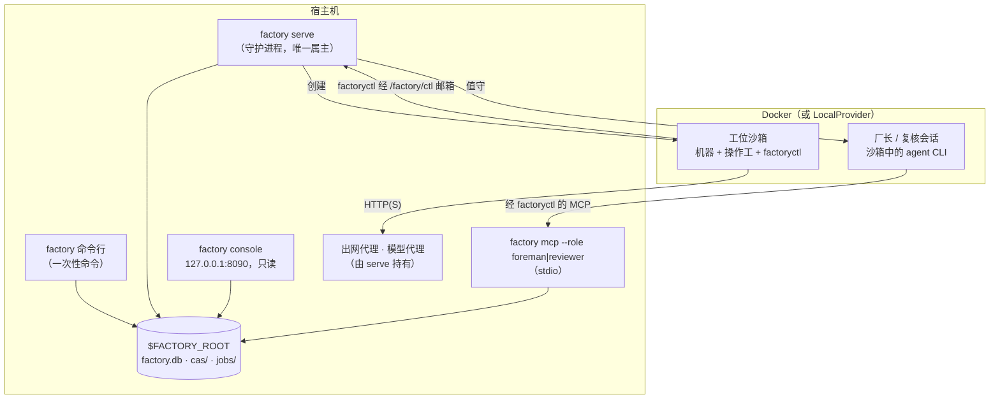
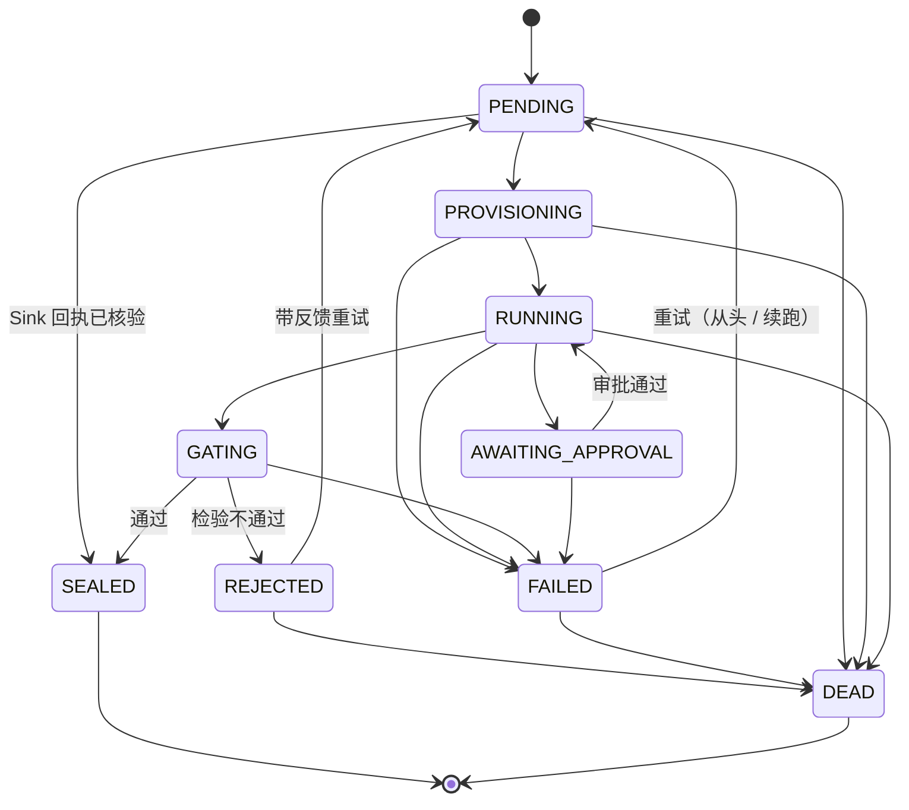

[English](../en/runtime.md) | [日本語](../ja/runtime.md) | [한국어](../ko/runtime.md) | [Français](../fr/runtime.md) | [Deutsch](../de/runtime.md) | [Español](../es/runtime.md) | [Português (BR)](../pt-BR/runtime.md) | [Русский](../ru/runtime.md) | **简体中文**

# 运行时

本页描述实际运行的部分：进程、job 与 run 的生命周期、工位怎样隔离、状态存放在哪里，以及怎样观察这一切。最后一节列出编写本文档时发现的缺口（2026-11-13）。

<p align="center"></p>

## 1. 进程



- **`factory` 命令行。** 每条命令在 `$FACTORY_ROOT` 上打开一个 `Context`，加载 registry 快照，完成工作后退出。`job run` 和 `line run` 在当前进程内执行，所以[快速上手](getting-started.md)的演示不需要守护进程。
- **`factory serve`。** 工厂长期运行的属主：持有租约（心跳写在 `$FACTORY_ROOT/serve.json`），启动自己持有的代理，并按轮次运行。它需要 `$FACTORY_ROOT/factory.json` 中的 `serve` 段，没有就拒绝启动（`SERVE_CONFIG_MISSING`）：

  ```json
  {"serve": {"tick_s": 2.0, "max_parallel_jobs": 4, "audit_every_s": 600,
             "canary_every_s": 86400, "docker_timeout_s": 60, "supervise": true}}
  ```

- **`factory console`。** 本机只读 Web 界面，需要令牌，只绑定 `127.0.0.1`。
- **`factory mcp`。** 厂长和复核者的操作面，只走 stdio。

### `serve` 的一轮

每一轮的结果记为一个 `TickReport`，按以下顺序执行各阶段：

| 阶段 | 做什么 |
|---|---|
| `epochs` | 刷新生效的 epoch（当前版本与金丝雀） |
| `recovered` | 接管租约过期的 job，例如崩溃之后（`mao.durable`） |
| `triggered` | 触发产线：Bean 到达、`cron`、`every` |
| `advanced` | 推进每个运行中的 run（`LineRunner.tick`）：展开动态构造，提交就绪的节点 |
| `dispatched` / `finished` | 在 `max_parallel_jobs` 之内把 job 交给调度器，并收集结果 |
| `governance` | 推进 ChangeSet：验证 → 影子运行 → 金丝雀 → 生效；评估安全模式 |
| `audited` | 每隔 `audit_every_s` 运行不变量审计 |
| `canaries` | 每隔 `canary_every_s` 运行 V4 金丝雀 |
| `wakes` | 把信号变成唤醒票；`supervise: true` 时为它们启动厂长会话 |

## 2. Job 生命周期



上图的边与 `mao.jobs.EDGES` 完全一致。`SEALED` 和 `DEAD` 是终态。重试次数来自工位的 `limits.retries`，DEAD 的 job 进入死信队列（`factory schedule dlq`）。反复导致下游失败的 Bean 可以被隔离（`factory schedule quarantine`）。

**产线 run** 的状态是 `PENDING → RUNNING → SUCCEEDED`；失败时经 `FAILING → FAILED`，取消时经 `CANCELLING → CANCELLED`。每个节点的状态是 `WAITING → SUBMITTED → DONE`、`FAILED` 或 `SKIPPED`。控制节点（`map`、`switch`、`until`、`subline`、`plan`）自己从不提交 job，而是创建子节点。例如 Plan 的步骤显示为 `<planner>/<step>`，如 `plan/shout`。

## 3. 工位内部

1. **来料检验：** 先检查类型匹配，再在真实的输入 Bean 上计算 `requires`。
2. **创建沙箱：**
   - 输入以只读方式物化到 `/factory/in/<port>/`；
   - job 有独立的可写工作区，失败时保留以便续跑；
   - 沙箱以非 root 身份运行，`cap-drop ALL`，限制 CPU 和内存，不挂载 `docker.sock`。
3. **Brief：** 操作工收到 Station Brief，由工厂契约、任务模板、输出契约、预算与审批策略，以及上次被退回的反馈拼成。
4. **操作：**
   - 操作工 CLI 以无头方式运行。它与宿主唯一的通道是 `factoryctl`（`inputs`、`contract`、`check`、`submit`、`approval`、`budget`、`log`、`fail`、`harvest`、`mcp`），写入 `/factory/ctl` 邮箱。
   - 服务型机器（B 形态）由宿主的 `ServiceGateway` 驱动：提交 → 轮询 → 取回。
5. **收货与检验：**
   - 产物按收货规则或显式 `submit` 收集；
   - 出厂检验依次检查结构 → validator → 验收表达式（MRL）→ 可选的 judge，然后封存或退回。
6. **封存：** payload 进入 CAS；Bean、血缘和检验报告写入 `factory.db`。

**网络。** 工位默认没有网络。策略可以授予一个出网等级：`providers`、`web_read`、`publish`（仅 Sink）或 `ingress`（仅 Source）。流量经工厂的出网代理，按域名和方法逐条放行或拒绝。模型请求经模型代理，由代理注入密钥，模型密钥永远不进入沙箱。

**Sink** 分两阶段（先 *propose*，再 *execute*），并且是幂等的：在做任何对外操作之前，先按 `idempotency_key` 占用一条回执。

## 4. 状态与存储

```
$FACTORY_ROOT/
├── factory.json        操作员配置：serve、retention、governance registry……
├── factory.db          SQLite：jobs、runs、run_nodes、events、receipts、job_keys、epochs、changesets、wakes……
├── cas/sha256/…        内容寻址的 blob
├── jobs/<job-id>/      job 工作区
├── tmp/                沙箱、检验临时空间
├── tools/factory/bin/  factoryctl（只读挂载进沙箱）
├── serve.json          serve 心跳（属主、轮次、运行中的 job）
└── console.token       控制台访问令牌
```

| 后端 | 默认 | 生产 | 切换方式 |
|---|---|---|---|
| Blob（CAS） | 本地文件系统 | S3 / MinIO，使用 SigV4 签名 | `factory backend migrate`，结果记录在 `backend-active.json`，每条命令都读这个指针 |
| 状态 | SQLite | PostgreSQL，经 `psql` 驱动（不引入驱动依赖） | 同上；`factory backend verify` 校验迁移结果 |

数据清理由两条命令负责：`factory gc [--dry-run]` 处理保留期、墓碑和 blob 清扫；`factory backup {create,verify,restore}` 负责备份与恢复。

## 5. 可观测性

| 工具 | 提供什么 |
|---|---|
| `factory status` | 按状态统计的 job 与 run、待审批数、当日花费、告警、`serve` 与值守的健康状况、安全模式 |
| `factory metrics` | Prometheus 文本格式 |
| `factory events [--since] [--kind] [--limit]` | 只追加的事件日志（`job.state`、`run.node`、`run.budget`、`sink.claimed`、`run.plan`……） |
| `factory console` | 以本地网页呈现同样的数据 |
| `factory bean lineage` / `factory cache explain` | 某个 Bean 为什么存在；某个 job 为什么被复用或没被复用 |

## 6. 已知缺口（2026-11-13）

下面四项是运行本文档的演练时发现的。它们是运行期缺陷，不是文档上的取舍，已提交给设计方和实现方跟进。上文描述的是规范规定的行为。

| # | 缺口 | 你会看到的现象 |
|---|---|---|
| 1 | Sink 回执在生产路径上只被占用，从未发布或核验：`ReceiptStore.publish`、`ReceiptStore.settle`、`connectors.verify` 在 `src/mao` 中没有调用者 | Sink job 未经回执核验就封存；用同一个幂等键再次运行同一个 Sink 时，得到 `IDEMPOTENCY_CONFLICT`，而不是被识别为重复发布 |
| 2 | 没有任何生产代码把 `JobCache` 传给 `LineRunner` | `cache_hit` 永远是 `false`，`factory cache ls` 始终为空，即使 transform job 完全相同 |
| 3 | `factory trigger process`、控制台、ChangeSet 重建和影子运行构造 `Runner` 时没有接入 `ServiceGateway` | 这些路径上的服务型（B 形态）工位报 `FORM_UNSUPPORTED` |
| 4 | `spec/system/connectors.md` 中的 `factory receipt {ls,show,verify,void}` 与 `factory source run` 没有实现 | 无法从命令行重新核验或作废回执 |
